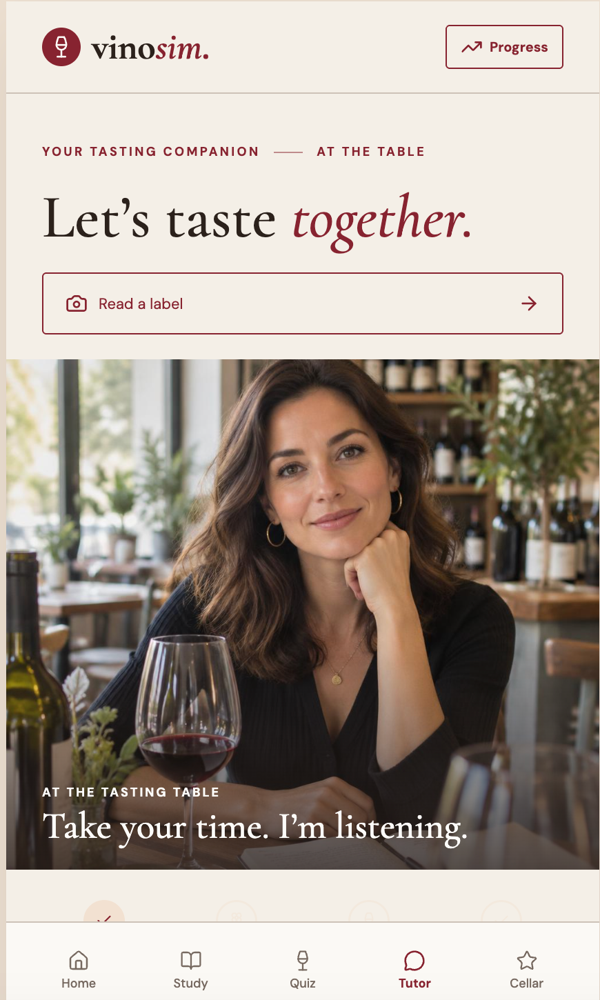
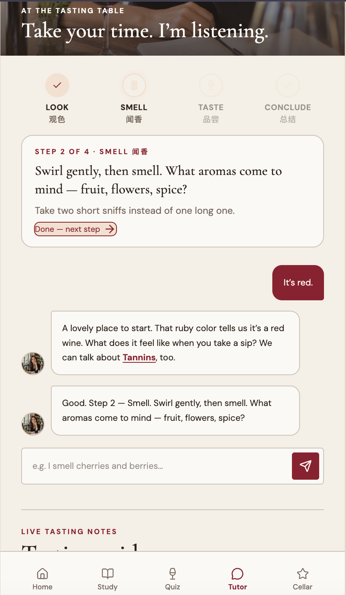
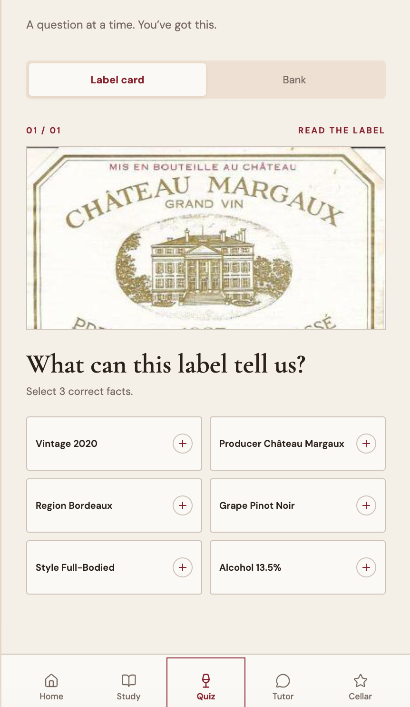
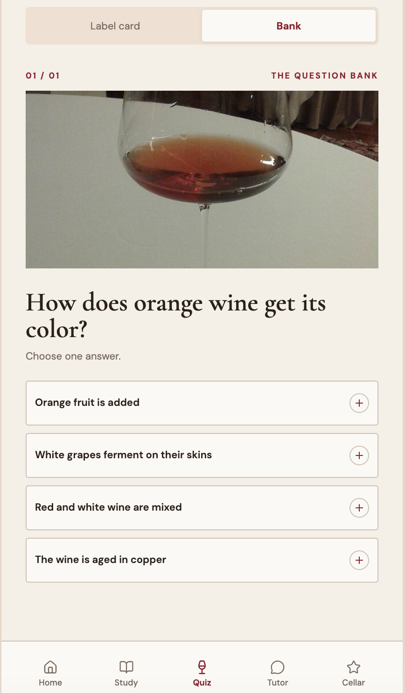
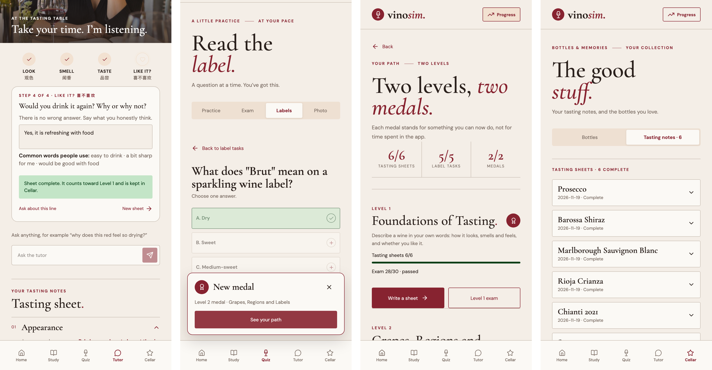

<!-- title-page -->
**VinoSim: Helping Wine Beginners Say What They Taste**

Ashley Xu

Educational Communication and Technology, New York University [[TO ADD: department name exactly as your program requires it on the title page]]

[[TO ADD: course number and name, e.g. the ECT thesis course]]

[[TO ADD: instructor name and title]]

[[TO ADD: due date, written as Month Day, Year]]

<!-- pagebreak -->

# Abstract

VinoSim is a mobile learning app for adults who can taste a wine but cannot yet say what they taste. It grew out of two experiences: a frustration with history classes that reduced events to dates, and a wine reception I skipped because I did not feel able to talk about wine. Brand-run surveys suggest that this discomfort is common, and research on wine expertise places the gap between novices and experts in words and concepts rather than in the nose. The entry-level qualifications of the Wine & Spirit Education Trust (WSET) teach the right vocabulary but assess it only with multiple-choice questions. VinoSim practises the step those exams leave unchecked: describing a glass in your own words. The first semester produced a retrieval-grounded tutor prototype and a three-bottle designer probe. The second semester narrowed the learner to early-career professionals at work dinners, added a ten-person survey and a class critique, and rebuilt the app around two levels modelled on WSET Levels 1 and 2. The app now has a four-line tasting sheet with a tutor that scaffolds one line at a time, a 160-item question bank, label tasks, and medals. A live walkthrough found and fixed four defects. No learning-outcome study has been run yet. The paper states what that leaves unknown and how it will be tested.

*Keywords:* wine education, tasting vocabulary, scaffolding, retrieval-augmented generation, mobile learning

<!-- pagebreak -->

# VinoSim: Helping Wine Beginners Say What They Taste

# I. Introduction and Background

## What VinoSim Is

VinoSim is a phone app for people who are new to wine. It works on one step: from a sensation the learner already has (this red dries my gums, this white makes my mouth water) to a word other people will recognize (tannin, acidity). The learner writes a short tasting sheet, a chat tutor walks through it one line at a time, a quiz links feelings to words and causes, and a Cellar keeps the wines they have tried. The content follows the scope of the WSET Level 1 and Level 2 Awards in Wines, so a learner who wants a real qualification later does not start from nothing. VinoSim is not affiliated with WSET and does not issue a certificate.

## Where It Started

Two experiences came before the project. The first was school history. In a note from October 2025 I described history class as a timeline plus a list of policies: the event itself sat inside politics, economy, and culture at the same time, and the test asked for the date. I sketched a "History Kaleidoscope" that would show one year from several sides at once. It never became the prototype, but it left me with a question: what structure would let a learner hold the thing itself, rather than a list about it?

The second was a reception. A friend invited me to an event with a dress code and a wine tasting (Figure 1). I got nervous and did not go. Later I heard that many people I would have liked to meet had been there. A glass of wine had felt like a test I was going to fail. Wine, I realized, had the same problem as history class. Charts of grapes and regions are easy to store, while the thing to be understood is in the mouth and disappears when the glass is empty. In December 2025 I moved the history notes onto wine, and VinoSim began.

**Figure 1**

*Invitation Poster for the Reception That Started the Project*

{width=3.2}

*Note.* Poster for the event described above, shared by the author. [[TO ADD: confirm you are comfortable including this poster (it names the host organization, date, and address); crop or blur those details if not]]

## Problem, Frame, and Learner

The problem is not a lack of wine information. Beginners can feel what is in the glass, but they lack the shared words to say it, so the remark stops at "I like it" or goes quiet (Section III). I frame the project narrowly: help a beginner describe a glass in their own words, and later follow the conversation well enough to add a few words of their own. The aim is confidence to take part, not expertise.

The target learner changed between semesters. The first-semester prototype was for an adult teaching themselves at home who felt put off by the image of wine culture. In the second semester, a survey and a class critique narrowed this to early-career professionals and graduate students who end up at work dinners and receptions, and the scope grew into two levels modelled on WSET (Section VII explains why). Both versions describe the same person at heart: someone who wants into wine talk and finds the usual picture of it hard to enter. People who already taste with a trained grid, and people who want the app to choose a bottle for them, are outside the frame.

## Why This Focus

The moment is common and specific, so it can be designed for. The skill involved, linking a sensation to a word, is small enough to practise in minutes and concrete enough to check on paper. I am also a member of the target group. That helps with empathy, and it is a risk, which is one reason the second semester added a survey and a critique instead of relying on my own taste.

Section II describes the design process across both semesters. Section III presents the research, Section IV the early ideas, and Section V the design rationale. Sections VI and VII describe what was built and how it was evaluated and changed. Sections VIII and IX reflect on the project and look ahead.

# II. Design Process

## The Process Followed

I followed a short, solo adaptation of design thinking, with the shape of the Double Diamond underneath it (Design Council, 2019): open the problem, close on a frame, open the possible products, and close on one loop that can be built and checked. I did not run a full ADDIE cycle. The constraint was a single designer who could write software, with one semester for each pass. That constraint suited the project. The honest first move was a precise prototype checked against published tasting language, not a claim about learning gains.

The project went through the diamond twice (Figure 2). The first semester framed the problem and built a prototype whose answers could be traced to stored notes. The second semester reopened the define stage with new evidence from a survey and a class critique, redefined the learning goal with backward design (Wiggins & McTighe, 2005), and rebuilt the product around that goal. The second pass was not planned at the start. It is the main iteration reported in Section VII.

**Figure 2**

*The Design Process Across Two Semesters*

[[FIGURE: two diamonds. Semester 1: Frame → Research → Ideate → Prototype. Semester 2: Redefine → Critique → Build → Evaluate and iterate. An arrow from the Nov 11 critique back to Redefine.]]

*Note.* Each diamond opens (research, ideas) and then closes (a frame, a build). The second diamond began from the first prototype.

## Stages, Methods, and Artifacts

Table 1 lists each stage with its goal, the methods used, the artifacts they produced, and how AI tools were involved. The methods that produced evidence (the designer probe, the survey, and the critique) are reported in Sections III and VII.

**Table 1**

*Design Stages, Methods, Artifacts, and AI Collaboration*

| Stage | Goal | Methods → artifacts | AI collaboration |
|---|---|---|---|
| 1. Frame (Oct–Dec 2025) | Find a problem that one design cycle could address | Two written problem notes → the frame: from a felt cue to a shared word; a loop of quiz, reading, tutor, and cellar | None |
| 2. Research the gap (Semester 1) | Learn whether the difficulty is information, smell, or language, and what already exists | Reading on wine expertise and the WSET tasting approach; desk comparison of four kinds of support; three-bottle designer probe → landscape findings and two rules for the tutor | An AI writing tool helped organize notes; it was not used as a source of wine facts |
| 3. Ideate and cut (Semester 1) | Produce several responses, keep only what attacks the translation | Six written concepts and four filters → the lead concept (Section IV) | [[TO ADD: how you used AI tools when ideating, if at all]] |
| 4. Prototype (Semester 1) | Make the loop run on a phone and make answers traceable | Front end from Google AI Studio; six n8n workflows; Gemini; a pgvector index of 12, later 19, teaching notes → v0 prototype | Gemini runs inside the product; the v0 front end was AI-generated |
| 5. Redefine (Semester 2) | Choose a learner and a goal that can be checked | Ten-person survey; close reading of the WSET Level 1 and 2 specifications; backward design → the four-line sheet as evidence; two levels | Claude as a sounding board for each version of the goal |
| 6. Critique (Nov 11, 2026) | Get outside eyes before building the rest | Capstone class critique → three design changes | An AI note-taker summarized the meeting; used only as a reminder because its numbers were wrong |
| 7. Build (Nov 2026) | Ship both levels on a phone | Python back end (FastAPI, LangGraph); Lovable front end; 160-item question bank → live app on November 17, 2026 | Claude wrote and revised much of the back end and SQL; Lovable generated the first screens |
| 8. Evaluate and iterate (Nov 2026) | Find what breaks and fix it | Retrieval test; question-bank validation; live walkthrough → feature-by-iteration matrix (Table 5) | Claude helped run the tests and draft fixes |

The first semester had no participants other than me, and I describe it that way. Primary research with other people began in the second semester. The survey went to 10 people I know, using the same short form for everyone. [[TO ADD: how you recruited the 10 people, when the survey ran, the format, and basic demographics]] The critique took place in the Capstone Thesis Class. [[TO ADD: who gave feedback (instructor and number of classmates) and how it was recorded]]

AI tools were part of building, not a source of evidence. I ran and tested the code myself and checked every number in this paper against its original source. When an AI meeting summary reported figures that did not match the sources, I discarded them. [[TO ADD: confirm the extent of your own code and question review]] The full statement is in the AI Acknowledgement.

# III. Research and Analysis

## Why the Problem Matters

Wine at a dinner is rarely only about the wine. Tasting when the server pours and commenting on the bottle are small social performances, and people who do them easily signal that they belong. Someone who cannot take part may stay quiet even when they have something to say.

Two brand-run surveys describe the discomfort. In Gallo's 2015 survey of 1,000 American wine drinkers aged 21 to 64, 34% of millennials felt awkward when a server asked them to taste, 34% worried their choice would be judged, and 31% were uncomfortable talking about wine (E. & J. Gallo Winery, 2015). A 2018 UK study of more than 2,000 people, run by Gallo's Dark Horse brand, found that 73% were intimidated by restaurant wine lists and 58% felt they lacked the knowledge to order with confidence (Shaw, 2018). Both were commissioned by a wine company, so I treat them as evidence that the problem exists at the moment of tasting and talking, not as evidence that any solution works.

Jackson's research adds the supply side. Of the UK's roughly 28 million monthly wine drinkers, 6 to 7 million were interested in a basic course, yet only 12% to 14% of the regular drinkers he sampled had ever taken one. The largest group among the interested, 42%, were "Unconfident Tentatives," for whom confidence was the main motive (Jackson, 2018). Many adults want to learn and few do. For the learners in this project, the dinner usually arrives before any course.

## Structure Words and WSET

Most of what a beginner feels in the mouth can be named with a few structure words. WSET Level 1 lists five: sweetness, acidity, tannin, alcohol, and body (Wine & Spirit Education Trust [WSET], 2022). VinoSim's Level 1 centers on three of them, defined in my own words with the same three parts the app uses: what you feel, the word, and one cause. *Acidity* makes your mouth water; cooler climates keep more of it. *Tannin* dries the gums and cheeks like strong black tea; it comes mostly from grape skins and seeds, which is why red wines have more. *Body* is the weight of the wine in the mouth, like the difference between skimmed and whole milk; alcohol adds to it, and riper grapes from warmer places make more alcohol.

WSET is an independent UK charity whose qualifications are taught in more than 80 countries. Its Systematic Approach to Tasting (SAT) is the structured method professionals use to describe wine, and it may only be reproduced with WSET's permission (WSET, n.d.). VinoSim's sheet is therefore my own simplified version. Level 1 is for people with little or no knowledge of wine: six hours of study, assessed by 30 multiple-choice questions with a 70% pass mark, and a three-part tasting framework of appearance, nose, and palate (WSET, 2022). Level 2 takes 28 hours, is assessed by 50 multiple-choice questions with a 55% pass mark, and adds a conclusion about quality (WSET, 2023, 2026).

## The Gap in the Entry Levels

Reading the two specifications side by side made the gap clear. Both levels teach tasting language and include a tasting framework, but neither assesses tasting. The exams check whether a candidate knows which grape makes red Burgundy, not whether they can describe the wine in front of them. Tasting is first assessed at Level 3 [[TO ADD: verify and cite the WSET Level 3 specification]]. Multiple-choice exams are a sensible choice for an awarding body, because tasting is hard to grade consistently. For a beginner at a dinner, though, the unassessed part is the part they need. VinoSim mirrors the content of Levels 1 and 2 and adds practice and feedback on that one skill.

## How Experts and Novices Differ

The research on wine expertise shaped the learning goal more than any other body of work. Experts and nonexperts describe the same wines with different language (Lawless, 1984). Experts are not more sensitive to smell; their advantage lies in recognizing wine-relevant odors and in semantic memory, that is, knowledge stored as words and concepts (Parr et al., 2002). Knowledge guides what experts notice, a "knowing nose" (Hughson & Boakes, 2002). Solomon (1990, 1997) argued that becoming an expert is a conceptual change: experts group wines by style, and their words are useful to other people. Wine experts are also more consistent than novices when they describe wines, an advantage coffee experts do not show, which suggests that wine culture trains a shared vocabulary (Croijmans & Majid, 2016).

Three implications follow. Beginners do not need a better nose; they need words attached to what they already sense. Those words must be anchored to sensations, or they become labels without meaning. And because expertise takes years, a short app should aim at a much smaller step: one cue, one structure word, and a way to continue.

## First-Semester Research: A Designer Probe

In the first semester I tested whether this translation could be built and checked. I wrote beginner-style descriptions of three wines (Penfolds Bin 389, Cloudy Bay Sauvignon Blanc, and Sassicaia) and compared the prototype's correction replies with published tasting notes. I was the only evaluator, so the probe tested the design, not learning. The structural matches were the ones the product exists to make: "mouth water a lot, sour" mapped to crisp acidity, and "dries my gums but polished" to firm but refined tannin. The misses mattered more. A "weird green leaf smell" was ignored, and "pencil shavings" was treated as generic oak. Two rules came from this. The tutor must address any smell the learner names, even if only to say its notes do not cover it, and it should be most careful with structure, where it is most reliable (Appendix E).

## Second-Semester Research: A Survey of 10

To see whether my experience matched other people's, I gave a short form to 10 people I know. It is a convenience sample, so I report counts and read them as signals (Appendix A). Seven of the 10 said they mostly stay quiet at dinners where wine is discussed, three of them because they lacked the words and three because they feared being judged. None had been offered a wine class. The open item was the most useful. Asked to describe a red wine, five people named only the sensation ("dry," "astringent," or the Chinese word 涩, *sè*) without the word tannin. Three wrote "I don't know," and two already used "tannin." Seven said they would fill in a simple tasting sheet, and several asked for a memorized line to get through the night. The five who named only the sensation are the clearest picture of the learner: they felt the tannin and could not name it.

## Learner Profile

The second-semester learner is a composite, not a named persona.

- **Situation:** early in a career or in graduate school; sometimes attends work dinners, receptions, or alumni events where wine is served.
- **Prior knowledge:** little or none; describes sensations in everyday words ("dry," "thick," "sharp").
- **Barrier:** lacks the shared vocabulary, and sometimes fears being judged for using it wrongly.
- **Motivation:** to take part and feel less out of place, not to become an expert, which matches Jackson's (2018) confidence motive.
- **Constraints:** little time; learns on a phone, often shortly before an event; must be of legal drinking age (21 in the United States).

The first-semester learner, an adult teaching themselves at home who dislikes the performance of wine culture, still shapes the tone: private practice, no rankings, and no rare words for their own sake.

## Landscape Audit

Table 2 compares VinoSim with consumer tools and structured courses. The consumer tools come from the first-semester audit; the courses come from the second-semester reading of WSET.

**Table 2**

*Landscape Audit*

| Option | What it offers a beginner | What it leaves out | Lesson for VinoSim |
|---|---|---|---|
| Rating apps (e.g., Vivino) | Label recognition and crowd ratings | Asks no description before the crowd's score appears | Do not lead with scores |
| Logging tools (e.g., CellarTracker) | A place to keep tasting notes | Assumes the user can already write a note; the blank note is the barrier | Give the note a structure |
| General chatbots | Will translate "drying" into "tannin" | Equally confident when guessing; no quiz, no record, no sources | Ground answers and admit gaps |
| WSET Level 1 and Level 2 | The right content and tasting framework | Hours of study and a fee; tasting not assessed | Mirror the content, practise the unassessed skill |
| WSET Level 3 and sommelier programs | Assessed blind tasting, professional depth | Far beyond what this learner wants [[TO ADD: verify details and cite]] | Optional bonus content points this way, ungraded |

*Note.* WSET details are from WSET (2022, 2023).

The audit justifies a narrow tool. VinoSim should not be a better Vivino. It should be a practice space that uses the professional grid without the professional course, and that is less willing than a general chatbot to answer beyond its notes.

## Context of Use

The main context is a phone and a few minutes, often the evening before an event or on the way. Screens must work one-handed, each activity must fit in minutes, and the app must work without a teacher. The practice is private: nothing is shared or ranked. Tasting itself happens at home or with friends, so the app suggests practice wines by style only (a crisp white, a light red, a full red, and so on), with no brands or prices, and reminds learners that small sips are enough.

## Content

The content follows the scope of WSET Levels 1 and 2: grape growing and winemaking basics, the structure words and their causes, principal grape and regional styles, label terms such as AOC and DOCG, sparkling and fortified wines, and storage, service, and food pairing (WSET, 2022, 2023). Everything is written for VinoSim. The tutor's index holds 19 short teaching notes. The question bank holds 65 Level 1 and 95 Level 2 multiple-choice items and 10 open tasting prompts (Appendix B). Method pages were used to check facts but were not copied, and wine reviews were not ingested.

## Project Goals

**Long-term goal.** People with no wine background can describe a glass in their own words, follow the conversation around them, and dare to join in.

**Short-term goal.** Complete both levels in the app, front end and back end (built November 14 to 18 and deployed November 17, 2026), then run a small before-and-after check of the tasting sheet.

**Learning goals.** Level 1, "Foundations of Tasting":

1. **LO1.** Know what acidity, tannin, and body feel like, and one cause of each. Assessed by the Level 1 exam.
2. **LO2.** Describe a wine by appearance, nose, and palate, then say whether you like it and why. Assessed by the tasting sheet. A sheet is complete when all four lines are in the learner's own words and the palate line names a structure word together with the sensation behind it ("my gums feel tight, so I think tannin"). Aroma and liking are never judged right or wrong.
3. **LO3.** Understand others who use these words, and respond. Future work.

Level 2, "Grapes, Regions and Labels," covers reading a label, the typical styles of principal grapes and regions, how sparkling and fortified wines are made, and service basics. It is assessed by the Level 2 exam and five label-reading tasks.

# IV. Design Rationale and Solution: Early Ideas

## Six Concepts and the Lead Idea

In the first semester I wrote out six responses to the research and filtered them. I include the ones I cut, because the cuts are the rationale.

1. **History Kaleidoscope.** One year seen from several sides, with sources on every card. Set aside because a responsible history tool needs contested sources and a review process. It remains the reason VinoSim is about structure rather than trivia.
2. **A wine encyclopedia.** Short articles on grapes, regions, and terms. Useful, and kept as Study, but on its own it repeats the textbook: a learner can read "tannin" and still not know whether tonight's drying feeling is tannin.
3. **A label trivia game.** The camera reads a label and the learner picks true facts. An early sketch showed six statements with three correct. It ties study to a real bottle but slides back into memorizing vintages. It survived as one quiz mode.
4. **Roleplay only.** A friendly sommelier at a bar. It matches the social reason for the project, but without a knowledge boundary the character invents facts. It survived as one mode of the tutor.
5. **A correction tutor with a live tasting grid.** The learner talks, the reply translates, and a grid fills in. Closest to the research, but nothing asks the learner to retrieve the idea later, and nothing remembers the bottle.
6. **The loop (kept).** A quiz question, a short reading, a tutor with two modes (correction, which looks up notes and names them, and roleplay, which does not), and a cellar that keeps the bottle.

Four filters decided the cut. The idea had to work on the translation rather than on shopping or trivia. I had to be able to check it. The learner had to keep doing the thinking, since an automatic tasting note would remove the only practice that matters. And it had to be buildable as one conversation with a clear branch: look something up, or stay in the scene. A recommender failed the first filter, an exam clone failed the third, and a classroom tool belonged to a later project with a teacher in the loop.

## The First Prototype

The first working version was built quickly with low-code tools. A React front end generated in Google AI Studio called six n8n workflows: label reading with Gemini Vision, the two-mode tutor (correction searched a pgvector index of teaching notes; roleplay did not), getting and submitting quiz questions, a label decoder, and study articles. A retrieval check on "why does this red wine feel so drying?" returned the notes Tannin, Order of checks on the palate, Acidity, and Body, in that order, which is the ranking the product needs.

[[TO ADD: optional figure, a screenshot of the v0 front end or the n8n workflows]]

The prototype showed that the idea worked, and it showed two limits. Visual workflows were hard to version and change in small steps. More importantly, the tutor had no learning goal behind it: it answered questions well, but nothing moved the learner toward a finished description. Those two limits set the agenda for the second semester: rebuild the back end so it could change reliably, and define one learning goal for the whole app to serve.

# V. Design Rationale

## Learning Theories and the Decisions They Shaped

**Backward design.** Instruction should start from the desired result and the evidence that would show it, and only then plan activities (Wiggins & McTighe, 2005). The desired result is a learner who can describe a glass in their own words. The evidence is the four-line sheet. Every feature was then judged by whether it helps produce that sheet. This showed me that a quiz item such as "What grape is red Burgundy?" is background knowledge, not evidence of the goal, so it moved to Level 2.

**Scaffolding and fading.** A tutor takes over the parts of a task the learner cannot yet manage, so the learner can complete the rest (Wood et al., 1976). The space between what a learner can do alone and with help is the zone of proximal development (Vygotsky, 1978), and support should fade as competence grows (Collins et al., 1989). The tutor scaffolds the sheet by asking about one line at a time. Fading is not built yet: the real test is whether the learner can write the next sheet before opening the tutor (Section IX).

**Cognitive load.** Working memory is limited, so effort spent on the interface is effort not spent on learning (Sweller, 1988). The quiz shows one question at a time, Study opens one note, and the visual design is quiet. A dense, prestigious interface would spend the learner's attention on the costume of wine culture.

**Retrieval practice.** Taking a test on studied material improves long-term retention more than restudying it (Roediger & Karpicke, 2006). The quiz and level exams ask the learner to recall before showing feedback, and many Level 1 items ask what a sensation means or what causes it, which is exactly the link the sheet needs.

**Feedback and self-efficacy.** Effective feedback tells learners where they are going, how they are doing, and what to do next. Feedback about the task and the process helps; praise of the person does little (Hattie & Timperley, 2007). Confidence grows most from mastery experiences, that is, seeing that you did something yourself, while vague encouragement is the weakest source (Bandura, 1997). Together these set the tutor's tone. After each saved sheet, the tutor quotes the learner's own words, says specifically what they did well, and offers at most one next step. It avoids generic praise and never calls an aroma or a preference wrong. Re-tasting a wine shows the earlier sheet beside the new one, so growth is visible as the learner's own evidence.

**Expert and novice differences.** Because experts differ mainly in knowledge and vocabulary (Section III), the app teaches words tied to sensations. Word cards pair what you feel, the word, and one cause.

**Situated learning.** Newcomers learn a practice by taking part at its edge, in low-risk ways (Lave & Wenger, 1991). Roleplay mode lets the learner rehearse a few sentences with a friendly dinner guest, without grading and without the knowledge base, so it is never mistaken for a sourced answer.

**Retrieval-augmented generation.** A language model first retrieves relevant passages and then answers from them (Lewis et al., 2020). In correction mode the tutor answers from notes I wrote. This reduces, without removing, the risk of confident errors, and the probe's rule applies: if the notes do not cover a named smell, the tutor says so.

**Motivation and badges.** Intrinsic motivation is supported by autonomy, competence, and relatedness (Ryan & Deci, 2000). Expected tangible rewards tend to undermine it, while informative feedback supports it (Deci et al., 1999), and badges can increase activity (Hamari, 2017). VinoSim's medals reward evidence of learning (a passed exam and complete sheets for six different wines), not streaks. There is no leaderboard, and bonus topics are optional.

## Design Principles

1. **Start from the sheet.** A feature that does not help a learner produce or understand the four-line sheet is secondary.
2. **Sensation first, then word, then cause.** "My gums feel tight" comes before "tannin," and "from grape skins" after.
3. **Respect perception.** Aroma and liking have no right answer.
4. **Private, low-stakes practice.** No leaderboards or public scores; three of the ten survey respondents stay quiet for fear of judgment.
5. **Short and one-handed.** Every activity fits in a few minutes on a phone.
6. **No shortcuts that skip learning.** No memorized lines, recommendations, or prices.
7. **Ground the tutor and admit gaps.**
8. **Stay honest about WSET.** Mirror its scope, credit it, never imply affiliation or copy the SAT.

## Instructional Strategies, Media, and Technology

The main strategies are scaffolded dialogue, word cards, retrieval practice through the quiz and exams, immediate feedback, open ungraded prompts for aroma and liking, and repeated practice on real wines (six sheets for the Level 1 medal, mirroring the six recommended tasting samples in WSET Level 1; WSET, 2022). I chose a mobile web app because the context of use is a phone near a dinner. A chat interface fits a tutor that asks one question at a time and accepts everyday words. A language model can respond to a free description such as "it feels thick" in a way a fixed quiz cannot, and retrieval over my own notes keeps its explanations close to vetted content. Images carry the visual tasks: reading a real label and judging a wine's color. Table 3 maps each feature to its basis.

**Table 3**

*Design Features Mapped to Theory and Principles*

| Design feature | Theory or research | Principle |
|---|---|---|
| Four-line tasting sheet as the goal | Backward design (Wiggins & McTighe, 2005) | Start from the sheet |
| Tutor asks about one line at a time | Scaffolding (Wood et al., 1976; Vygotsky, 1978) | Short and one-handed |
| Writing the sheet before the tutor (planned) | Fading (Collins et al., 1989) | Start from the sheet |
| Word cards: sensation, word, cause | Expert–novice research (Parr et al., 2002; Solomon, 1997) | Sensation first |
| One quiz question at a time; level exams | Retrieval practice (Roediger & Karpicke, 2006); cognitive load (Sweller, 1988) | Short and one-handed |
| Tutor note after each saved sheet; completeness score | Feedback (Hattie & Timperley, 2007); self-efficacy (Bandura, 1997) | Respect perception |
| Re-tasting with the earlier sheet shown after saving | Mastery experiences (Bandura, 1997) | Private, low-stakes practice |
| Correction mode with notes and admitted gaps | RAG (Lewis et al., 2020); designer probe | Ground the tutor |
| Roleplay with a dinner guest | Situated learning (Lave & Wenger, 1991) | Private, low-stakes practice |
| Medals for exams and sheets; no leaderboard | Self-determination theory (Ryan & Deci, 2000); badges (Hamari, 2017) | Private, low-stakes practice |

## Logic Model

Table 4 merges the first-semester logic model with the current design. The arrows are design hypotheses, not results.

**Table 4**

*Logic Model*

| Inputs | Activities | Outputs | Short-term outcomes (to be tested) | Long-term outcomes |
|---|---|---|---|---|
| The learner's own words about a glass | Fill in the four-line sheet with the tutor, one line at a time | Saved sheets with a completeness score and a tutor note | Links acidity, tannin, and body to what they feel and one cause each | Follows wine conversation at a dinner and adds a few words |
| 19 teaching notes; 160 questions; 10 open prompts | Quiz and level exams, one question at a time | Exam results; Level 1 and Level 2 medals | Writes a complete sheet without hints | Feels confident taking part at social and work events, without adopting the prestige image of wine |
| WSET Level 1 and 2 scope | Read short Study notes ordered by the learner's gaps | A profile of weak and mentioned topics | Reads a label: origin, grape, classification terms | Some learners continue to a formal course |
| Gemini models; Postgres with pgvector; Railway hosting | Practise a few sentences in roleplay; re-taste a wine | Re-tasted sheets that can be compared | Says when they are guessing, and treats "I'm not sure" as acceptable | [[TO ADD: any further impact you want to claim, stated modestly]] |

*Note.* No outcome has been measured yet (Section VII).

# VI. Design and Development

## Overview

VinoSim has five main screens (Home, Quiz, Study, Tutor, and Cellar), organized into two levels, plus an age gate before any tasting content. Figure 2 shows the user flow through the redesigned screens. All of the parts described below were built between November 14 and 18, 2026, and are running on the deployed service. Figure 3 shows them in a live walkthrough.

**Figure 2**

*User Flow Through the Redesigned Screens*

{width=6}

*Note.* From left to right: Home, Quiz, a Study article, the Tutor in correction mode, and the Cellar. Prototype screens made in Lovable this semester.

## Two Levels and Medals

*Status: built and deployed (November 2026).*

The app is organized into two levels. Level 1, "Foundations of Tasting," covers the structural words and the tasting sheet, mirroring the scope of WSET Level 1. Level 2, "Grapes, Regions and Labels," covers labels, grape and regional styles, sparkling and fortified wines, and service, mirroring the scope of WSET Level 2. Completing both levels completes the course. Learners who want a recognized certificate are pointed to WSET Level 1.

Medals take the place of a certificate. They exist only inside the app and are not branded as WSET. The Level 1 medal requires passing the Level 1 exam and completing six tasting sheets, which mirrors the six recommended tasting samples in WSET Level 1 (WSET, 2022), and it unlocks Level 2. The Level 2 medal requires passing the Level 2 exam and completing five label-reading tasks. Optional bonus medals cover ungraded interest content in the direction of WSET Levels 3 and 4, such as terroir, ageing, and more regions; this part is still being refined. [[TO ADD: list of bonus topics once decided]]

The rationale comes from motivation research. Badges can increase activity (Hamari, 2017), but rewards that feel controlling can undermine intrinsic motivation (Deci et al., 1999). So the medals reward evidence of learning rather than streaks or time spent, there is no leaderboard, and the learner chooses which bonus topics to pursue (Ryan & Deci, 2000). The leaderboard decision also follows from the survey: three of the seven quiet respondents fear being judged, and a ranking would recreate the table they are trying to get comfortable at.

## The Tasting Sheet

*Status: built and deployed (November 2026).*

The tasting sheet is the center of Level 1. It has four lines and two columns (Table 4). Each line asks about one part of the wine, and each has a column for "What I sense," in the learner's own words, and a column for "Common words people use." The two columns came directly from critique point 2: a learner's "this feels really heavy" is not wrong, and the shared word "full-bodied" sits next to it rather than replacing it.

**Table 4**

*Structure of the VinoSim Tasting Sheet*

| Line | What it asks | What I sense (learner's words) | Common words people use | Judged? |
|---|---|---|---|---|
| 1. Appearance | Colour and depth | e.g., "dark, almost purple" | white, rosé, red; pale, medium, deep | No |
| 2. Nose | What family of smells | e.g., "like cherries and a bit of smoke" | fruit, flowers, spice, oak, earth | No; there is no right answer |
| 3. Palate | Acidity, tannin, body, and so on, with an optional "because…" | e.g., "my gums feel tight" | acidity, tannin, body, sweetness, alcohol | Yes: at least one structure word tied to the sensation it refers to |
| 4. Like it? | Do I like it, why, and would I drink it again | e.g., "too drying for me, but nice with food" | (personal) | No |

*Note.* This is the author's own simplified sheet. It is not the WSET Systematic Approach to Tasting, which may not be reproduced without WSET's written permission.

The sheet's first three lines match the three parts of WSET's Level 1 tasting framework (appearance, nose, palate; WSET, 2022). An earlier version used a fourth line taken from Level 2, a conclusion rating quality (WSET, 2026). I replaced it with "Do I like it? Why?" for two reasons. Judging quality is a Level 2 skill that beginners have little basis for, and saying whether you like a wine, and why, is the sentence most likely to be useful at a dinner table. It also gives the learner a talking point that belongs to them.

A sheet counts as complete when all four lines are written in the learner's own words and the palate line uses at least one structure word (acidity, tannin, body, sweetness, or alcohol) together with the sensation it refers to, for example "my gums feel tight, so I think tannin." Aroma and liking are never graded. This standard is lighter than my earlier rule, which required two of acidity, tannin, and body. One honest link between a feeling and a word is the step my survey showed people missing; asking for two made the sheet feel like a test. The optional "because…" field on the palate line invites a cause ("because red wine ferments with the skins") without requiring it, in response to critique point 1.

## The Tutor

*Status: built and deployed: both modes, retrieval, the four-step interface, the sheet beside the chat, and the revised tone rules.*

The tutor (Figures 3 and 4) is a chat with two modes. In correction mode, the learner describes what they notice or asks a question, the back end retrieves the four most similar notes from the knowledge base, and the model answers from those notes and lists the ones it used. In roleplay mode, the learner chats with a friendly sommelier character to practise speaking up; nothing is retrieved and nothing is graded.

**Figure 3**

*Tutor Introduction Screen*

{width=2.2}

*Note.* The opening screen reads "Take your time. I'm listening." The "Read a label" button opens the label scanner. [[TO ADD: source and license of the portrait photo on this screen]]

**Figure 4**

*Tutor Chat With the Four Steps*

{width=2.2}

*Note.* The step bar shows Look, Smell, Taste, and Conclude, with Chinese labels. The learner wrote "It's red," and the tutor built on that answer, then moved to Step 2 (Smell). "Tannins" is a tappable term.

The four steps at the top of the chat match the four lines of the sheet. When the learner finishes one step, the tutor moves to the next. This is scaffolding in the sense of Wood et al. (1976): the tutor holds the structure of the task while the learner supplies the content. In Figure 4, the learner offers only "It's red." The tutor accepts that, adds one piece of vocabulary (ruby), and asks what the wine feels like on a sip. It does not correct or lecture.

Two rules govern the tutor's tone, both from critique point 2. It never calls an aroma wrong; instead it says something like "many people describe it that way; others say…" And on the palate line, where there is shared vocabulary, it asks where the learner feels the sensation before offering a word. A good answer to "it feels dry" links dryness to tannin and says where you feel it, on the gums and the inside of the cheeks. A weak answer just says "high tannin" and leaves the learner with nothing to check against. These rules are part of the current build; the system prompts in the running back end do not yet state them explicitly. [[TO ADD: update after the 11/18 build — confirm the tone rules are in the tutor's prompts]]

I rejected one feature outright: memorized lines. Several survey respondents asked for a sentence they could say to get through the night. A memorized line might work once, but it teaches nothing that transfers to the next bottle, and it would turn the app into a script rather than a tutor.

## The Quiz

*Status: built and deployed: practice by level, both level exams with a review of every answer, label tasks, and label scanning.*

The quiz has two kinds of item, both shown one at a time (Figures 5 and 6). The label card shows a real wine label and asks the learner to pick three true facts from six. On the Château Margaux label, the correct facts are the producer (Château Margaux), the region (Bordeaux), and the style (full-bodied); the distractors are a 2020 vintage, the Pinot Noir grape, and 13.5% alcohol. Bank items are single-answer multiple-choice questions with a photo and immediate feedback. Figure 6 asks how orange wine gets its color; the answer is that white grapes ferment on their skins. That question stays in practice only and is not used in exams.

**Figure 5**

*Quiz Label Card*

{width=2.2}

*Note.* The learner selects three correct facts about the Château Margaux label. [[TO ADD: source of the label image and whether permission is needed to show it]]

**Figure 6**

*Quiz Question Bank Item*

{width=2.2}

*Note.* One question at a time, with a photo and immediate feedback. Practice item; not used in level exams.

Building the quiz taught me that a correct click is not a finished sheet. "What do tannins feel like?" links a feeling to a word and supports the goal directly. "What grape is red Burgundy?" is useful background, but a high score on questions like it says nothing about whether a learner can describe a glass. That question is now tagged Level 2. For Level 1, I added sensation items (what a structure word feels like) and cause items (why a wine feels that way), which respond to critique point 1.

The question bank was expanded on November 14, 2026. Level 1 has 65 multiple-choice questions, including 12 sensation items (10 new, 3 of them about acidity) and 13 cause items. Level 2 has 95 multiple-choice questions. Ten open tasting prompts, such as "Do you like this wine? Say why or why not in one sentence," are kept in a separate table with example answers and guidance, because they have no correct answer and must never be graded. The share of questions per learning outcome follows the WSET exam weighting (Appendix B). All questions are original, written for VinoSim rather than copied from WSET materials.

The level exams follow the WSET formats for now: 30 questions with a 70% pass mark for Level 1, and 50 questions with a 55% pass mark for Level 2, drawn per learning outcome to match the weighting. These settings are provisional, and there is no time limit yet. [[TO ADD: final exam settings (question count, pass mark, time limit) after the 11/18 build]] One known gap: the two quiz items in the redesigned screens are front-end sample data, and the back-end bank is not yet connected to that interface.

## Study

*Status: built.*

Study holds short articles, such as "What are tannins?" and "A little guide to Bordeaux" (Figure 2). Articles are ranked for each learner using a learner profile (described below), so topics the learner has struggled with in the tutor appear first. Reading is optional; the articles exist so that a learner who meets a new word in the tutor or quiz can look it up in a minute.

## Cellar as a Portfolio

*Status: built. Bottles are saved on the device; tasting sheets are saved on the server.*

The Cellar is a personal record of bottles the learner has tried, with name, grape, region, year, notes, and a rating (Figure 2, right). In the current build, entries are stored in the browser on the learner's own device. I treat the Cellar as a learning portfolio: over time it holds the learner's own descriptions, which they can look back on. Completed tasting sheets appear in the Cellar under "Tasting notes," each marked complete or not, so the six sheets required for the Level 1 medal become a visible record of progress (Figure 3).

## Age Gate and Responsible Drinking

*Status: built and deployed (November 2026).*

Before any tasting content, the app asks the user to confirm that they are of legal drinking age, which is 21 in the United States. WSET's Level 1 specification takes a similar line: under-age candidates may take the course but may not taste (WSET, 2022). The app also includes a short responsible-drinking note: small sips are enough, and spitting is fine. The gate is a yes/no confirmation that the user is of legal drinking age where they live (21 or older in the United States), shown before any other screen. The note reads: "Tasting is about small sips. Spitting is completely fine, and so is learning without drinking at all." Answering no shows a short page asking the user to come back later. The confirmation is remembered on the device only; no birth date is collected.

## Back-End Architecture

*Status: built and deployed.*

The back end was rebuilt this semester as a Python service; the first commit of the new back end is dated September 23, 2026. It has five main parts.

1. **FastAPI** serves the HTTP endpoints: label scanning, the tutor, quiz retrieval and submission, label decoding, articles, and the learner profile.
2. **LangGraph** runs the tutor as a state graph that mirrors the old n8n workflow: load the chat history, route by mode, retrieve notes (correction mode only), run the correction or roleplay agent, and save the turn.
3. **Gemini** provides the models: gemini-2.5-flash for chat and label vision, and gemini-embedding-001 for 768-dimensional embeddings.
4. **Postgres with pgvector** stores the knowledge notes, chat history, quiz questions, articles, and learner profiles. Notes are searched by cosine similarity using an HNSW index. There is no reranker or keyword search.
5. **Railway** hosts the service, and the bundled React 19 web client is fitted to phone screens.

Two decisions deserve explanation. First, I kept a compatibility layer of `/webhook/*` endpoints that accept and return the old n8n field names. This let the existing front end keep working unchanged while I replaced everything behind it, which meant I could test the new back end against a known interface. Second, I added a learner-profile loop. After each tutor turn, a background task asks the model to summarize what the turn showed and to list weak and mentioned topics, chosen only from a closed vocabulary of 28 topic names. The chat reply does not wait for this. The stored profile is then used to rank Study articles. The closed vocabulary keeps the profile predictable and easy to inspect, and it prevents the model from inventing topics.

The choice to leave visual low-code tools was practical. Code can be versioned, tested, and changed in small steps, and the question bank can be applied as a repeatable migration. The cost is that the system now depends on my ability to maintain it.

## User Scenario and Workflow

The following scenario describes how a learner moves through the app once the current build is complete. The learner is a composite based on the survey, not a real participant.

1. **Age gate.** A first-year analyst who has a team dinner next week opens VinoSim, confirms they are of legal drinking age, and reads the responsible-drinking note.
2. **Level 1 begins.** On Home, they see one question and one short note. They answer a few quiz items, including "What do tannins feel like?", and get immediate feedback.
3. **First sheet with the tutor.** At home, they open a bottle of a full-bodied red, chosen by style from the app's list. In the tutor, they go through look, smell, taste, and conclude. On the palate line they write "my gums feel tight," and the tutor asks where they feel it, then offers the word tannin and one cause. They write "my gums feel tight, so I think tannin" and, on the last line, "I like it with food, not on its own."
4. **Practice continues.** Over the following days, they complete more sheets with different styles and read the Study notes the app ranks for them. Each sheet is saved with a Cellar entry.
5. **Level 1 medal.** After six sheets, they take the Level 1 exam (30 questions) and pass. The Level 1 medal unlocks Level 2.
6. **Level 2.** They work through label cards and Level 2 quiz items, complete five label-reading tasks, and pass the Level 2 exam (50 questions).
7. **Level 2 medal.** The course is complete. The app suggests WSET Level 1 if they want a certificate.
8. **Optional bonus.** They choose a bonus topic, such as ageing, and explore it without grading.

Table 5 summarizes the same workflow.

**Table 5**

*Learner Workflow From Age Gate to Bonus Content*

| Step | Screen(s) | What the learner does | Evidence produced | Status |
|---|---|---|---|---|
| 1. Age gate | Age gate | Confirms legal drinking age; reads responsible-drinking note | None | Built |
| 2. Level 1 practice | Home, Quiz, Study | Answers sensation and cause items; reads notes | Quiz attempts; learner profile | Built |
| 3. Tasting sheets | Tutor, tasting sheet, Cellar | Writes four-line sheets with tutor support | Six completed sheets | Built |
| 4. Level 1 exam | Quiz (exam) | Takes 30-question exam | Exam result (pass at 70%, provisional) | Built |
| 5. Level 1 medal | Progress | Receives medal; Level 2 unlocks | Medal | Built |
| 6. Level 2 practice | Quiz (label card, bank), Study | Reads labels; answers Level 2 items | Five label-reading tasks | Built |
| 7. Level 2 exam and medal | Quiz (exam), Progress | Takes 50-question exam; receives medal | Exam result (pass at 55%, provisional); medal | Built |
| 8. Bonus (optional) | Study, Progress | Chooses ungraded interest topics | Bonus medals | Built; three topics so far |

*Note.* Status as of November 19, 2026. Each step was checked on the deployed service in the walkthrough described in Section VII.

# VII. Implementation, Evaluation, and Iteration

## Methods Used to Evaluate and Iterate

I have used five methods so far. None of them measures learning outcomes, and I say more about that gap at the end of this section.

### The Author's Survey

The 10-person survey (Section III and Appendix A) was the main input from potential users. It confirmed the core gap (five of 10 named the tannin sensation without the word), shaped the decision to make the sheet short and written (seven of 10 would fill one in), supported the decision against leaderboards (three of the seven quiet respondents fear judgment), and surfaced the request for memorized lines, which I declined. Because it is a convenience sample of people I know, I used it to find problems and test assumptions, not to estimate how common anything is.

### Class Critique

The Capstone Thesis Class critique on November 11, 2026, produced the three points described in Section II. Each led to concrete changes. Point 1 (understand why a wine feels a certain way) led to three-part word cards, an optional "because…" on the palate line, and cause questions in the bank. Point 2 (respect personal perception) led to the two-column sheet, ungraded aroma prompts, the tutor's rule never to call an aroma wrong, and the removal of the two-word palate standard. Point 3 (focus on the social situation) led me to add a third Level 1 outcome, understanding others and responding, which I moved to future work because it could not be built and evaluated this semester.

### Retrieval Test

To check that correction mode retrieves the right notes, I ran a test query on the live index: "Why does this red wine feel so drying?" The four most similar notes by cosine similarity were Tannin (0.747), Palate order (0.718), Acidity (0.688), and Body (0.686). Tannin ranked first, which is the correct note for a drying sensation, and the other three are plausible neighbors. This is a sanity check on one query, not a systematic evaluation. The scores between the first and fourth notes are close, and there is no reranker, so a differently phrased question could rank them differently. [[TO ADD: optional — results of a few more test queries, if you run them]]

### Question-Bank Validation

I set a blueprint for the expanded bank: the share of questions per learning outcome should follow the WSET exam weighting (Level 1: 6, 18, and 6 of 30; Level 2: 5, 4, 19, 12, 6, and 4 of 50; WSET, 2022, 2023), and Level 1 should include sensation and cause items. The bank was then checked against that blueprint (Appendix B). The pool shares are within two percentage points of the WSET shares for every learning outcome. The migration was applied twice on a scratch database to confirm that it is idempotent (row counts did not change on the second run), that every question has four options and exactly one correct answer, and that correct answers are spread across the letters (Level 1: A 16, B 17, C 17, D 15; Level 2: A 23, B 26, C 24, D 22). Two questions needed decisions: the red-Burgundy grape question is tagged Level 2, and the orange-wine question, which falls outside both WSET ranges, stays in practice only and is not used in exams.

### Migration From n8n to a Local Stack

The move from six n8n workflows to a FastAPI and LangGraph service was itself an iteration. The compatibility layer allowed a direct comparison: the old front end, unchanged, could call the new back end through the same `/webhook/*` routes. After the migration, the model and embedding versions were updated (gemini-2.5-flash for chat and vision, gemini-embedding-001 at 768 dimensions), the bundled web client was fitted to phone screens, and the service was deployed to Railway. [[TO ADD: any problems you hit during migration and how you verified that each endpoint behaved like the old workflow]]

### Live Walkthrough

After deployment, I walked through the whole learner path on the live service with a fresh test account: age gate, a tasting sheet written with the tutor, five more sheets, the Level 1 exam, the Level 1 medal, five label tasks, the Level 2 exam, and the Level 2 medal. Repetitive steps (sheets two to six, most label tasks) were entered directly through the API; the first sheet, the Level 1 exam, the last label task, and every progress screen were done in the app. The walkthrough found four problems, all fixed the same week (Table 6). It tests the software, not learning.

**Figure 3**

*Live Walkthrough of the Learner Path*

{width=6}

*Note.* From left to right: the tasting sheet after saving, the last label task with the Level 2 medal notice, the path page with both medals, and the learner's tasting notes in the Cellar. Screens from the deployed app, November 19, 2026.

## Feature-by-Iteration Matrix

Table 6 lists the main design features, what happened when each was implemented or tested, and the specific iteration that followed.

**Table 6**

*Design Features, Implementation Results, and Iterations*

| Specific design feature | Implementation result | Specific iteration |
|---|---|---|
| Learning goal | "Speak like an expert" did not fit the research (experts do not have better noses) or the time users have | Redefined as a four-line tasting sheet written in about five minutes without hints (backward design) |
| Palate-line standard | Requiring two of acidity, tannin, and body tied to a sensation made the sheet feel like a test; critique point 2 questioned a single "standard answer" | Replaced by one structure word (acidity, tannin, body, sweetness, or alcohol) tied to the sensation it refers to; aroma and liking stay ungraded |
| Fourth line of the sheet | A quality conclusion, taken from WSET Level 2, asked beginners for a judgment they had little basis for | Changed to "Do I like it? Why?", which matches Level 1's three-part framework plus a personal talking point |
| Sheet layout | A single answer field per line implied one correct description | Two columns: "What I sense" and "Common words people use" |
| Tutor tone on aromas | Critique point 2: tasting differs by person; a classmate noted "this wine feels really heavy" is not wrong | The tutor never calls an aroma wrong ("many people describe it that way; others say…"); aroma prompts are ungraded |
| Explaining why (critique point 1) | Vocabulary alone did not explain why a wine feels as it does | Three-part word cards (sensation → word → cause); optional "because…" on the palate line; 13 cause questions in Level 1 |
| Memorized lines | Several survey respondents asked for a line to get through the night | Deliberately not built: a line gets you through tonight, not the next bottle |
| Quiz scope | Building the quiz showed that a correct click is not a finished sheet; background items did not serve the goal | Background items moved to Level 2 (for example, the red-Burgundy grape question); sensation and cause items added to Level 1 |
| Question bank | The back-end bank had five multiple-choice questions and a few label questions | Expanded to 65 Level 1 and 95 Level 2 questions plus 10 ungraded prompts, weighted to WSET exam shares and validated on a scratch database |
| Back end | Six n8n workflows were hard to version, test, and change in small steps | Rebuilt as FastAPI + LangGraph + Gemini + Postgres/pgvector, with a webhook compatibility layer, deployed to Railway |
| Personalization | Study articles were the same for everyone | Learner-profile loop: each tutor turn is distilled into weak and mentioned topics from a closed vocabulary, used to rank articles |
| User interface | The v0 front end had no visible structure for tasting | Redesigned mobile screens; the tutor shows four steps that match the sheet |
| Medal design | A certificate would imply an accreditation VinoSim does not have | In-app medals tied to exams and sheets (six sheets for Level 1; five label tasks for Level 2); no leaderboard; no streaks |
| Age gate | The app had no check on drinking age | Yes/no age gate and responsible-drinking note shown before any other screen; built and deployed |
| Palate check | In the walkthrough, a palate line of "nice" was correctly marked incomplete (no structure word); "high acidity, my mouth watered" was marked complete | Kept as built; the sheet names the missing part so the learner knows what to add |
| Level exams | Both exams ran end to end on the live service (Level 1: 28/30, pass; Level 2: 44/50, pass), with a review of every missed question | Kept as built; pass marks stay provisional until real learners take them |
| Medals | Medals were awarded at the right moment: Level 1 after the exam plus six sheets, Level 2 after the exam plus the fifth label task; Level 2 stayed locked until then | The medal notice was pushed off-screen on narrow phones; fixed so it stays centred |
| Tutor in deployment | The live tutor failed with a server error, while the same code worked locally | Cause found in the logs (a newer model library called an API version that rejects system instructions); the version was pinned and errors are now logged |
| Tutor wording | In the walkthrough the tutor said "the knowledge snippets I have don't…", exposing its retrieval to the learner | Prompt changed: the tutor never mentions snippets or sources and falls back to general beginner guidance |
| Level names | The first names ("Talk about the glass," "Read the bottle") read as informal next to the WSET framing | Renamed "Foundations of Tasting" and "Grapes, Regions and Labels" |
| Listening and responding (critique point 3) | Could not be designed and evaluated within the semester | Recorded as Level 1 LO3, moved to future work |

*Note.* Rows from "Palate check" down come from the live walkthrough on November 19, 2026, run by the author with a test account. They show that the features work as designed, not that they help anyone learn.

## What Has Not Been Evaluated

No learning-outcome study with users has been run. I do not yet know whether using VinoSim helps anyone write a better tasting sheet, feel more confident at a dinner, or say anything at all. The survey describes the problem; the critique improved the design; the retrieval test and question-bank checks show that parts of the system work as intended. None of these is evidence of learning.

The planned next step is a small before-and-after check. A few people will taste the same bottle and write a sheet before using the tutor, then write another after. I will compare the two sheets against the completion standard: all four lines written in the learner's own words, and a palate line with at least one structure word tied to the sensation it refers to. With so few people, one bottle, and no comparison group, the check cannot support conclusions. Its purpose is to find obvious problems, for example a tutor step that confuses people or a sheet line that nobody understands, before a larger evaluation. [[TO ADD: results of the before-and-after check, if you run it before submission: number of participants, date, and what you observed, reported as counts]]

# VIII. Conclusion and Reflection

## How the Project Meets Its Goals

VinoSim set out to help beginners at a dinner table describe a glass of wine in their own words. Measured against that goal, the project has a clear design and a partial build. The learning goal is specific and checkable: a four-line sheet, written in about five minutes, with at least one structure word tied to a real sensation. Each feature traces back to that goal or to research. The tutor scaffolds the sheet step by step. The quiz practises the link between sensation, word, and cause. The medals reward completed sheets and passed exams. The back end grounds the tutor in notes I can check, and the question bank follows the WSET content scope closely enough that a learner could move on to a real course.

What I cannot yet say is whether it works for learners. The design responds to the problem as the survey and the research describe it, but the evidence that it helps will come only from the evaluation in Section IX.

## Insights and Lessons

**A correct click is not a finished sheet.** Building the quiz made me separate two things I had treated as one: knowing a fact about wine and being able to describe a wine. A learner who knows that red Burgundy is Pinot Noir may still have nothing to say about the glass in front of them. This changed which questions belong in Level 1 and made the tasting sheet, not the quiz score, the evidence of learning.

**WSET's entry levels do not test tasting.** I expected the established qualifications to cover the skill I cared about. Reading the specifications showed that Levels 1 and 2 assess knowledge by multiple choice only. That finding gave VinoSim its position. It also kept me modest: I am building a practice tool next to a qualification system, not a replacement for it.

**Respecting perception and calibrating vocabulary pull in different directions.** The critique made me see a tension I had not noticed. Shared words are only useful if people use them in roughly the same way, which is what experts do (Croijmans & Majid, 2016). But beginners who are told their perceptions are wrong stop talking, which defeats the purpose. My resolution is partial: aroma and liking are never judged; the palate line, where vocabulary is most shared, asks for one honest link between a feeling and a word. I expect this balance to keep shifting as I learn more from users.

**Refusing a shortcut can be a design decision.** The request for memorized lines was the most direct thing users asked for, and I said no. A script would have met the immediate need and taught nothing. I found it useful to state the refusal in the design principles, so that I would not drift back toward it under pressure.

**The definition stage never really ended.** I rewrote the learning goal more often than any piece of code. Each version made the app smaller and more concrete. Looking back, the best use of my time was the work that made the goal checkable, because it made every later decision easier.

## Contribution to the Field

The contribution is modest and specific. VinoSim shows one way to turn a consumer-education problem, documented mostly by industry surveys, into a narrow learning goal grounded in research on expertise, and to build a scaffolded, retrieval-grounded tutor around it. Its clearest idea is to target the skill that entry-level wine qualifications teach but do not assess, and to make the learner's own written description the evidence of learning. For educational technology more broadly, it is a small case study in using a large language model as a tutor with a defined end product, grounded content, and explicit limits on what it may judge. Whether the approach helps learners is still an open question.

# IX. Future Directions

## Listening and Responding (LO3)

Critique point 3 asked me to focus on the social situation: helping someone outside the conversation understand it and add a few words. That is Level 1's third outcome, and it is the one closest to the original problem. It will need different activities from the sheet, such as hearing or reading what others say about a wine and practising a short response. Roleplay mode is a starting point. Assessing this outcome will also be harder than assessing a written sheet.

## Fading the Scaffold

The tutor currently gives the same support every time. Following Collins et al. (1989), support should be withdrawn as the learner improves, for example by asking the learner to write each line before the tutor responds, or by removing step prompts after a few sheets. The real test is whether a learner can write the sheet for a new bottle without the tutor.

## Bonus Levels

Optional bonus content in the direction of WSET Levels 3 and 4 (terroir, ageing, more regions) is still being refined. It should stay ungraded and chosen by the learner, in line with the medal design. [[TO ADD: bonus topics and timeline]]

## Outcome Evaluation With Real Users

The most important next step is to find out whether VinoSim helps. After the small before-and-after check, a stronger study would recruit people from the target group rather than friends, use several wines, compare sheets written with and without the app, and ask about confidence at a real event some time later. It would also be worth testing whether the completion standard can be scored reliably by two different readers.

## Reviewing the Question Bank With Real Learners

The quiz now draws from the full bank, by level, and the exams sample questions per learning outcome. The next step is to look at which questions real learners miss most often and rewrite the ones that are unclear rather than hard.

## Real-World Adoption Factors

Several factors would matter if VinoSim were released beyond a class project.

- **Legal drinking age.** The age gate needs a clear design and must reflect the law where the app is used.
- **Responsible drinking.** Tasting practice should continue to encourage small amounts and spitting, and the app should never reward drinking more.
- **WSET trademark and the SAT.** VinoSim must not imply affiliation with WSET, use its branding, or reproduce the SAT without written permission. If the app grew, it would be worth asking WSET whether a formal relationship is possible.
- **Content accuracy.** Notes and questions need regular review, and someone has to be responsible for corrections when wine facts or regulations change.
- **Images and labels.** The quiz uses a real wine label, and the tutor screen uses a portrait photo. Their sources and permissions need to be checked before any public release.
- **Cost of model calls.** Every tutor turn calls a language model, and the learner-profile loop adds a second call. At scale, this cost would need a budget or a cheaper design.
- **Privacy of learner profiles.** The profile stores a summary of what each learner struggles with. It should be minimal, explained to users, deletable, and never shared.

# AI Acknowledgement

[[TO ADD: align this statement with the wording required by your thesis section's AI policy; the policy text is not in the public program guide]]

I used Claude (Anthropic) throughout this project. It helped me draft and edit the text of this paper and my presentation scripts, organize my notes, and check references against publishers' pages and Crossref. It also helped write code for the VinoSim back end and web client, the database migrations, and the content of the question bank, which I specified through a blueprint. Inside the product, Google's Gemini models generate the tutor's replies, read wine labels, create embeddings for retrieval, and summarize each tutor turn into the learner profile. The redesigned screens were first generated with Lovable. An AI note-taker in Notion summarized the class critique; because that summary contained wrong numbers, I did not use any of its figures. I reviewed and revised all AI-assisted text, code, and content, and I am responsible for the final work. All data reported in this paper come from the original sources or from my own survey and tests. [[TO ADD: confirm the list of AI tools, including any used in the 1st semester (for example Google AI Studio for the v0 front end)]]

<!-- pagebreak -->

# References

<!-- references -->
Bandura, A. (1997). *Self-efficacy: The exercise of control*. W. H. Freeman.

Collins, A., Brown, J. S., & Newman, S. E. (1989). Cognitive apprenticeship: Teaching the crafts of reading, writing, and mathematics. In L. B. Resnick (Ed.), *Knowing, learning, and instruction: Essays in honor of Robert Glaser* (pp. 453–494). Lawrence Erlbaum Associates.

Croijmans, I., & Majid, A. (2016). Not all flavor expertise is equal: The language of wine and coffee experts. *PLoS ONE, 11*(6), e0155845. https://doi.org/10.1371/journal.pone.0155845

Deci, E. L., Koestner, R., & Ryan, R. M. (1999). A meta-analytic review of experiments examining the effects of extrinsic rewards on intrinsic motivation. *Psychological Bulletin, 125*(6), 627–668. https://doi.org/10.1037/0033-2909.125.6.627

Design Council. (2019). *Framework for innovation: Design Council's evolved Double Diamond*. https://www.designcouncil.org.uk/our-resources/framework-for-innovation/

E. & J. Gallo Winery. (2015, December 8). *Gallo survey finds that today's wine drinkers are diverse with an appreciation of new offerings for more occasions* [Press release]. https://www.gallo.com/press/2015-12-08-wine-drinker-diversity

Hamari, J. (2017). Do badges increase user activity? A field experiment on the effects of gamification. *Computers in Human Behavior, 71*, 469–478. https://doi.org/10.1016/j.chb.2015.03.036

Hattie, J., & Timperley, H. (2007). The power of feedback. *Review of Educational Research, 77*(1), 81–112. https://doi.org/10.3102/003465430298487

Hughson, A. L., & Boakes, R. A. (2002). The knowing nose: The role of knowledge in wine expertise. *Food Quality and Preference, 13*(7–8), 463–472. https://doi.org/10.1016/S0950-3293(02)00051-4

Jackson, T. (2017). *Elementary consumer wine education: UK market size, characteristics and significance to the trade* [Master of Wine research paper]. Institute of Masters of Wine.

Jackson, T. (2018). *Consumer wine education: Should the wine trade care?* [WSET Alumni report]. Wine & Spirit Education Trust. https://www.wsetglobal.com/media/5507/wsetalumreport_consumerwineeducation-2018-03.pdf

Lave, J., & Wenger, E. (1991). *Situated learning: Legitimate peripheral participation*. Cambridge University Press.

Lawless, H. T. (1984). Flavor description of white wine by "expert" and nonexpert wine consumers. *Journal of Food Science, 49*(1), 120–123.

Lewis, P., Perez, E., Piktus, A., Petroni, F., Karpukhin, V., Goyal, N., Küttler, H., Lewis, M., Yih, W., Rocktäschel, T., Riedel, S., & Kiela, D. (2020). Retrieval-augmented generation for knowledge-intensive NLP tasks. *Advances in Neural Information Processing Systems, 33*, 9459–9474.

Parr, W. V., Heatherbell, D., & White, K. G. (2002). Demystifying wine expertise: Olfactory threshold, perceptual skill and semantic memory in expert and novice wine judges. *Chemical Senses, 27*(8), 747–755. https://doi.org/10.1093/chemse/27.8.747

Roediger, H. L., III, & Karpicke, J. D. (2006). Test-enhanced learning: Taking memory tests improves long-term retention. *Psychological Science, 17*(3), 249–255. https://doi.org/10.1111/j.1467-9280.2006.01693.x

Ryan, R. M., & Deci, E. L. (2000). Self-determination theory and the facilitation of intrinsic motivation, social development, and well-being. *American Psychologist, 55*(1), 68–78. https://doi.org/10.1037/0003-066X.55.1.68

Shaw, L. (2018, July 5). 73% of Brits are intimidated by wine lists. *The Drinks Business*. https://www.thedrinksbusiness.com/2018/07/73-of-brits-are-intimidated-by-wine-lists/

Solomon, G. E. A. (1990). Psychology of novice and expert wine talk. *The American Journal of Psychology, 103*(4), 495–517. https://doi.org/10.2307/1423321

Solomon, G. E. A. (1997). Conceptual change and wine expertise. *The Journal of the Learning Sciences, 6*(1), 41–60.

Sweller, J. (1988). Cognitive load during problem solving: Effects on learning. *Cognitive Science, 12*(2), 257–285.

Vygotsky, L. S. (1978). *Mind in society: The development of higher psychological processes*. Harvard University Press.

Wiggins, G., & McTighe, J. (2005). *Understanding by design* (2nd ed.). Association for Supervision and Curriculum Development.

Wine & Spirit Education Trust. (2022). *WSET Level 1 Award in Wines: Specification* (Issue 1.2). https://www.wsetglobal.com/media/zyhewzz4/wset-l1wines-specification.pdf

Wine & Spirit Education Trust. (2023). *WSET Level 2 Award in Wines: Specification* (Issue 2). https://www.wsetglobal.com/media/3yuhxb4i/wset-l2wines-specification.pdf

Wine & Spirit Education Trust. (2026). *WSET Level 2 systematic approach to tasting wine* (Issue 2.1). https://www.wsetglobal.com/student-resources/systematic-approach-to-tasting-sat/

Wine & Spirit Education Trust. (n.d.). *About WSET*. Retrieved November 11, 2026, from https://www.wsetglobal.com/about/about-wset/

Wood, D., Bruner, J. S., & Ross, G. (1976). The role of tutoring in problem solving. *Journal of Child Psychology and Psychiatry, 17*(2), 89–100. https://doi.org/10.1111/j.1469-7610.1976.tb00381.x

<!-- /references -->

<!-- pagebreak -->

# Appendix A: Survey Summary

The author gave the same short form to 10 people the author knows. This is a convenience sample, not a random one; results are reported as counts. [[TO ADD: recruitment method, dates, format, and the exact wording of each question]]

**Table A1**

*Survey Responses (N = 10)*

| Item | Response | Count |
|---|---|---|
| Behavior at dinners where wine is discussed | Mostly stay quiet | 7 |
| Main reason for staying quiet (of the 7) | Lack the words | 3 |
| | Fear being judged or laughed at | 3 |
| | Had no chance to practise | 1 |
| | Not interested | 1 |
| Ever offered a wine class | Yes | 0 |
| Took a wine class before | Yes, years ago, and forgot most of it | 1 |
| Open item: describe a red wine | Named only the sensation ("dry," "astringent," 涩) without the word tannin | 5 |
| | Wrote "I don't know" or guessed | 3 |
| | Used the word tannin | 2 |
| Willing to fill in a simple tasting sheet | Yes | 7 |
| Asked for a memorized line to use at the event | Several (exact count not recorded) | [[TO ADD: count, if you have it]] |

*Note.* The reasons for staying quiet add up to 8 for 7 people. [[TO ADD: check whether one respondent gave two reasons, or correct the counts]]

# Appendix B: Question-Bank Blueprint

Counts include seven earlier questions that were re-tagged. WSET exam shares are from WSET (2022, Section 4) and WSET (2023, Section 4).

**Table B1**

*Level 1 Question Pool by Learning Outcome and Item Type*

| Learning outcome | Sensation | Cause | Knowledge | Service | Pairing | Total | Share of pool | WSET exam share |
|---|---|---|---|---|---|---|---|---|
| L1-LO1 Grape growing and winemaking | 0 | 5 | 8 | 0 | 0 | 13 | 20% | 20% (6/30) |
| L1-LO2 Types, characteristics, and styles | 12 | 5 | 21 | 0 | 0 | 38 | 58% | 60% (18/30) |
| L1-LO3 Storage and service | 0 | 3 | 0 | 7 | 4 | 14 | 22% | 20% (6/30) |
| Total | 12 | 13 | 29 | 7 | 4 | 65 | 100% | 100% |

**Table B2**

*Level 2 Question Pool by Learning Outcome and Item Type*

| Learning outcome | Cause | Knowledge | Label | Service | Pairing | Total | Share of pool | WSET exam share |
|---|---|---|---|---|---|---|---|---|
| L2-LO1 Vineyard and label terms | 3 | 2 | 6 | 0 | 0 | 11 | 12% | 10% (5/50) |
| L2-LO2 Winemaking and ageing | 7 | 3 | 0 | 0 | 0 | 10 | 11% | 8% (4/50) |
| L2-LO3 Principal grapes | 4 | 22 | 8 | 0 | 0 | 34 | 36% | 38% (19/50) |
| L2-LO4 Regional grapes | 1 | 18 | 2 | 0 | 0 | 21 | 22% | 24% (12/50) |
| L2-LO5 Sparkling and fortified | 2 | 7 | 3 | 0 | 0 | 12 | 13% | 12% (6/50) |
| L2-LO6 Storage, service, and pairing | 1 | 2 | 0 | 1 | 3 | 7 | 7% | 8% (4/50) |
| Total | 18 | 54 | 19 | 1 | 3 | 95 | 100% | 100% |

*Note.* Level 2 has no sensation items. Ten open, ungraded tasting prompts are stored separately and are not part of these counts. Provisional exam settings: Level 1, 30 questions, pass at 70%; Level 2, 50 questions, pass at 55%; no time limit.

# Appendix C: Tasting-Sheet Template

This is the author's own simplified sheet, not the WSET Systematic Approach to Tasting.

**Table C1**

*VinoSim Tasting Sheet*

| Line | What I sense (in my own words) | Common words people use |
|---|---|---|
| 1. Appearance: What colour is it? Pale or deep? | | white, rosé, red; lemon, gold, pink, ruby, garnet; pale, medium, deep |
| 2. Nose: What does it smell like? (No right answer.) | | fruit, flowers, herbs, spice, oak (vanilla, toast), earth |
| 3. Palate: How does it feel in my mouth? Optional: because… | | acidity (mouth-watering), tannin (drying on the gums), body (light to full), sweetness, alcohol (warmth) |
| 4. Do I like it? Why? Would I drink it again? | | (personal) |

*Note.* A sheet is complete when all four lines are written in the learner's own words and the palate line uses at least one structure word together with the sensation it refers to. Practice wines are chosen by style: crisp white, oaked white, rosé, light red, full red, sparkling. Small sips are enough, and spitting is fine.

# Appendix D: Development Plan

Level 1 and Level 2 (front end and back end, including the tasting sheet, level exams, medals, and age gate) were built from November 14 to 18, 2026, and deployed on November 17.

| Date | Planned work | Status |
|---|---|---|
| November 14 | Decisions on the palate standard and label tasks; question bank imported locally; new database tables | Done |
| November 15 | Back end: practice by level, exams, tasting sheets, progress and medals, label tasks, tutor prompt changes | Done |
| November 16 | Front end, Level 1: age gate, path page, exam mode, tasting sheet beside the tutor, Cellar notes, word cards | Done |
| November 17 | Front end, Level 2: label tasks, Level 2 exam, bonus area; local end-to-end test | Done |
| November 18 | Back up and migrate the live database; deploy; live walkthrough; screenshots; update this paper | Done November 17 to 19 (deployment problems with the model API delayed the walkthrough by a day) |
