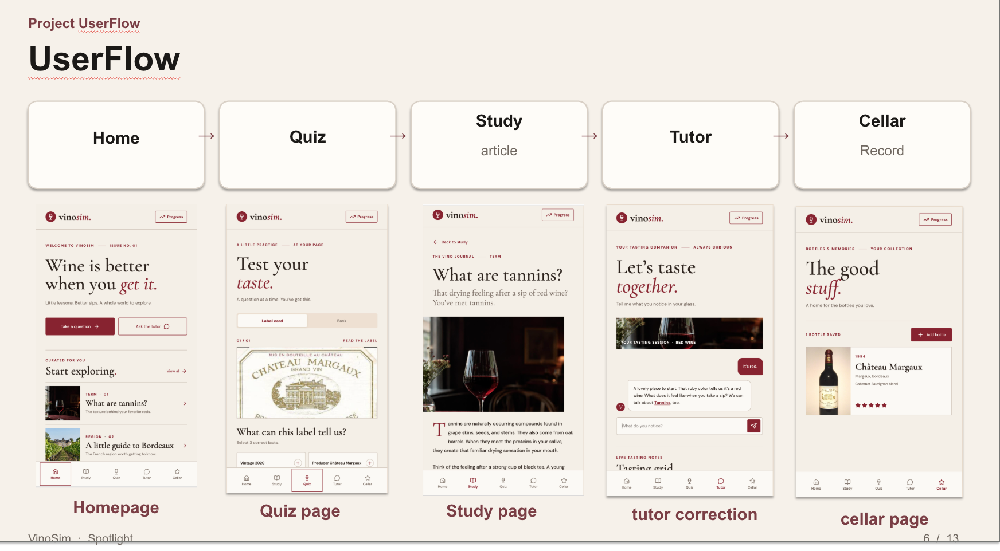

<!-- title-page -->
**VinoSim: A Mobile App for Learning to Talk About Wine**

Ashley Xu

Educational Communication and Technology, New York University [[TO ADD: department name exactly as your program requires it on the title page]]

[[TO ADD: course number and name, e.g. the ECT thesis course]]

[[TO ADD: instructor name and title]]

[[TO ADD: due date, written as Month Day, Year]]

<!-- pagebreak -->

# Abstract

VinoSim is a mobile wine-learning app for adults who meet wine in social settings. It grew out of a wine reception I skipped because I did not feel able to talk about wine. Industry surveys suggest that this kind of social unease is common, and research on wine expertise places the gap between novices and experts in vocabulary and concepts rather than in sensory acuity. The entry-level qualifications of the Wine & Spirit Education Trust (WSET) teach the right words but assess them only with multiple-choice questions, with no practice in producing a description. VinoSim focuses on the step those exams leave out: guiding learners to describe the wine in their glass in their own words, so that a professional vocabulary becomes a source of social confidence.

VinoSim began as an assignment for an elective course, where it produced a tutor prototype built on retrieval-augmented generation (RAG) and a three-wine designer probe. In the second semester of my thesis year, I switched my thesis project to VinoSim, and the target audience narrowed to early-career professionals who attend business dinners. Drawing on a ten-person survey and a class critique, I rebuilt the app around two levels modeled on WSET Levels 1 and 2. VinoSim now includes a four-line tasting sheet that the AI tutor guides line by line, a 160-question bank across the two levels, label tasks, and a medal system.

*Keywords:* wine education, tasting vocabulary, scaffolding, retrieval-augmented generation, mobile learning

<!-- pagebreak -->

# VinoSim: A Mobile App for Learning to Talk About Wine

# I. Introduction and Background

## What VinoSim Is

VinoSim is a mobile learning app for wine beginners. It helps learners turn a direct sensory experience ("this red makes my gums feel dry") into shared professional words ("tannin," "acidity"). In the app, an AI tutor guides the learner through a tasting sheet one line at a time, interactive quizzes connect sensations, words, and causes, and a Cellar keeps a personal record of the wines the learner has tried. The content follows the scope of the WSET Level 1 and Level 2 Awards in Wines. It is written in plain language for real social situations, and it also gives learners a foundation if they later want a formal qualification. VinoSim is not affiliated with WSET and does not issue a certificate.

## Where It Started

The project began with a social regret. A friend invited me to a formal event with a wine tasting (Figure 1). Embarrassed by how little I knew about wine, I went back and forth and finally stayed home, only to hear afterward that many people I would have liked to meet had been there. In that moment, a glass of wine felt like an exam I was bound to fail. Charts of grapes and regions are easy to memorize, I realized, but what you actually need to understand stays on the palate and is gone when the glass is empty. VinoSim started there, first as an assignment for an elective course. In the second semester of my thesis year, I changed my thesis project to VinoSim and carried that work forward.

**Figure 1**

*Invitation Poster for the Reception That Started the Project*

{width=3.2}

*Note.* Poster for the event described above, shared by the author.

## Tasting Culture and Its Shared Vocabulary

Wine tasting has a highly conventional way of speaking. Experts describe a wine in a fixed order: look at the color, smell, taste, and then conclude. Their words are fairly standard too: acidity, tannin, and body for structure, and terms such as blackcurrant, toast, and minerality for aroma (Lehrer, 2009). With this shared vocabulary, two strangers can talk precisely about the same glass. When one says "the tannins are tight," the other knows what is meant. Wine experts describe wines far more consistently than novices do, and this consistency comes from training rather than talent: coffee experts, for example, do not show the same agreement (Croijmans & Majid, 2016).

The vocabulary is more than a tool for communication, however. The linguistic anthropologist Silverstein (2003) called this way of talking "oinoglossia" and showed how mastering it signals taste and social position. Earlier, the sociologist Bourdieu (1984) argued that taste itself works as a mechanism of social distinction.

For beginners, this is where the real barrier lies. Their senses are not dull: they also notice their gums drying, their mouth watering, or a wine feeling heavy. What they lack is a way to translate those impressions into shared words, and the confidence to say them aloud in company.

At the start of the project I surveyed the tools already available (Table 1). Each existing tool handles one part of the wine experience: some help people choose a bottle, some keep records, some train the nose, and some provide structured knowledge or a live tasting. What is missing is the step in the middle: facing a real glass, putting one's own sensations into shared words, and getting immediate feedback on that sentence. This step needs private, low-pressure, repeated practice, and none of the existing tools is built around it.

**Table 1**

*What Existing Tools Do*

| Type | What it does | What a beginner cannot get from it |
|---|---|---|
| Rating and label apps (e.g., Vivino) | Recognizes labels, shows crowd ratings, helps choose and remember bottles | No one asks you to describe the wine before you see other people's scores |
| Cellar and note tools (e.g., CellarTracker) | Manages a collection and stores tasting notes | Assumes you can already write a note; for a beginner, the empty note field is the barrier |
| Aroma wheels and aroma kits (e.g., the Wine Aroma Wheel, Le Nez du Vin) | Provides aroma vocabulary and trains smell recognition | Offers a word list, not feedback on the glass in your hand |
| General-purpose chatbots | Answers any question; will translate "drying" into "tannin" | Equally confident when guessing; no practice, no record, no stated sources |
| Tastings at events and wine shops | Guided, in-person tasting of several wines | Speaking in front of others is exactly what beginners fear; occasional and not continuous |
| WSET Level 1 and Level 2 | Structured knowledge, a tasting framework, and a certificate | Hours of study and a fee; assessed only by multiple choice, with no tasting assessment |
| WSET Level 3 and sommelier programs | Assessed blind tasting and professional qualifications | Far beyond what this learner needs [[TO ADD: verify details and cite]] |

*Note.* WSET details are from WSET (2022, 2023). The Wine Aroma Wheel is described in Noble et al. (1987).

VinoSim concentrates on that gap and keeps clear boundaries with the tools around it. It does not recommend wines to buy or score them, and it does not try to replace a course: learners who want a qualification are pointed to WSET Level 1. It borrows the professional tasting framework without requiring a professional course first. And it is more restrained than a general chatbot: it answers only from its own notes and says plainly when those notes do not cover a question.

## Problem, Frame, and Learner

The core problem is that wine beginners often lack the courage to speak up, and that confidence is missing because they have had no chance to practise and no feedback. They can taste what is in the glass; what they lack is a shared vocabulary, so the conversation stops at "I like it" or never starts (Section III). I therefore drew the project's boundary tightly. The main goal is to help beginners describe a glass of wine in their own words, then follow the conversation around them and dare to join in. The aim is confidence to take part, not professional-level tasting.

The picture of the target learner sharpened as the research went on. The first prototype was aimed at adults teaching themselves at home who felt somewhat distant from the traditional image of wine culture. After the survey and the class critique, I narrowed the audience to early-career professionals and graduate students who attend business dinners and receptions, and extended the content into two levels modeled on WSET (Section VII). Both versions describe the same group: beginners who want to join wine conversations but are held back by the barriers of traditional tasting culture. The project explicitly excludes advanced tasters who already use a professional framework, and consumers who only want an app to choose a wine for them.

## Who Uses VinoSim, and When

VinoSim's core users are young people starting their careers and graduate students. They are regularly invited to business dinners, receptions, or alumni events, and they can tell that two wines taste different but cannot say how. Secondary users are wine enthusiasts who want to learn at home but are not ready to commit dozens of hours to a professional course. Both groups want to join wine conversations naturally, not to become professional tasters.

Use centers on four moments:

- **Before a social event** (a few days to the night before): a few Level 1 questions or a short reading to pin down what acidity, tannin, and body actually feel like.
- **Opening a bottle at home** (about 10 to 20 minutes): filling in the four-line tasting sheet with the AI tutor's line-by-line guidance, then reading the completeness score and the tutor's note. This is the main everyday practice.
- **After a social event:** using the role-play mode to rehearse what one wanted to say but did not, or recording the evening's wines in the Cellar.
- **Tasting the same wine again:** writing a new sheet with the re-taste feature and comparing it with the earlier one to see how one's vocabulary has grown.

VinoSim is meant to be used away from the table. Looking down at a phone in front of others would undercut the ease the project wants to give people; private practice beforehand is what lets them leave the tool behind when they actually raise a glass.

## Why This Focus

The problem is common and specific, which makes it designable. The core skill, linking one sensation to one standard word, is small enough to practise in a few minutes and concrete enough to check on paper. As the researcher, I am also a member of the target group. That helps me understand users' frustrations but also risks personal bias, so in the second semester I added a survey and a class critique to keep design decisions from resting on my intuition alone.

The rest of the paper is organized as follows. Section II describes the design process; Section III presents the research; Section IV reviews the early design ideas; Section V sets out the design rationale; Sections VI and VII describe the build, evaluation, and iteration; and Sections VIII and IX reflect on the project and look ahead.

# II. Design Process

## The Process Followed

I followed a short, solo adaptation of design thinking, with the shape of the Double Diamond underneath it (Design Council, 2019): open the problem, close on a frame, open the possible products, and close on one loop that can be built and checked. I did not run a full ADDIE cycle. The constraint was a single designer who could write software, with one pass in the elective course and one in the thesis semester. That constraint suited the project. The honest first move was a precise prototype checked against published tasting language, not a claim about learning gains.

The project went through the diamond twice (Figure 2). The first pass framed the problem and built a prototype whose answers could be traced to stored notes. The second reopened the define stage with new evidence from the survey and the class critique, redefined the learning goal with backward design (Wiggins & McTighe, 2005), and rebuilt the product around that goal. The second pass was not planned at the start. It is the main iteration reported in Section VII.

**Figure 2**

*The Design Process: Elective Course and Thesis Semester*

[[FIGURE: two diamonds. Elective course: Frame → Research → Ideate → Prototype. Thesis semester 2: Redefine → Critique → Build → Evaluate and iterate. An arrow from the November 11 critique back to Redefine.]]

*Note.* Each diamond opens (research, ideas) and then closes (a frame, a build). The second diamond began from the first prototype.

## Stages, Methods, and Artifacts

Table 2 lists each stage with its goal, the methods used, the artifacts they produced, and how AI tools were involved. The methods that produced evidence (the designer probe, the survey, and the critique) are reported in Sections III and VII.

**Table 2**

*Design Stages, Methods, Artifacts, and AI Collaboration*

| Stage | Goal | Methods → artifacts | AI collaboration |
|---|---|---|---|
| 1. Frame (elective course, Oct–Dec 2025) | Find a problem that one design cycle could address | Written problem notes → the frame: from a felt cue to a shared word; a loop of quiz, reading, tutor, and cellar | None |
| 2. Research the gap | Learn whether the difficulty is information, smell, or language, and what already exists | Reading on wine expertise and the WSET tasting approach; desk comparison of existing support; three-wine designer probe → landscape findings and two rules for the tutor | An AI writing tool helped organize notes; it was not used as a source of wine facts |
| 3. Ideate and cut | Produce several responses; keep only what attacks the translation | Six written concepts and four filters → the lead concept (Section IV) | [[TO ADD: how you used AI tools when ideating, if at all]] |
| 4. Prototype | Make the loop run on a phone and make answers traceable | Front end from Google AI Studio; six n8n workflows; Gemini; a pgvector index of 12, later 19, teaching notes → v0 prototype | Gemini runs inside the product; the v0 front end was AI-generated |
| 5. Redefine (thesis semester 2) | Choose a learner and a goal that can be checked | Ten-person survey; close reading of the WSET Level 1 and 2 specifications; backward design → the four-line sheet as evidence; two levels | Claude as a sounding board for each version of the goal |
| 6. Critique (Nov 11, 2026) | Get outside eyes before building the rest | Capstone class critique → three design changes | An AI note-taker summarized the meeting; used only as a reminder because its numbers were wrong |
| 7. Build (Nov 2026) | Ship both levels on a phone | Python back end (FastAPI, LangGraph); Lovable front end; 160-question bank → live app on November 17, 2026 | Claude wrote and revised much of the back end and SQL; Lovable generated the first screens |
| 8. Evaluate and iterate (Nov 2026) | Find what breaks and fix it | Retrieval test; question-bank validation; live walkthrough → feature-by-iteration matrix (Table 6) | Claude helped run the tests and draft fixes |

During the elective course there were no participants other than me, and I describe it that way. Primary research with other people began after VinoSim became my thesis project. The survey went to 10 people I know, using the same short form for everyone. [[TO ADD: how you recruited the 10 people, when the survey ran, the format, and basic demographics]] The critique took place in the Capstone Thesis Class. [[TO ADD: who gave feedback (instructor and number of classmates) and how it was recorded]]

AI tools were part of building, not a source of evidence. I ran and tested the code myself and checked every number in this paper against its original source. When an AI meeting summary reported figures that did not match the sources, I discarded them. [[TO ADD: confirm the extent of your own code and question review]] The full statement is in the AI Acknowledgement.

# III. Research and Analysis

## Why the Problem Matters

Wine at a dinner is often about more than flavor. The taste the server offers when pouring, and the brief comment on the wine that follows, are small social performances. Two industry surveys put numbers on the unease. In Gallo's 2015 survey of 1,000 American wine drinkers aged 21 to 64, 34% of millennials felt awkward when a server asked them to taste, 34% worried that their choice would be judged, and 31% were uncomfortable talking about wine (E. & J. Gallo Winery, 2015). A 2018 UK study of more than 2,000 people, run by Gallo's Dark Horse brand, found that 73% were intimidated by restaurant wine lists and 58% felt they lacked the knowledge to order with confidence (Shaw, 2018). Because both surveys were commissioned by a wine company, I cite them cautiously: as evidence that the unease exists at the moment of tasting and talking, not as evidence that any solution works.

Jackson's research shows the barrier from the demand side. Of the UK's roughly 28 million monthly wine drinkers, 6 to 7 million were interested in a basic course, yet only 12% to 14% of the regular drinkers he sampled had ever taken one. The largest group among those interested, 42%, were "Unconfident Tentatives," whose main motive was confidence (Jackson, 2018). Many people want to learn, but few make it into a classroom, because for the learners in this project the dinner usually arrives before the course.

## Structure Words and WSET

Most of what a beginner feels in the mouth can be named with a few structure words. WSET Level 1 lists five: sweetness, acidity, tannin, alcohol, and body (Wine & Spirit Education Trust [WSET], 2022). VinoSim's Level 1 centers on three of them, defined in my own words with the same three parts the app uses: what you feel, the word, and one cause.

- **Acidity:** makes your mouth water; grapes from cooler climates keep more acid.
- **Tannin:** dries the gums and the inside of the cheeks, like strong black tea; it comes mostly from grape skins and seeds, which is why red wines have more.
- **Body:** the weight of the wine in the mouth, like the difference between skimmed and whole milk; alcohol adds to it, and riper grapes from warmer regions make wines with more alcohol.

The Wine & Spirit Education Trust (WSET), mentioned several times above, is an independent UK educational charity whose qualifications are offered in more than 80 countries and regions. Its Systematic Approach to Tasting (SAT) is the structured method the wine trade uses to describe wine. Because the SAT is protected and may not be reproduced without permission (WSET, n.d.), VinoSim's tasting sheet is my own simplified adaptation.

The two entry levels differ in depth. WSET Level 1 is for near-complete beginners: six hours of study, an exam of 30 multiple-choice questions with a 70% pass mark, and a tasting framework of appearance, nose, and palate (WSET, 2022). WSET Level 2 recommends 28 hours of study, is assessed by 50 multiple-choice questions with a 55% pass mark, and adds a conclusion about quality to the tasting framework (WSET, 2023, 2026).

## The Gap in the Entry Levels

Reading the two specifications side by side made the gap clear. Both levels teach tasting language and include a tasting framework, but neither assesses tasting. The exams check whether a candidate knows which grape makes red Burgundy, not whether they can describe the wine in front of them. Tasting is first assessed at Level 3 [[TO ADD: verify and cite the WSET Level 3 specification]]. Multiple-choice exams are a sensible choice for an awarding body, because tasting is too subjective to grade consistently. For a beginner at a dinner, though, the unassessed part is exactly the part they need. VinoSim mirrors the content of Levels 1 and 2 and adds practice and feedback on that one skill.

## How Experts and Novices Differ

Cognitive research on wine expertise shaped the project's learning goal more than any other body of work. Experts and nonexperts use very different language to describe the same wine (Lawless, 1984). Experts are not physiologically more sensitive to smell; their real advantage is recognizing wine-specific odors and semantic memory, that is, knowledge stored as words and concepts (Parr et al., 2002). Background knowledge guides experts toward particular flavor cues, a "knowing nose" (Hughson & Boakes, 2002). Solomon (1990, 1997) further argued that becoming an expert is essentially a conceptual change: experts group wines by style, which makes their descriptions useful to other people. Wine experts also describe wines far more consistently than novices, while coffee experts show no such advantage, which confirms that wine culture has trained a highly shared vocabulary (Croijmans & Majid, 2016).

## Elective-Course Research: A Designer Probe

In the elective course I tested whether this translation could be built and checked. I wrote beginner-style descriptions of three wines (Penfolds Bin 389, Cloudy Bay Sauvignon Blanc, and Sassicaia) and compared the prototype's correction replies with published tasting notes. I was the only evaluator, so the probe tested the design, not learning. The structural matches were the ones the product exists to make: "mouth water a lot, sour" mapped to crisp acidity, and "dries my gums but polished" to firm but refined tannin. The misses mattered more. A "weird green leaf smell" was ignored, and "pencil shavings" was treated as generic oak. Two rules came from this. The tutor must address any smell the learner names, even if only to say its notes do not cover it, and it should be most careful with structure, where it is most reliable (Appendix E).

## Thesis-Semester Research: A Survey of 10

To see whether my experience matched other people's, I gave a short form to 10 people I know. It is a convenience sample, so I report counts and read them as signals (Appendix A). Seven of the 10 said they mostly stay quiet at dinners where wine is discussed, three of them because they lacked the words and three because they feared being judged. None had been offered a wine class. The open item was the most useful. Asked to describe a red wine, five people named only the sensation ("dry," "astringent," or the Chinese word 涩, *sè*) without the word tannin. Three wrote "I don't know," and two already used "tannin." Seven said they would fill in a simple tasting sheet, and several asked for a memorized line to get through the night. The five who named only the sensation are the clearest picture of the learner: they felt the tannin but did not know how to say it in shared terms.

## Learner Profile

The thesis-semester target learner is a composite persona rather than a single fictional individual (Figure 3).

- **Social situation:** early in a career or in graduate school; occasionally attends business dinners, receptions, or alumni events where wine is served.
- **Knowledge base:** little wine knowledge, but able to describe sensations in everyday words ("dry," "thick," "sharp").
- **Core barrier:** lacks a vocabulary shared with others, and worries about being judged for using the wrong word in public.
- **Motivation:** to join the conversation naturally and feel less out of place, not to become a professional taster, which matches the confidence motive Jackson (2018) describes.
- **Practical constraints:** limited, fragmented time; tends to learn on a phone in short gaps before events; must be of legal drinking age (21 or older in the United States).

**Figure 3**

*Learner Profile*

{{img:kix.bc4ejpl3rd78}}

*Note.* [[TO ADD: one-line description of this figure]]

## Context of Use

Section I lists four moments of use. In every case the device is a phone and a session lasts from a few minutes to about twenty. Screens must work one-handed, each activity must fit in minutes, and the app must work without a teacher. The practice is private: nothing is shared or ranked. Tasting itself happens at home or with friends, so the app suggests practice wines by style only (a crisp white, a light red, a full red, and so on), with no brands or prices, and reminds learners that small sips are enough.

## Content

The content follows the scope of WSET Levels 1 and 2: grape growing and winemaking basics, the structure words and their causes, principal grape and regional styles, label terms such as AOC and DOCG, sparkling and fortified wines, and storage, service, and food pairing (WSET, 2022, 2023). Everything is written for VinoSim. The tutor's index holds 19 short teaching notes. The question bank holds 65 Level 1 and 95 Level 2 multiple-choice questions and 10 open tasting prompts (Appendix B).

## Project Goals

**Figure 4**

*Project Goals*

{{img:kix.nfviv1u3b48q}}

*Note.* [[TO ADD: one-line description of this figure]]

**Long-term goal.** People with no wine background can describe a glass in their own words, follow the conversation around them, and dare to join in.

**Short-term goal.** Complete both levels in the app, front end and back end (built November 14 to 18 and deployed November 17, 2026), then run a small before-and-after check of the tasting sheet.

**Learning goals.** Level 1, "Foundations of Tasting":

1. **LO1.** Know what acidity, tannin, and body feel like, and one cause of each. Assessed by the Level 1 exam.
2. **LO2.** Describe a wine by appearance, nose, and palate, then say whether you like it and why. Assessed by the tasting sheet. A sheet is complete when all four lines are in the learner's own words and the palate line names a structure word together with the sensation behind it ("my gums feel tight, so I think tannin"). Aroma and liking are never judged right or wrong.
3. **LO3.** Understand others who use these words, and respond. Future work.

Level 2, "Grapes, Regions and Labels," covers reading a label, the typical styles of principal grapes and regions, how sparkling and fortified wines are made, and service basics. It is assessed by the Level 2 exam and five label-reading tasks.

# IV. Design Rationale and Solution: Early Ideas

## Six Concepts and the Lead Idea

In the elective course I wrote out six responses to the research and filtered them. I include the ones I cut, because the cuts are the rationale.

1. **History Kaleidoscope.** One year seen from several sides, with sources on every card. Set aside because a responsible history tool needs contested sources and a review process. It remains the reason VinoSim is about structure rather than trivia.
2. **A wine encyclopedia.** Short articles on grapes, regions, and terms. Useful, and kept as Study, but on its own it repeats the textbook: a learner can read "tannin" and still not know whether tonight's drying feeling is tannin.
3. **A label trivia game.** The camera reads a label and the learner picks true facts. An early sketch showed six statements with three correct. It ties study to a real bottle but slides back into memorizing vintages. It survived as one quiz mode.
4. **Role-play only.** A friendly sommelier at a bar. It matches the social reason for the project, but without a knowledge boundary the character invents facts. It survived as one mode of the tutor.
5. **A correction tutor with a live tasting grid.** The learner talks, the reply translates, and a grid fills in. Closest to the research, but nothing asks the learner to retrieve the idea later, and nothing remembers the bottle.
6. **The loop (kept).** A quiz question, a short reading, a tutor with two modes (correction, which looks up notes and names them, and role-play, which does not), and a cellar that keeps the bottle.

Four filters decided the cut. The idea had to work on the translation rather than on shopping or trivia. I had to be able to check it. The learner had to keep doing the thinking, since an automatic tasting note would remove the only practice that matters. And it had to be buildable as one conversation with a clear branch: look something up, or stay in the scene. A recommender failed the first filter, an exam clone failed the third, and a classroom tool belonged to a later project with a teacher in the loop.

## The First Prototype

The first working version was built quickly with low-code tools (Figure 5). A React front end generated in Google AI Studio called six n8n workflows: label reading with Gemini Vision, the two-mode tutor (correction searched a pgvector index of teaching notes; role-play did not), getting and submitting quiz questions, a label decoder, and study articles. A retrieval check on "why does this red wine feel so drying?" returned the notes Tannin, Order of checks on the palate, Acidity, and Body, in that order, which is the ranking the product needs.

**Figure 5**

*The First Prototype*

{{img:kix.kh8zsf6jbe3h}}

*Note.* [[TO ADD: one-line description of this figure, e.g., the v0 screens or the n8n workflows]]

The prototype showed that the idea worked, and it showed two limits. Visual workflows were hard to version and change in small steps. More importantly, the tutor had no learning goal behind it: it answered questions well, but nothing moved the learner toward a finished description. Those two limits set the agenda once VinoSim became my thesis project: rebuild the back end so it could change reliably, and define one learning goal for the whole app to serve.

# V. Design Rationale

## Learning Theories and the Decisions They Shaped

**Backward design.** Instruction should start from the desired result and the evidence that would show it, and only then plan activities (Wiggins & McTighe, 2005). The desired result is a learner who can describe a glass in their own words. The evidence is the four-line sheet. Every feature was then judged by whether it helps produce that sheet. This showed me that a quiz item such as "What grape is red Burgundy?" is background knowledge, not evidence of the goal, so it moved to Level 2.

**Scaffolding and fading.** A tutor takes over the parts of a task the learner cannot yet manage, so the learner can complete the rest (Wood et al., 1976). The space between what a learner can do alone and with help is the zone of proximal development (Vygotsky, 1978), and support should fade as competence grows (Collins et al., 1989). The tutor scaffolds the sheet by asking about one line at a time. Fading is not built yet: the real test is whether the learner can write the next sheet before opening the tutor (Section IX).

**Cognitive load.** Working memory is limited, so effort spent on the interface is effort not spent on learning (Sweller, 1988). The quiz shows one question at a time, Study opens one note, and the visual design is quiet. A dense, prestigious interface would spend the learner's attention on the costume of wine culture.

**Retrieval practice.** Taking a test on studied material improves long-term retention more than restudying it (Roediger & Karpicke, 2006). The quiz and level exams ask the learner to recall before showing feedback, and many Level 1 items ask what a sensation means or what causes it, which is exactly the link the sheet needs.

**Feedback and self-efficacy.** Effective feedback tells learners where they are going, how they are doing, and what to do next. Feedback about the task and the process helps; praise of the person does little (Hattie & Timperley, 2007). Confidence grows most from mastery experiences, that is, seeing that you did something yourself, while vague encouragement is the weakest source (Bandura, 1997). Together these set the tutor's tone. After each saved sheet, the tutor quotes the learner's own words, says specifically what they did well, and offers at most one next step. It avoids generic praise and never calls an aroma or a preference wrong. Re-tasting a wine shows the earlier sheet beside the new one, so growth is visible as the learner's own evidence.

**Expert and novice differences.** Because experts differ mainly in knowledge and vocabulary (Section III), the app teaches words tied to sensations. Word cards pair what you feel, the word, and one cause.

**Situated learning.** Newcomers learn a practice by taking part at its edge, in low-risk ways (Lave & Wenger, 1991). Role-play mode lets the learner rehearse a few sentences with a friendly dinner guest, without grading and without the knowledge base, so it is never mistaken for a sourced answer.

**Retrieval-augmented generation.** A language model first retrieves relevant passages and then answers from them (Lewis et al., 2020). In correction mode the tutor answers from notes I wrote. This reduces, without removing, the risk of confident errors, and the probe's rule applies: if the notes do not cover a named smell, the tutor says so.

**Motivation and badges.** Intrinsic motivation is supported by autonomy, competence, and relatedness (Ryan & Deci, 2000). Expected tangible rewards tend to undermine it, while informative feedback supports it (Deci et al., 1999), and badges can increase activity (Hamari, 2017). VinoSim's medals reward evidence of learning (a passed exam and complete sheets for six different wines), not streaks. There is no leaderboard, and bonus topics are optional.

## Design Principles

1. **Start from the sheet.** A feature that does not help a learner produce or understand the four-line sheet is secondary.
2. **Sensation first, then word, then cause.** "My gums feel tight" comes before "tannin," and "from grape skins" after.
3. **Respect perception.** Aroma and liking have no right answer.
4. **Private, low-stakes practice.** No leaderboards or public scores; three of the ten survey respondents stay quiet for fear of judgment.
5. **Short and one-handed.** Every activity fits in a few minutes on a phone.
6. **No shortcuts that skip learning.** No memorized lines, recommendations, or prices.
7. **Ground the tutor and admit gaps.**
8. **Stay honest about WSET.** Mirror its scope, credit it, never imply affiliation or copy the SAT.

## Instructional Strategies, Media, and Technology

The main strategies are scaffolded dialogue, word cards, retrieval practice through the quiz and exams, immediate feedback, open ungraded prompts for aroma and liking, and repeated practice on real wines (six sheets for the Level 1 medal, mirroring the six recommended tasting samples in WSET Level 1; WSET, 2022). I chose a mobile web app because the context of use is a phone before and after a dinner. A chat interface fits a tutor that asks one question at a time and accepts everyday words. A language model can respond to a free description such as "it feels thick" in a way a fixed quiz cannot, and retrieval over my own notes keeps its explanations close to vetted content. Images carry the visual tasks: reading a real label and judging a wine's color. Table 3 maps each feature to its basis.

**Table 3**

*Design Features Mapped to Theory and Principles*

| Design feature | Theory or research | Principle |
|---|---|---|
| Four-line tasting sheet as the goal | Backward design (Wiggins & McTighe, 2005) | Start from the sheet |
| Tutor asks about one line at a time | Scaffolding (Wood et al., 1976; Vygotsky, 1978) | Short and one-handed |
| Writing the sheet before the tutor (planned) | Fading (Collins et al., 1989) | Start from the sheet |
| Word cards: sensation, word, cause | Expert–novice research (Parr et al., 2002; Solomon, 1997) | Sensation first |
| One quiz question at a time; level exams | Retrieval practice (Roediger & Karpicke, 2006); cognitive load (Sweller, 1988) | Short and one-handed |
| Tutor note after each saved sheet; completeness score | Feedback (Hattie & Timperley, 2007); self-efficacy (Bandura, 1997) | Respect perception |
| Re-tasting with the earlier sheet shown after saving | Mastery experiences (Bandura, 1997) | Private, low-stakes practice |
| Correction mode with notes and admitted gaps | RAG (Lewis et al., 2020); designer probe | Ground the tutor |
| Role-play with a dinner guest | Situated learning (Lave & Wenger, 1991) | Private, low-stakes practice |
| Medals for exams and sheets; no leaderboard | Self-determination theory (Ryan & Deci, 2000); badges (Hamari, 2017) | Private, low-stakes practice |

## Logic Model

Table 4 merges the elective-course logic model with the current design. The arrows are design hypotheses, not results.

**Table 4**

*Logic Model*

| Inputs | Activities | Outputs | Short-term outcomes (to be tested) | Long-term outcomes |
|---|---|---|---|---|
| The learner's own words about a glass | Fill in the four-line sheet with the tutor, one line at a time | Saved sheets with a completeness score and a tutor note | Links acidity, tannin, and body to what they feel and one cause each | Follows wine conversation at a dinner and adds a few words |
| 19 teaching notes; 160 questions; 10 open prompts | Quiz and level exams, one question at a time | Exam results; Level 1 and Level 2 medals | Writes a complete sheet without hints | Feels confident taking part at social and work events, without adopting the prestige image of wine |
| WSET Level 1 and 2 scope | Read short Study notes ordered by the learner's gaps | A profile of weak and mentioned topics | Reads a label: origin, grape, classification terms | Some learners continue to a formal course |
| Gemini models; Postgres with pgvector; Railway hosting | Practise a few sentences in role-play; re-taste a wine | Re-tasted sheets that can be compared | Says when they are guessing, and treats "I'm not sure" as acceptable | [[TO ADD: any further impact you want to claim, stated modestly]] |

*Note.* No outcome has been measured yet (Section VII).

# VI. Design and Development

## Overview

VinoSim has five screens (Home, Quiz, Study, Tutor, and Cellar), organized into two levels, with an age gate before any tasting content (Figure 6). Everything described here was built between November 14 and 20, 2026, and runs on the deployed service.

**Figure 6**

*The Five Main Screens*

{width=6}

*Note.* From left to right: Home, Quiz, a Study article, the Tutor, and the Cellar.

## Two Levels and Medals

Level 1, "Foundations of Tasting," covers the structure words and the tasting sheet, mirroring WSET Level 1. Level 2, "Grapes, Regions and Labels," covers labels, grape and regional styles, sparkling and fortified wines, and service, mirroring WSET Level 2. Medals take the place of a certificate and are not branded as WSET. The Level 1 medal requires a passed Level 1 exam and complete tasting sheets for six different wines, mirroring the six tasting samples in WSET Level 1 (WSET, 2022). It unlocks Level 2. The Level 2 medal requires a passed Level 2 exam and five label-reading tasks. Optional, ungraded bonus reading points toward WSET Levels 3 and 4. Following Section V, medals reward evidence of learning rather than streaks, and there is no leaderboard: three of the seven quiet survey respondents feared being judged, and a ranking would recreate the table they are trying to get comfortable at.

## The Tasting Sheet

The tasting sheet is the center of Level 1 (Table 5). Each line has the learner's own words next to "common words people use," so a learner's "this feels really heavy" is kept beside the shared word "full-bodied" rather than replaced by it. That layout came from the class critique.

**Table 5**

*The VinoSim Tasting Sheet*

| Line | What it asks | Example in the learner's words | Common words people use | Judged? |
|---|---|---|---|---|
| Appearance | Color and depth | "dark, almost purple" | pale, medium, deep; lemon, ruby, garnet | No |
| Nose | Families of smells | "cherries and a bit of smoke" | fruit, flowers, spice, oak, earth | No |
| Palate | How it feels, with an optional "because…" | "my gums feel tight" | acidity, tannin, body, sweetness, alcohol | One structure word tied to the sensation |
| Like it? | Do I like it, and why | "too drying for me, but nice with food" | (personal) | No |

*Note.* The author's own simplified sheet, not the WSET Systematic Approach to Tasting.

The first three lines match the WSET Level 1 tasting framework. An earlier fourth line, a conclusion about quality from Level 2, was replaced with "Do I like it? Why?", because judging quality is a skill beginners have little basis for, and whether you like a wine is the sentence most useful at a dinner table.

**After saving.** When the learner saves a sheet, three things appear (Figure 7). First, a completeness score out of six (look, smell, taste, a structure word, the feeling behind it, and liking), shown at once, together with the Level 1 progress. Second, a short note from the tutor, fetched separately so a slow model never delays the save. It quotes the learner's own words, says specifically what worked, and, if something is missing, invites them to add the one most useful piece now. Third, a button to talk more with the tutor about that sheet. These follow the feedback and self-efficacy rationale in Section V: the note praises what the learner did, never the person, and never judges an aroma.

**Editing and re-tasting.** From the Cellar, a learner can edit a sheet or re-taste a wine. A re-taste opens a fresh sheet for the same wine and keeps the earlier notes hidden until the new sheet is saved, so the learner tastes it fresh. After saving, the two can be compared, and the tutor's note names one concrete thing that grew. Level 1 counts each wine once, so re-tasting adds practice without inflating progress.

**Figure 7**

*The Tasting Sheet After Saving*

[[FIGURE: left, an incomplete sheet scoring 4/6 with the tutor's note; right, a re-tasted wine scoring 6/6 with the earlier tasting open. To be captured on the live app once the Gemini quota resets.]]

## The Tutor

The tutor has two modes. In correction mode, the back end retrieves the four notes most similar to the learner's message and the model answers from them. In role-play mode, the learner chats with a friendly dinner guest to practise a few sentences; nothing is retrieved or graded. Four steps at the top of the chat match the four lines of the sheet, and the tutor asks about one at a time. In both modes, the prompts set the same tone: start from the learner's words, quote them, praise what they did rather than the person, give at most one next step, keep replies short, and never call an aroma or a preference wrong. On the palate line the tutor asks where the learner feels a sensation before offering a word, and it explains that "dry" can mean not sweet or the drying feeling of tannin. One feature was rejected outright: a memorized line to get through the night, which several survey respondents asked for. A line gets you through tonight, not the next bottle.

## The Quiz and Exams

Quiz items appear one at a time, with immediate feedback. Bank items are single-answer questions, many with a photo. Label cards show a real label and ask for three true facts out of six. Building the quiz taught me that a correct click is not a finished sheet. "What do tannins feel like?" supports the goal directly. "What grape is red Burgundy?" is background, so it moved to Level 2, and Level 1 gained sensation items (what a word feels like) and cause items (why a wine feels that way). The bank holds 65 Level 1 and 95 Level 2 original questions, weighted by WSET learning outcome, plus 10 ungraded open prompts kept separately (Appendix B). The level exams follow the WSET formats for now: 30 questions with a 70% pass mark for Level 1, and 50 with 55% for Level 2, with a review of every answer.

## Study, Cellar, and the Age Gate

Study holds short articles such as "What are tannins?" Articles are ordered by a learner profile: after each tutor turn, a background step records weak and mentioned topics from a closed list of 28, so topics the learner struggled with appear first. The Cellar keeps the bottles the learner has tried and all their tasting sheets, with a label for each re-tasting, so the sheets become a visible portfolio. Before any tasting content, the app asks the user to confirm they are of legal drinking age (21 in the United States) and shows a note: small sips are enough, and spitting is fine. No birth date is collected.

## Architecture

The elective-course n8n workflows were rebuilt as a Python service (Figure 8). FastAPI serves the endpoints. LangGraph runs the tutor as a small graph: load history, route by mode, retrieve notes (correction only), answer, and save the turn. Gemini provides the chat, vision, and embedding models. Postgres with pgvector stores the notes, questions, sheets, and profiles. Railway hosts the back end, and the Lovable front end runs in the browser. A compatibility layer kept the old front end working while everything behind it was replaced, which let me test the new back end against a known interface. Leaving low-code tools was practical: code can be versioned, tested, and changed in small steps.

**Figure 8**

*System Architecture*

{{img:kix.1v15oarujht9}}

*Note.* [[TO ADD: one-line description of this figure]]

## A Learner's Path

A first-year analyst has a team dinner next week. The analyst confirms their age, answers a few Level 1 questions, and reads a note on tannin. At home they open a full red, chosen by style, and fill in the sheet with the tutor. On the palate line they write "nice," save, and see 4 of 6; the tutor quotes their "deep ruby" and suggests adding a structure word. They add "my gums feel tight, so I think tannin" and save again. Over the next days they taste five more wines, pass the Level 1 exam, and earn the medal. A week later they re-taste the first wine and see that this time they named the acidity too. Level 2 follows with labels and the second exam.

# VII. Implementation, Evaluation, and Iteration

## Methods

Seven methods have shaped the design so far. None of them measures learning, a gap discussed at the end of this section.

1. **Designer probe (elective course).** Three wines, beginner-style descriptions, replies compared with published notes. It produced the rule that the tutor must address any smell the learner names (Section III).
2. **Survey of 10 (thesis semester).** It confirmed the core gap, supported a short written sheet, argued against leaderboards, and surfaced the request for memorized lines, which I declined (Section III).
3. **Class critique (November 11, 2026).** Three points changed the design: help learners understand *why* a wine feels as it does; respect personal perception rather than chase a standard answer; and focus on the social situation.
4. **Retrieval test.** For "Why does this red wine feel so drying?", the live index ranked Tannin first (0.747), then Order of checks on the palate, Acidity, and Body. This is a check on one query, not a systematic evaluation.
5. **Question-bank validation.** Pool shares are within two percentage points of the WSET weights for every learning outcome; the migration was applied twice on a scratch database with no change in row counts; every question has four options and one correct answer, spread evenly across letters (Appendix B).
6. **Live walkthrough (November 19, 2026).** A fresh test account went through the whole path on the deployed service, from the age gate to both medals. It found four defects, all fixed that week.
7. **Prompt testing (November 20, 2026).** The tutor note was tested on sheets that were incomplete, complete, re-tasted, and written in Chinese, and the tutor on an unsure learner and a mismatched word.

## The Biggest Iteration

The largest change was not a feature. The elective-course version was designed for an adult self-learner at home and explicitly avoided a syllabus. The survey pointed to a more specific moment, the work dinner, and the critique asked for structure that explains why a wine feels as it does. The learner narrowed to early-career professionals, and the scope grew to two levels mirroring WSET, because a recognized content scope gives learners a path forward and gives me a checkable boundary for the content. The commitments from the elective course survived the change: private practice, a quiet interface, a grounded tutor that admits gaps, and the learner doing the thinking.

## Feature-by-Iteration Matrix

**Table 6**

*Design Features, Implementation Results, and Iterations*

| Specific design feature | Implementation result | Specific iteration |
|---|---|---|
| Target learner and scope | Home self-learner with no syllabus; the survey pointed to work dinners, and the critique asked for structure | Narrowed to early-career professionals; two levels mirroring WSET Levels 1 and 2 |
| Learning goal | "Speak like an expert" did not fit the research or the time learners have | Redefined by backward design as a four-line sheet in the learner's own words |
| Tutor and named smells (elective course) | The probe showed the tutor dropping a named "green leaf" smell | Rule: address every named smell, or say the notes do not cover it |
| Palate standard | Requiring two structure words made the sheet feel like a test | One structure word tied to its sensation; aroma and liking never judged |
| Fourth line | A quality conclusion asked beginners for a judgment they could not yet make | "Do I like it? Why?" |
| Sheet layout | One field per line implied one correct description | Learner's words beside "common words people use" |
| Explaining why (critique 1) | Vocabulary alone did not explain causes | Word cards (sensation, word, cause); optional "because…"; 13 cause questions |
| Quiz scope | A correct click is not a finished sheet | Background items moved to Level 2; sensation and cause items added to Level 1 |
| Back end | n8n workflows were hard to version and test | Rebuilt as FastAPI, LangGraph, Gemini, and pgvector on Railway |
| Live tutor (walkthrough) | Server error in deployment only | A newer model library used an API version that rejects system instructions; version pinned, errors logged |
| Tutor wording (walkthrough) | The tutor said "the knowledge snippets I have don't…" | Prompt: never mention snippets or sources |
| Medal notice and path layout (walkthrough) | Notice pushed off-screen; bonus cards squeezed on narrow phones | CSS fixed and redeployed |
| Feedback after saving | Saving gave only a rule-based list of what was missing; learners did not see what they did well | Completeness score plus a short tutor note that quotes the learner; the note loads after the save |
| Generic praise in the note | Even when told not to, the model wrote "great" or "很棒" | The note is checked for stock praise and rewritten once if found |
| Re-tasting | The only way to revise a sheet was to overwrite it, losing evidence of growth | Edit and re-taste from the Cellar; earlier notes hidden until saved; each wine counts once |
| Listening and responding (critique 3) | Could not be designed and evaluated this semester | Level 1 LO3, moved to future work |

*Note.* The walkthrough and prompt tests were run by the author with test accounts. They show that features work as designed, not that they help anyone learn.

## What Has Not Been Evaluated

No learning-outcome study with users has been run. I do not yet know whether VinoSim helps anyone write a better sheet or feel more confident at a dinner. The probe and survey describe the problem, the critique improved the design, and the technical checks show that the system works as intended. None of these is evidence of learning. Section IX describes the planned study.

# VIII. Conclusion and Reflection

## How the Project Meets Its Goals

VinoSim's core goal is to help wine beginners describe a glass of wine in their own words. Through this project, that goal has become a specific, checkable learning outcome, implemented in full in a deployed mobile app. Every feature can be traced to a learning goal or to research: the AI tutor scaffolds the tasting process through step-by-step dialogue; the quizzes repeatedly strengthen the links between sensation, vocabulary, and cause; the feedback after each saved sheet directs learners to what they have already mastered; and the medals reward real evidence of learning rather than activity. How well these mechanisms work for real learners remains to be tested in the study described in Section IX.

## Insights and Lessons

- **Getting a question right is not the same as learning to describe.** Knowing an isolated fact about wine and being able to describe a wine are different things, and only the second counts as evidence of the goal. This changed which questions belong in Level 1 and made the tasting sheet the core assessment.
- **The entry-level qualifications leave tasting out.** Reading the WSET specifications closely gave VinoSim a precise position and kept it modest: a practice tool beside professional certification, not a replacement, built to supply the active description practice the exams lack.
- **Respecting perception and sharing vocabulary pull in opposite directions.** Shared words are valuable because people agree on them, yet beginners told they are "wrong" tend to fall silent. The project takes a middle path: aroma and personal preference are never judged right or wrong, and only the palate line asks learners to tie a specific sensation (such as "drying") honestly to a professional word (such as "tannin").
- **Positive feedback has to be specific to be believed.** Telling a model to "be positive" produces stock praise. To build self-efficacy, feedback must point to what the learner actually wrote, so they can see their own progress. That took careful prompt design and rules enforced in code.
- **The definition stage never really ended.** I revised the learning goal more often than any piece of code, and each narrowing made the app smaller, more concrete, and more focused.

## Contribution to the Field

The contribution is modest and specific. VinoSim offers a workable pattern for turning a broad consumer-education problem, documented mainly by industry surveys, into a narrow learning goal grounded in research on expertise, and for building a scaffolded, retrieval-grounded AI tutor around it. Its central move is to target the descriptive skill that entry-level wine qualifications teach but do not assess, and to treat the learner's own words as the evidence of learning. For educational technology and human–computer interaction, it is a small, concrete case: when a large language model is used as a tutor, it should be given a clear end product, grounded content, and strict limits on what it may judge.

# IX. Future Directions

**Outcome study.** The next step is a small design check, planned before any data are collected (Appendix D). About five people take part: at least two who feel outside wine talk and at least two who already taste with a grid. With one red wine and about 20 minutes each, they describe the wine with the app closed, use the tutor on their own sentence, and describe it again. Each before-and-after pair is marked as a hit (a structure word tied to a sensation they can point to, where the first description had none), a partial, or a miss, using rules fixed in advance. A short questionnaire also asks who the screen seems to be for. Five people can show whether the goal is observable, not that it holds for wine drinkers in general. A larger study would add the full four-line sheet, several wines, a second scorer, and a follow-up after a real event.

**Linking mistakes to reading.** When a learner misses a quiz question, the app could point to the Study note that explains it, so that the short articles support the exam questions directly.

**Fading the scaffold.** Support should be withdrawn as the learner improves (Collins et al., 1989), for example by asking the learner to write each line before the tutor responds. The real test is a new bottle without the tutor.

**Listening and responding (LO3).** The third Level 1 outcome, understanding others and adding a few words, is closest to the original problem. Role-play mode is a starting point.

**Adoption factors.** A public release would need an age gate that reflects local law, continued encouragement of small amounts, no implied affiliation with WSET, regular review of notes and questions, cleared rights for the label and portrait images, a budget for model calls (each saved sheet adds one or two), and a minimal, deletable learner profile.

# AI Acknowledgement

[[TO ADD: align this statement with the wording required by your thesis section's AI policy]]

I used Claude (Anthropic) throughout this project to draft and edit the text of this paper and my presentation scripts, organize notes, check references, and write code for the back end, the web client, the database migrations, and the question bank, which I specified through a blueprint. During the elective course, I used an AI writing tool to organize the course paper, and the v0 front end was generated with Google AI Studio. Inside the product, Google's Gemini models write the tutor's replies and sheet notes, read labels, create embeddings, and summarize tutor turns into the learner profile. The redesigned screens were first generated with Lovable. An AI note-taker summarized the class critique; its numbers were wrong, so I used none of them. I reviewed and revised all AI-assisted text, code, and content, and I am responsible for the final work. All data in this paper come from original sources or from my own survey and tests.

<!-- pagebreak -->

# References

<!-- references -->
Bandura, A. (1997). *Self-efficacy: The exercise of control*. W. H. Freeman.

Bourdieu, P. (1984). *Distinction: A social critique of the judgement of taste* (R. Nice, Trans.). Harvard University Press.

Collins, A., Brown, J. S., & Newman, S. E. (1989). Cognitive apprenticeship: Teaching the crafts of reading, writing, and mathematics. In L. B. Resnick (Ed.), *Knowing, learning, and instruction: Essays in honor of Robert Glaser* (pp. 453–494). Lawrence Erlbaum Associates.

Croijmans, I., & Majid, A. (2016). Not all flavor expertise is equal: The language of wine and coffee experts. *PLoS ONE, 11*(6), e0155845. https://doi.org/10.1371/journal.pone.0155845

Deci, E. L., Koestner, R., & Ryan, R. M. (1999). A meta-analytic review of experiments examining the effects of extrinsic rewards on intrinsic motivation. *Psychological Bulletin, 125*(6), 627–668. https://doi.org/10.1037/0033-2909.125.6.627

Design Council. (2019). *Framework for innovation: Design Council's evolved Double Diamond*. https://www.designcouncil.org.uk/our-resources/framework-for-innovation/

E. & J. Gallo Winery. (2015, December 8). *Gallo survey finds that today's wine drinkers are diverse with an appreciation of new offerings for more occasions* [Press release]. https://www.gallo.com/press/2015-12-08-wine-drinker-diversity

Hamari, J. (2017). Do badges increase user activity? A field experiment on the effects of gamification. *Computers in Human Behavior, 71*, 469–478. https://doi.org/10.1016/j.chb.2015.03.036

Hattie, J., & Timperley, H. (2007). The power of feedback. *Review of Educational Research, 77*(1), 81–112. https://doi.org/10.3102/003465430298487

Hughson, A. L., & Boakes, R. A. (2002). The knowing nose: The role of knowledge in wine expertise. *Food Quality and Preference, 13*(7–8), 463–472. https://doi.org/10.1016/S0950-3293(02)00051-4

Jackson, T. (2017). *Elementary consumer wine education: UK market size, characteristics and significance to the trade* [Master of Wine research paper]. Institute of Masters of Wine.

Jackson, T. (2018). *Consumer wine education: Should the wine trade care?* [WSET Alumni report]. Wine & Spirit Education Trust. https://www.wsetglobal.com/media/5507/wsetalumreport_consumerwineeducation-2018-03.pdf

Lave, J., & Wenger, E. (1991). *Situated learning: Legitimate peripheral participation*. Cambridge University Press.

Lawless, H. T. (1984). Flavor description of white wine by "expert" and nonexpert wine consumers. *Journal of Food Science, 49*(1), 120–123.

Lehrer, A. (2009). *Wine and conversation* (2nd ed.). Oxford University Press.

Lewis, P., Perez, E., Piktus, A., Petroni, F., Karpukhin, V., Goyal, N., Küttler, H., Lewis, M., Yih, W., Rocktäschel, T., Riedel, S., & Kiela, D. (2020). Retrieval-augmented generation for knowledge-intensive NLP tasks. *Advances in Neural Information Processing Systems, 33*, 9459–9474.

Noble, A. C., Arnold, R. A., Buechsenstein, J., Leach, E. J., Schmidt, J. O., & Stern, P. M. (1987). Modification of a standardized system of wine aroma terminology. *American Journal of Enology and Viticulture, 38*(2), 143–146.

Parr, W. V., Heatherbell, D., & White, K. G. (2002). Demystifying wine expertise: Olfactory threshold, perceptual skill and semantic memory in expert and novice wine judges. *Chemical Senses, 27*(8), 747–755. https://doi.org/10.1093/chemse/27.8.747

Roediger, H. L., III, & Karpicke, J. D. (2006). Test-enhanced learning: Taking memory tests improves long-term retention. *Psychological Science, 17*(3), 249–255. https://doi.org/10.1111/j.1467-9280.2006.01693.x

Ryan, R. M., & Deci, E. L. (2000). Self-determination theory and the facilitation of intrinsic motivation, social development, and well-being. *American Psychologist, 55*(1), 68–78. https://doi.org/10.1037/0003-066X.55.1.68

Shaw, L. (2018, July 5). 73% of Brits are intimidated by wine lists. *The Drinks Business*. https://www.thedrinksbusiness.com/2018/07/73-of-brits-are-intimidated-by-wine-lists/

Silverstein, M. (2003). Indexical order and the dialectics of sociolinguistic life. *Language & Communication, 23*(3–4), 193–229. https://doi.org/10.1016/S0271-5309(03)00013-2

Solomon, G. E. A. (1990). Psychology of novice and expert wine talk. *The American Journal of Psychology, 103*(4), 495–517. https://doi.org/10.2307/1423321

Solomon, G. E. A. (1997). Conceptual change and wine expertise. *The Journal of the Learning Sciences, 6*(1), 41–60.

Sweller, J. (1988). Cognitive load during problem solving: Effects on learning. *Cognitive Science, 12*(2), 257–285.

Vygotsky, L. S. (1978). *Mind in society: The development of higher psychological processes*. Harvard University Press.

Wiggins, G., & McTighe, J. (2005). *Understanding by design* (2nd ed.). Association for Supervision and Curriculum Development.

Wine & Spirit Education Trust. (2022). *WSET Level 1 Award in Wines: Specification* (Issue 1.2). https://www.wsetglobal.com/media/zyhewzz4/wset-l1wines-specification.pdf

Wine & Spirit Education Trust. (2023). *WSET Level 2 Award in Wines: Specification* (Issue 2). https://www.wsetglobal.com/media/3yuhxb4i/wset-l2wines-specification.pdf

Wine & Spirit Education Trust. (2026). *WSET Level 2 systematic approach to tasting wine* (Issue 2.1). https://www.wsetglobal.com/student-resources/systematic-approach-to-tasting-sat/

Wine & Spirit Education Trust. (n.d.). *About WSET*. Retrieved November 11, 2026, from https://www.wsetglobal.com/about/about-wset/

Wood, D., Bruner, J. S., & Ross, G. (1976). The role of tutoring in problem solving. *Journal of Child Psychology and Psychiatry, 17*(2), 89–100. https://doi.org/10.1111/j.1469-7610.1976.tb00381.x

<!-- /references -->

<!-- pagebreak -->

# Appendix A: Survey Summary

The author gave the same short form to 10 people the author knows. This is a convenience sample, not a random one; results are reported as counts. [[TO ADD: recruitment method, dates, format, and the exact wording of each question]]

**Table A1**

*Survey Responses (N = 10)*

| Item | Response | Count |
|---|---|---|
| Behavior at dinners where wine is discussed | Mostly stay quiet | 7 |
| Main reason for staying quiet (of the 7) | Lack the words | 3 |
| | Fear being judged or laughed at | 3 |
| | Had no chance to practise | 1 |
| | Not interested | 1 |
| Ever offered a wine class | Yes | 0 |
| Took a wine class before | Yes, years ago, and forgot most of it | 1 |
| Open item: describe a red wine | Named only the sensation ("dry," "astringent," 涩) without the word tannin | 5 |
| | Wrote "I don't know" or guessed | 3 |
| | Used the word tannin | 2 |
| Willing to fill in a simple tasting sheet | Yes | 7 |
| Asked for a memorized line to use at the event | Several (exact count not recorded) | [[TO ADD: count, if you have it]] |

*Note.* The reasons for staying quiet add up to 8 for 7 people. [[TO ADD: check whether one respondent gave two reasons, or correct the counts]]

# Appendix B: Question-Bank Blueprint

Counts include seven earlier questions that were re-tagged. WSET exam shares are from WSET (2022, Section 4) and WSET (2023, Section 4).

**Table B1**

*Level 1 Question Pool by Learning Outcome and Item Type*

| Learning outcome | Sensation | Cause | Knowledge | Service | Pairing | Total | Share of pool | WSET exam share |
|---|---|---|---|---|---|---|---|---|
| L1-LO1 Grape growing and winemaking | 0 | 5 | 8 | 0 | 0 | 13 | 20% | 20% (6/30) |
| L1-LO2 Types, characteristics, and styles | 12 | 5 | 21 | 0 | 0 | 38 | 58% | 60% (18/30) |
| L1-LO3 Storage and service | 0 | 3 | 0 | 7 | 4 | 14 | 22% | 20% (6/30) |
| Total | 12 | 13 | 29 | 7 | 4 | 65 | 100% | 100% |

**Table B2**

*Level 2 Question Pool by Learning Outcome and Item Type*

| Learning outcome | Cause | Knowledge | Label | Service | Pairing | Total | Share of pool | WSET exam share |
|---|---|---|---|---|---|---|---|---|
| L2-LO1 Vineyard and label terms | 3 | 2 | 6 | 0 | 0 | 11 | 12% | 10% (5/50) |
| L2-LO2 Winemaking and ageing | 7 | 3 | 0 | 0 | 0 | 10 | 11% | 8% (4/50) |
| L2-LO3 Principal grapes | 4 | 22 | 8 | 0 | 0 | 34 | 36% | 38% (19/50) |
| L2-LO4 Regional grapes | 1 | 18 | 2 | 0 | 0 | 21 | 22% | 24% (12/50) |
| L2-LO5 Sparkling and fortified | 2 | 7 | 3 | 0 | 0 | 12 | 13% | 12% (6/50) |
| L2-LO6 Storage, service, and pairing | 1 | 2 | 0 | 1 | 3 | 7 | 7% | 8% (4/50) |
| Total | 18 | 54 | 19 | 1 | 3 | 95 | 100% | 100% |

*Note.* Level 2 has no sensation items. Ten open, ungraded tasting prompts are stored separately and are not part of these counts. Provisional exam settings: Level 1, 30 questions, pass at 70%; Level 2, 50 questions, pass at 55%; no time limit.

# Appendix C: Tasting-Sheet Template

This is the author's own simplified sheet, not the WSET Systematic Approach to Tasting.

**Table C1**

*VinoSim Tasting Sheet*

| Line | What I sense (in my own words) | Common words people use |
|---|---|---|
| 1. Appearance: What colour is it? Pale or deep? | | white, rosé, red; lemon, gold, pink, ruby, garnet; pale, medium, deep |
| 2. Nose: What does it smell like? (No right answer.) | | fruit, flowers, herbs, spice, oak (vanilla, toast), earth |
| 3. Palate: How does it feel in my mouth? Optional: because… | | acidity (mouth-watering), tannin (drying on the gums), body (light to full), sweetness, alcohol (warmth) |
| 4. Do I like it? Why? Would I drink it again? | | (personal) |

*Note.* A sheet is complete when all four lines are written in the learner's own words and the palate line uses at least one structure word together with the sensation it refers to. Practice wines are chosen by style: crisp white, oaked white, rosé, light red, full red, sparkling. Small sips are enough, and spitting is fine.

# Appendix D: Planned User Study

This protocol was written in October 2026, before any data were collected, and has not yet been run. It predates the four-line sheet, so it asks for one sentence rather than a full sheet; Section IX describes how it will be extended.

**Participants and setting.** About five adults of legal drinking age: at least two who feel outside wine talk and at least two who already taste with a grid or have taken a class, screened with questions 1 to 4. One red wine, tasted by the author beforehand to confirm a drying or acid cue. About 20 minutes per person. Participation is voluntary, ungraded, and can stop at any time; notes are taken only with consent, and nothing is recorded without it.

**Procedure.** The participant describes the wine with the app closed, then types that sentence into the tutor's correction mode and reads the reply, then describes the wine again. Only then do they see the home screen and answer the audience questions. The structure word is never said before question 9.

**Table D1**

*Questionnaire*

| # | When | Question | What is counted |
|---|---|---|---|
| 1 | Before tasting | How often do you drink wine? | Screening |
| 2 | Before tasting | When others talk about a wine, I usually stay quiet / say whether I like it / try to describe it / use words like tannin | Screening |
| 3 | Before tasting | I feel outside wine culture and would like a way in (yes / somewhat / no) | Group: "wants in" |
| 4 | Before tasting | I already taste with a grid or have taken a class (yes / no) | Group: "already skilled" |
| 5 | Glass in hand, app closed | In a sentence you would say at the table, what is this wine doing? | Pretest |
| 6 | Same moment | If you point to one sensation, what is it? | Cue available before help |
| 7 | After the tutor's reply | Describe the same wine again in one or two sentences | Compared with question 5 |
| 8 | After | Which one word would you use: acidity, tannin, body, or not sure? | The word |
| 9 | After | What do you feel that this word points at? | The sensation; required for a hit |
| 10 | After | If you named a smell, did the reply address it, say its notes did not cover it, or ignore it? | Admitted gaps count; ignored smells do not |
| 11 | Home screen | Who is this screen for: someone new to wine talk / someone who tastes seriously / both / neither? | Audience check |
| 12 | Same screen | The quiet look makes me more willing to type a plain sentence (agree / not sure / disagree) | Audience check |
| 13 | Last | What would you change so you would use this with a glass in hand? | Design notes |

**Marking rules, fixed in advance.** *Hit:* question 8 is acidity, tannin, or body, and question 9 names a sensation that fits it (drying or grip for tannin, a watering mouth for acidity, weight for body), where the pretest was vaguer. *Partial:* the word without the sensation, or the sensation with a word that does not match. *Miss:* the post-test is still only "I like it," or a term with nothing the person can point to. *Not counted:* the participant needed the sample prompt to start, or the author said the word before question 9.

<!-- pagebreak -->

# Appendix E: Elective-Course Designer Probe

During the elective course, the author wrote descriptions the way a beginner speaks for three wines (Penfolds Bin 389, Cloudy Bay Sauvignon Blanc, and Sassicaia) and compared the prototype's correction replies with published tasting language. The author was the only evaluator. The probe tested the design, not learning.

**Table E1**

*Beginner Descriptions and How the Prototype Handled Them*

| Beginner description | Published category | Prototype reply |
|---|---|---|
| "Heavy but super smooth" | Full body, polished tannin | Matched |
| "Mouth water a lot, sour" | Crisp acidity | Matched |
| "Cooked dark jam" | Cooked rather than fresh fruit | Matched |
| "Dries my gums but polished" | Present, refined tannin | Matched |
| "Weird green leaf smell" | A leafy or herbaceous note | Ignored |
| "Pencil shavings" | Often cedar or graphite in Cabernet notes | Treated as generic oak |

*Note.* The rules taken into the design: the tutor must address every smell the learner names, including by saying its notes do not cover it, and it is most reliable on structure, so structure is where the sheet asks for a shared word.

<!-- pagebreak -->

# Appendix F: Development Plan

Level 1 and Level 2 (front end and back end, including the tasting sheet, level exams, medals, and age gate) were built from November 14 to 18, 2026, and deployed on November 17.

| Date | Planned work | Status |
|---|---|---|
| November 14 | Decisions on the palate standard and label tasks; question bank imported locally; new database tables | Done |
| November 15 | Back end: practice by level, exams, tasting sheets, progress and medals, label tasks, tutor prompt changes | Done |
| November 16 | Front end, Level 1: age gate, path page, exam mode, tasting sheet beside the tutor, Cellar notes, word cards | Done |
| November 17 | Front end, Level 2: label tasks, Level 2 exam, bonus area; local end-to-end test | Done |
| November 18 | Back up and migrate the live database; deploy; live walkthrough; screenshots; update this paper | Done November 17 to 19 (deployment problems with the model API delayed the walkthrough by a day) |
