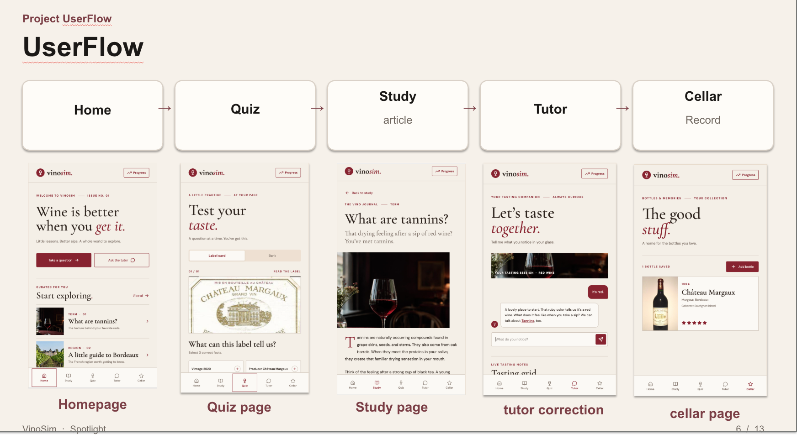
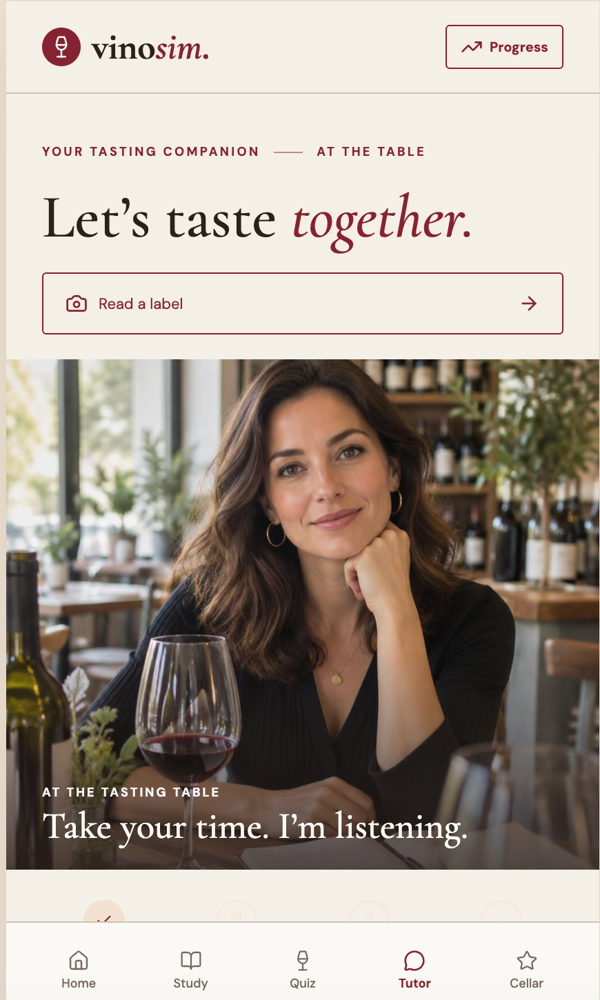
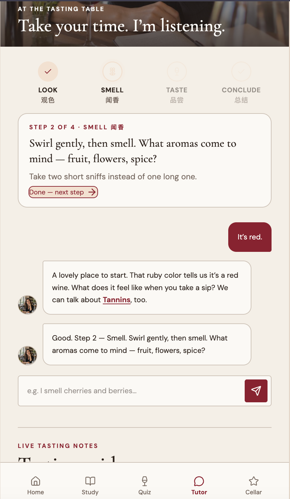
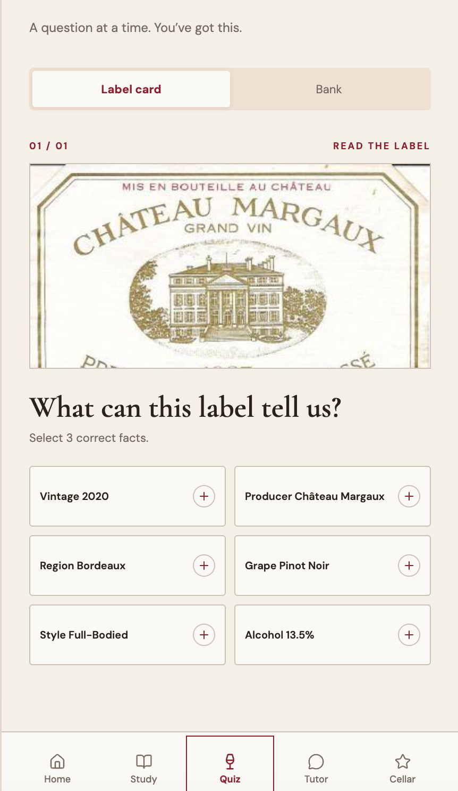
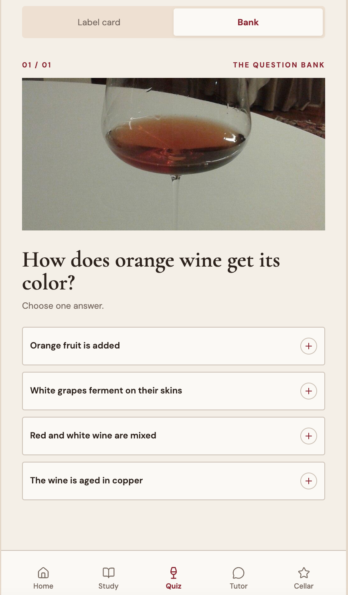

<!-- title-page -->
**VinoSim: Helping Wine Beginners Say What They Taste**

Ashley Xu

Educational Communication and Technology, New York University [[TO ADD: department name exactly as your program requires it on the title page]]

[[TO ADD: course number and name, e.g. the ECT thesis course]]

[[TO ADD: instructor name and title]]

[[TO ADD: due date, written as Month Day, Year]]

<!-- pagebreak -->

# Abstract

VinoSim is a mobile-first learning app for adults who end up at a dinner or reception where wine is poured and who can taste the wine but cannot name what they taste. Brand-run surveys in the United States and the United Kingdom suggest that this kind of discomfort is common, and research on wine expertise suggests that the gap between novices and experts lies more in language and knowledge than in sensitivity of the nose. The entry-level qualifications of the Wine & Spirit Education Trust (WSET) cover the right content, but at Levels 1 and 2 they assess it with multiple-choice questions only. VinoSim targets the step those exams do not check: describing a glass in your own words. The app has two levels. Level 1 asks the learner to write a four-line tasting sheet (appearance, nose, palate, and whether they like it) and to know what acidity, tannin, and body feel like and one cause of each. Level 2 covers label reading, grape and regional styles, sparkling and fortified wines, and service. A chat tutor scaffolds the sheet one step at a time and grounds its corrections in a small retrieval index; a question bank of 160 original multiple-choice items follows the WSET exam weighting. This paper describes the problem, the research behind it, the design rationale, the current build, and the iteration so far. No learning-outcome study with users has been run yet, and the paper is explicit about what that leaves unknown.

*Keywords:* wine education, tasting vocabulary, scaffolding, retrieval-augmented generation, mobile learning

<!-- pagebreak -->

# VinoSim: Helping Wine Beginners Say What They Taste

# I. Introduction and Background

## What VinoSim Is

VinoSim is a phone app for people who are new to wine. It is built for one kind of moment. Someone early in their career, or a graduate student, is brought along to a work dinner. The wine is already in the glass. They can taste things: this red feels thick, that white makes their mouth water, there is a leafy smell. Then they get stuck. Is "thick" what people mean by body? Is "mouth-watering" acidity? What do you call that smell? The dinner will not pause while they figure it out, and nobody at the table is going to suggest they take a course and come back next week.

The app tries to help with that one step, from a sensation the learner already has to a word other people at the table will recognize. It does this through a short tasting sheet that the learner fills in for themselves, a chat tutor that walks through the sheet one line at a time, a quiz that links feelings to words and causes, short study notes, and a personal record of the wines the learner has tried. The content follows the scope of the WSET Level 1 and Level 2 Awards in Wines so that a learner who wants a real qualification later can continue to a WSET course without starting from nothing. VinoSim is not affiliated with or approved by WSET, and it does not issue a certificate.

## Where It Started

The project started with something that happened to me. A friend invited me to a reception with a dress code and a wine tasting, with an open bar serving cocktails, wine, and sparkling wine (Figure 1). I got nervous and did not go. Later my friend told me that many successful people had been there. My first reaction was a joke at my own expense about the opportunity I had missed because I could not talk about wine. Underneath the joke was a real question: why did a glass of wine feel like a test I was going to fail? I decided to learn about wine, and VinoSim grew out of that decision.

**Figure 1**

*Invitation Poster for the Reception That Started the Project*

{width=3.2}

*Note.* Poster for the event described above, shared by the author. [[TO ADD: confirm you are comfortable including this poster (it names the host organization, date, and address); crop or blur those details if not, and add the source line your program prefers]]

## The Problem and the Opportunity

My own experience is a sample of one, so I looked for evidence that it was more common. Two brand-run surveys point the same way. In a 2015 survey of 1,000 frequent wine drinkers in the United States, 34% of millennial respondents said they felt awkward when a server asked them to taste the wine, 34% worried their selection would be judged, and 31% felt uncomfortable talking about wine; four in ten of all respondents were afraid of mispronouncing a wine's name (E. & J. Gallo Winery, 2015). In the United Kingdom, a 2018 study of more than 2,000 people found that 73% were intimidated by restaurant wine lists (Shaw, 2018). Both studies were run by a wine company, so I treat them as evidence that the discomfort exists, not as evidence that any particular solution works.

The opportunity is that many people want to learn and few do. Jackson (2017, 2018) estimated that about 28 million people in the UK drink wine monthly, that 6 to 7 million are interested in a basic course, and that 4 to 5 million would pay for at least two hours of one. Yet only 12% to 14% of the regular wine drinkers in his sample had ever taken a course. The largest segment among the interested, 42%, were people he called "Unconfident Tentatives," for whom building confidence is the main motivation (Jackson, 2018). For my users, the dinner usually arrives before any course does.

## Framing and Focus

There are many ways to frame "learning about wine." One could aim at expertise, at buying better bottles, or at memorizing regions. I chose a narrower frame: helping a beginner describe a glass in their own words, and eventually understand the conversation around them well enough to add a few words of their own. The goal is confidence to take part, not expertise. Research on wine experts supports this frame. Experts do not appear to have better noses than novices; what they do better is recognize and describe what they smell and taste (Hughson & Boakes, 2002; Parr et al., 2002). Novices often notice something and cannot find the word for it (Croijmans & Majid, 2016; Solomon, 1990). That is a learnable gap, and a much smaller one than the gap between a beginner and a sommelier.

The frame also explains why VinoSim sits next to WSET rather than competing with it. WSET Level 1 and Level 2 teach the structural words beginners need (sweetness, acidity, tannin, alcohol, body), but they assess knowledge with multiple-choice exams and do not test tasting itself (Wine & Spirit Education Trust [WSET], 2022, 2023). Saying what you taste is exactly the skill those levels leave unchecked, and it is the skill a dinner table asks for.

## Target Users

The core user is an early-career professional or student who sometimes goes to these dinners. They can tell that two wines differ but cannot say how. They feel the dryness of a young red but cannot name it. A secondary user is someone about to start a hospitality job. I keep that group in view but do not design for it, because a server needs service flow, wine lists, and prices, and VinoSim deliberately avoids recommendations and prices. Three groups are out of scope: people who already talk comfortably about tannin, people who are not interested in wine, and people who want the app to pick their glass for them. All users must be of legal drinking age, which is 21 in the United States.

## Why This Focus

I chose this focus for three reasons. First, the moment is common and specific, which makes it designable. Second, the skill involved, linking a sensation to a word, is small enough to practise in a few minutes and concrete enough to check on paper. Third, I am a member of the target group. That helps with empathy but also creates a risk of designing for myself, which is one reason I ran a survey and brought the work to class critique.

## Preview of the Paper

Section II describes the design process and how I worked with AI tools at each stage. Section III presents the research and analysis: the roots of the problem, key definitions, the gap in WSET's entry levels, research on expert and novice tasters, my target learners, a landscape audit, the context of use, and the project goals. Section IV covers early ideas and the first prototype. Section V explains the design rationale, with a feature-by-theory mapping and a draft logic model. Section VI describes the current design and development, including what is built and what is still being built this week. Section VII reports the evaluation and iteration so far in a feature-by-iteration matrix. Sections VIII and IX reflect on the project and outline future work.

# II. Design Process

## The Process Followed

[[TO ADD: from 1st-semester paper (M2) — the design framework you named (for example ADDIE, design thinking, or rapid prototyping) and one or two sentences on why you chose it. Then revise this paragraph so it says how the process below adapts that framework.]]

Looking back at the work as it actually happened, the process moved through six stages: research, define, ideate, prototype, critique, and iterate. It did not move in a straight line. The definition stage was revisited at least four times as the learning goal changed, and the critique on November 11, 2026, sent me back to the define stage after the prototype already existed. I describe the stages below in the order they first happened, with the goals, methods and artifacts, and a note on how I used AI tools in each.

## Stage 1: Research

### Goals

The goal was to find out whether the discomfort I felt at the reception was common, who felt it most, and what already existed to help.

### Methods and Artifacts

I read two brand-run surveys (E. & J. Gallo Winery, 2015; Shaw, 2018) and Jackson's research on consumer wine education (Jackson, 2017, 2018). I read the WSET Level 1 and Level 2 specifications closely, including their learning outcomes, exam formats, and tasting frameworks (WSET, 2022, 2023), and WSET's description of itself as an organization (WSET, n.d.). I read research on expert and novice wine tasters (Croijmans & Majid, 2016; Hughson & Boakes, 2002; Parr et al., 2002; Solomon, 1990). I also ran a short survey with 10 people I know, using the same form for everyone; it is summarized in Section III and Appendix A. [[TO ADD: from 1st-semester paper (M3) — any other research methods you used (interviews, observation, empathy maps, personas), with participant numbers and dates. Delete this placeholder if the survey was the only primary research.]]

[[TO ADD: survey details — how you recruited the 10 people, when the survey ran, the format (online form, paper, chat), and basic demographics such as age range and occupation if you collected them]]

### AI Collaboration

I used Claude (Anthropic) to help locate and check sources. When an AI-generated meeting summary in Notion reported numbers that did not match the original sources, I discarded those numbers and went back to the publishers' pages and PDFs. Every figure in this paper comes from the original source. [[TO ADD: any AI use during 1st-semester research, if different]]

## Stage 2: Define

### Goals

The goal was to define one learning goal that a user could reach in minutes and that I could check on paper.

### Methods and Artifacts

I used backward design: decide what the learner should be able to do at the end, decide what evidence would show it, and only then plan the activities (Wiggins & McTighe, 2005). The main artifact is the learning goal itself, which went through several versions. My first idea was to help users "speak like an expert." I dropped it because experts do not have better noses (Parr et al., 2002) and because becoming an expert takes years. The second version defined the end point as a four-line tasting sheet written in about five minutes without hints. The first draft of that sheet followed the WSET Level 2 tasting framework, with a final line rating quality (WSET, 2026), and its completion standard required at least two of acidity, tannin, and body to be tied to a felt sensation. After critique, the fourth line became "Do I like it? Why?" and the two-word standard was removed. In its place I adopted a lighter rule: all four lines written in the learner's own words, with the palate line using at least one structure word together with the sensation it refers to. Section VII traces these changes in detail.

### AI Collaboration

I used Claude as a sounding board when drafting and revising the learning goal and to check that each version still matched the WSET content scope I wanted to mirror. The decisions themselves, including dropping the quality line and refusing memorized lines, were mine.

## Stage 3: Ideate

### Goals

The goal was to generate ways of getting a beginner from "this feels thick" to "this has full body" inside a short session on a phone.

### Methods and Artifacts

[[TO ADD: from 1st-semester paper (M4) — early ideas and sketches, how many concepts you generated, and how you chose the lead idea]]

From the iteration history I can say that the lead idea combined three pieces: a tutor that asks one question at a time, a quiz that links sensations to words, and a written tasting sheet as the end product. One idea I considered and rejected came straight from the survey. Several respondents asked for a memorized line they could say to get through the night. I did not build it. A line gets you through tonight, not the next bottle.

### AI Collaboration

[[TO ADD: how you used AI tools when ideating in the 1st semester, if at all]]

## Stage 4: Prototype

### Goals

The goal was to build something a person could actually use on a phone and that I could test and change quickly.

### Methods and Artifacts

The first prototype (v0) had a front end built in Google AI Studio (React and Vite) that called six n8n webhook workflows: label reading with Gemini Vision, an AI tutor with two modes (correction with retrieval, and roleplay), quiz retrieval and submission, a label decoder, and study articles. This semester I rebuilt the back end as a local Python service (v1) and redesigned the mobile interface in Lovable. The current artifacts are the running back end, the redesigned screens (Figures 2 to 6), the question bank, and the documentation for it.

### AI Collaboration

AI was central to building. Gemini models run inside the product. During development, I used Claude to write and revise much of the Python back end, the database migrations, and the question-bank SQL, and I used Lovable's AI features to generate the first version of the redesigned screens. I ran and tested the code myself, and I am responsible for every line that ships. [[TO ADD: confirm the extent of your own code review and question review]] [[TO ADD: confirm which tools generated the v0 front end and the Lovable screens, and how much you edited them by hand]]

## Stage 5: Critique

### Goals

The goal was to get outside eyes on the learning goal and interface before building the remaining parts.

### Methods and Artifacts

I presented VinoSim in the Capstone Thesis Class on November 11, 2026. [[TO ADD: who gave feedback (instructor and number of classmates) and how feedback was recorded]] The critique produced three points that changed the design: build confidence by helping users understand why a wine feels a certain way; respect personal perception rather than chasing a standard answer; and focus on the social situation, where the aim is to help someone outside the conversation understand it and dare to add a few words. A classmate who had taken a wine class put the second point plainly: the correct words help, but saying "this wine feels really heavy" is not wrong.

### AI Collaboration

The class meeting was summarized by an AI note-taker in Notion. That summary contained wrong numbers, so I used it only as a reminder of the topics discussed and relied on my own notes for the three points above. [[TO ADD: confirm that the three critique points match your own notes]]

## Stage 6: Iterate

### Goals

The goal was to turn each critique point and each test result into a concrete design change.

### Methods and Artifacts

The changes are listed in the iteration matrix in Section VII (Table 6). The main ones were a new fourth line on the tasting sheet, a two-column sheet layout, a tutor that never calls an aroma wrong, three-part word cards that pair a sensation with a word and a cause, a question bank expanded and weighted to match WSET, two app levels with medals, and an age gate.

### AI Collaboration

I used Claude to draft the expanded question bank against a blueprint I set (counts per learning outcome and item type), to validate it on a scratch database, and to keep the documentation in step with the SQL. The questions are original, and each one needs my final check for accuracy and wording before it reaches users. [[TO ADD: update once you have reviewed all 160 questions]]

# III. Research and Analysis

## The Importance and Roots of the Problem

Wine at a business dinner is rarely only about the wine. Choosing a bottle, tasting it when the server pours, and commenting on it are small social performances, and people who do them easily signal that they belong. Wine knowledge works as a form of social currency in these settings. Someone who cannot take part may stay quiet even when they have something to say, and over time that silence can cost them a small share of the conversation, and of the relationships that form around it.

The surveys I found describe the discomfort in numbers. In Gallo's 2015 survey of 1,000 nationally representative American wine drinkers aged 21 to 64, who drank wine frequently, 34% of millennials felt awkward when a server asked them to taste, 34% were afraid their choice would be judged, 31% were uncomfortable talking about wine, and 30% called themselves novices. Four in ten respondents overall feared mispronouncing a wine's name (E. & J. Gallo Winery, 2015). A UK study of more than 2,000 people, run by Gallo's Dark Horse brand and reported by *The Drinks Business*, found that 73% were intimidated by restaurant wine lists and 36% were unsure what to look for when a waiter offered them a taster (Shaw, 2018).

I use these surveys with a caveat. Both were commissioned by a wine company with an interest in making wine feel approachable. They are useful evidence that the problem exists and that it shows up at the moment of tasting and talking. They say nothing about whether an app like VinoSim would help.

Jackson's research adds the supply side. He estimated that 6 to 7 million of the UK's roughly 28 million monthly wine drinkers were interested in a basic course and that 4 to 5 million would pay for at least two hours, while only 12% to 14% of his sample of 1,000 regular wine drinkers had ever taken one and 82% to 87% had not (Jackson, 2017, 2018). Interest skewed younger, with people aged 25 to 34 the most over-represented among the interested. Confidence was a key motivation, and the largest segment of interested consumers, 42%, were "Unconfident Tentatives" (Jackson, 2018). The 2017 paper is an unpublished Master of Wine research paper; the figures I report come from the public 2018 WSET Alumni report that summarizes it.

Put together, the evidence suggests a large group of adults who feel uneasy talking about wine, who would like to learn, and who mostly have not. Courses exist, but they take hours and cost money, and the dinner is often next week.

## Background and Definitions

### Structural Words

Most of what a beginner feels in the mouth can be described with a few structural words. WSET Level 1 names five as the notable structural characteristics of wine: sweetness, acidity, tannin, alcohol, and body (WSET, 2022). VinoSim's Level 1 focuses on three of them, because they are the ones my survey respondents and I most often felt without being able to name.

*Acidity* is the sharp, fresh quality that makes your mouth water after a sip. A white that "makes your mouth water" usually has noticeable acidity. Grapes from cooler climates tend to keep more of their acid.

*Tannin* is the drying, gripping feeling on the gums and the inside of the cheeks, similar to strong black tea. It comes mainly from grape skins and seeds, which is why it is found mostly in red wine, which ferments with the skins; oak can add some.

*Body* is the sense of weight or fullness in the mouth, the difference between skimmed milk and whole milk. A red that "feels thick" is usually full-bodied. Alcohol contributes to body, and riper grapes from warmer places tend to produce wines with more alcohol.

These definitions are written in my own words, and the same three-part pattern (what you feel, the word people use, one cause) is how the app teaches them.

### WSET and Its Levels

The Wine & Spirit Education Trust was founded in 1969. It is an independent, UK-registered charity whose qualifications are offered in more than 80 countries and 15 languages through more than 700 course providers, and it is recognized by Ofqual as an awarding organization. WSET created the Systematic Approach to Tasting (SAT), its structured method for describing wine (WSET, n.d.). The SAT may only be reproduced with WSET's written permission. The tasting sheet in VinoSim is therefore my own simplified version, not a copy of the SAT, and VinoSim is not affiliated with WSET.

WSET Level 1 is intended for people with little or no knowledge of wine. It has three learning outcomes: the key stages of grape growing and winemaking; the types, characteristics, and styles of wines from the principal grapes; and storage and service. It has a total qualification time of six hours and is assessed by 30 multiple-choice questions in 45 minutes, with a pass mark of 70%. The Level 1 tasting framework has only three parts: appearance, nose, and palate, with no conclusion. Candidates under the legal drinking age may take the course but may not taste (WSET, 2022). WSET Level 2 also suits people with a general interest in wine. It has six learning outcomes, covering vineyard and label terms, winemaking and ageing, the principal grapes, regionally important grapes, sparkling and fortified wines, and storage, service, and food pairing. It has a total qualification time of 28 hours and is assessed by 50 multiple-choice questions in 60 minutes, with a pass mark of 55% (WSET, 2023). Its tasting framework adds a conclusion about quality (WSET, 2026).

## Framing and Focus: The Gap

Reading the two specifications side by side made the gap clear. Both levels teach tasting language, and both include a tasting framework. Neither level assesses tasting. The exams check whether a candidate knows which grape makes red Burgundy or what temperature to serve a sparkling wine. They do not ask anyone to describe a wine in the glass. [[TO ADD: citation for the level at which WSET first assesses tasting (the bundle notes blind tasting appears at Level 3); cite the WSET Level 3 specification if you use this claim]]

That is a reasonable choice for an awarding body. Multiple-choice exams are reliable and cheap to grade, and tasting assessment is hard to standardize. For my users, though, the unassessed part is the part they need on Friday night. A candidate could pass Level 1 and still freeze when a colleague asks what they think of the wine. VinoSim's position follows from this: it mirrors the content scope of WSET Levels 1 and 2 and adds practice and feedback on the one thing those levels leave unchecked, saying what you taste.

## Domain Knowledge: How Experts and Novices Differ

The research on wine expertise shaped the learning goal more than any other body of work. Parr et al. (2002) compared expert and novice wine judges and found that experts were not more sensitive to smell; their advantage lay in recognizing wine-relevant odors and in what the authors relate to semantic memory, that is, knowledge stored as words and concepts. Hughson and Boakes (2002) similarly concluded that knowledge plays a central role in wine expertise. Solomon (1990) studied how experts and novices talk about wine and found differences in how they describe it and how useful those descriptions are to others. Croijmans and Majid (2016) found that wine experts were more consistent than novices when describing wines, and that this advantage did not appear for coffee experts, which suggests that a shared descriptive vocabulary is something wine culture trains.

Three implications follow for design. First, beginners do not need a better nose; they need words attached to what they already sense. Second, those words have to be anchored to sensations, or they become labels without meaning. Third, expertise is built over years, so a five-minute app should aim at a much smaller step. That is why VinoSim's goal is a written sheet in the learner's own words, and why the quiz pairs each structural word with what it feels like.

## Target Learners and Their Characteristics

### Survey of 10 People

To check whether my own experience matched others', I gave the same short form to 10 people I know. This is a convenience sample, not a random one, so I report counts rather than percentages and read them as signals, not estimates. Appendix A summarizes the answers.

Seven of the 10 said they mostly stay quiet at dinners where wine is discussed. Of those seven, three said they lacked the words and three said they were afraid of being judged or laughed at; one said they had never had a chance to practise and one was not interested. [[TO ADD: these reasons add up to eight for seven people; check whether one person gave two reasons]] None of the 10 had ever been offered a wine class. One had taken a class years ago and had forgotten most of it.

The open item was the most useful. When asked to describe a red wine, five people named only the sensation, writing "dry," "astringent," or the Chinese word 涩 (*sè*, astringent), without using the word tannin. Three wrote "I don't know" or guessed. Two already used the word tannin. Seven said they would be willing to fill in a simple tasting sheet. Several asked for a memorized line they could use to get through the night.

The five who named only the sensation are the clearest picture of my user. They felt the tannin. They just could not name it.

### Learner Profile

From the survey and the evidence above, I describe the target learner as a composite rather than a named persona. [[TO ADD: from 1st-semester paper (M3) — your persona(s) and empathy map, if you made them; replace or merge this composite]]

- **Situation:** early in a career or in graduate school; sometimes attends work dinners, receptions, or alumni events where wine is served.
- **Prior knowledge:** little or none; can tell two wines differ and can describe sensations in everyday words ("dry," "thick," "sharp").
- **Barrier:** lacks the shared vocabulary, and in some cases fears being judged for using it wrongly (three of the seven who stay quiet).
- **Motivation:** wants to take part in the conversation and feel less out of place, not to become an expert. This matches the confidence motive in Jackson's (2018) segment of Unconfident Tentatives.
- **Constraints:** limited time; learns on a phone, often shortly before or even during an event; prefers short, low-stakes practice; must be of legal drinking age.
- **Preferences:** willing to fill in a simple sheet (seven of 10); some want a script to memorize, which the design declines.

## Landscape Audit

The audit compares VinoSim with structured wine education and with consumer tools. Table 1 summarizes the WSET ladder and two other kinds of programs. I include only facts I could verify; the rest are marked for completion.

**Table 1**

*Landscape Audit of Wine Education Options*

| Program | Intended learner | How it is assessed | Tasting assessed? | Relevance to VinoSim |
|---|---|---|---|---|
| WSET Level 1 Award in Wines | Little or no prior knowledge | 30 multiple-choice questions, 45 min, pass 70%; 6 h total qualification time | No | Content scope of VinoSim Level 1; three-part tasting framework |
| WSET Level 2 Award in Wines | Beginners and people with a general interest | 50 multiple-choice questions, 60 min, pass 55%; 28 h total qualification time | No | Content scope of VinoSim Level 2; tasting framework adds a quality conclusion |
| WSET Level 3 Award in Wines | [[TO ADD: from the Level 3 specification]] | [[TO ADD]] | Yes, blind tasting [[TO ADD: citation]] | Where tasting is first assessed; direction of optional bonus content |
| WSET Level 4 Diploma in Wines | [[TO ADD: from WSET]] | [[TO ADD]] | [[TO ADD]] | Professional track; outside VinoSim's scope |
| Intensive sommelier training (e.g., Institute of Culinary Education) | Career changers and hospitality professionals [[TO ADD: verify from ICE's program page]] | [[TO ADD]] | [[TO ADD]] | Professional track; shows how far the expert path runs |
| Consumer wine apps | [[TO ADD: name two or three apps you reviewed]] | [[TO ADD]] | [[TO ADD]] | [[TO ADD: what they do and do not offer a beginner who wants to talk at the table]] |

*Note.* WSET Level 1 and Level 2 details are from WSET (2022, 2023). Rows with placeholders need verified sources before submission.

Course providers describe the WSET Level 1 learner in terms close to mine. Napa Valley Wine Academy, for example, frames that learner as someone who loves wine but cannot explain why two Chardonnays taste different. [[TO ADD: citation for the Napa Valley Wine Academy page you drew this framing from, and add it to the reference list]] I borrowed that framing, in my own words, for VinoSim's core user.

Two conclusions came from the audit. Structured courses are thorough, but they take hours and are assessed by knowledge tests at the entry levels. The professional track runs far beyond what my users want. Between "I have never had a class" and "I passed a multiple-choice exam," there is room for a short tool that practises the spoken and written side of tasting. [[TO ADD: from 1st-semester paper (M3) — your original landscape audit; merge any additional competitors and findings here]]

## Context of Use

VinoSim is designed for a specific context: a dinner, reception, or work event, with about five minutes to spare, on a phone. The learner may open the app the evening before, on the way, or quietly at the table. That context sets several constraints. Screens must work one-handed on a small display. Each activity must fit in minutes, not hours. The app must work without a teacher. And it should never put the learner in a position where they feel tested in front of others; the practice is private, and nothing is shared or ranked.

Tasting also happens away from the event. Level 1 asks the learner to complete six tasting sheets, which in practice means opening a bottle at home or with friends. For that reason the app lists practice wines by style only (a crisp white, an oaked white, a rosé, a light red, a full red, and a sparkling wine), with no brands or prices, and it reminds learners that small sips are enough and spitting is fine.

## Content

The content follows the scope of WSET Levels 1 and 2 (WSET, 2022, 2023). Level 1 content covers grape growing and winemaking basics, the structural words and what causes them, the principal grape styles, and storage and service. Level 2 content covers label terms such as AOC and DOCG, the typical styles of principal grapes and regions, how sparkling and fortified wines are made, serving temperatures, and food pairing. The knowledge base behind the tutor currently holds 19 short notes, from "Tannin," "Acidity," and "Body" to "Reading a wine label" and "Aroma families." The question bank holds 65 Level 1 and 95 Level 2 multiple-choice questions and 10 open tasting prompts, all written for VinoSim (Section VI and Appendix B).

## Project Goals

### Long-Term Goal

Help people with no wine background who end up at a dinner table describe a glass in their own words, and eventually understand the conversation and dare to join in. The aim is confidence to take part, not expertise.

### Short-Term Goals

For this semester: complete Level 1 and Level 2 in the app, front end and back end, including the tasting sheet, level exams, medals, and an age gate, which are being built from November 14 to 18, 2026; and, if time allows, run a small before-and-after check of the tasting sheet with a few people.

### Learning Goals

Level 1, "Talk about the glass":

1. **LO1.** Know what acidity, tannin, and body feel like, and one cause of each. Assessed by the Level 1 exam.
2. **LO2.** Describe a wine by appearance, nose, and palate, then say whether you like it and why. Assessed by the tasting sheet and tutor feedback. Aroma and liking are never judged right or wrong. A sheet counts as complete when all four lines are written in the learner's own words and the palate line uses at least one structure word (acidity, tannin, body, sweetness, or alcohol) together with the sensation it refers to, for example "my gums feel tight, so I think tannin."
3. **LO3.** Understand others who use these words, and respond. Future work.

Level 2, "Read the bottle":

1. Read a label: origin, grape, and classification terms such as AOC and DOCG.
2. Know the typical styles of the principal grapes and regions.
3. Know how sparkling and fortified wines are made.
4. Know the basics of storage, serving temperature, and food pairing.

Level 2 is assessed by the Level 2 exam and five label-reading tasks.

# IV. Design Rationale and Solution: Early Ideas

## Early Ideas and the Lead Idea

[[TO ADD: from 1st-semester paper (M4) — your early ideas, sketches, and storyboards, with figures if you have them, and the criteria you used to choose the lead idea]]

The lead idea that carried into this semester was an AI sommelier tutor that a beginner could talk to. Its two modes reflected two needs I had seen. In correction mode, the learner asks a vague question ("why does this feel so drying?") and gets an answer grounded in short notes. In roleplay mode, the learner practises speaking up with a friendly sommelier character, without being graded. Around the tutor sat smaller tools: a label scanner, a quiz, and study articles.

## The n8n Prototype

The first working version was built quickly with low-code tools. The front end was a React and Vite app generated in Google AI Studio. Behind it were six n8n webhook workflows:

1. Label reading: Gemini Vision extracted text from a photo of a label.
2. The AI tutor: an IF node routed each message to correction mode, which searched a Postgres PGVector store built with Gemini embeddings, or to roleplay mode, which did not.
3. Getting a quiz question.
4. Submitting an answer.
5. A label decoder that generated questions from a label photo.
6. Study articles.

This prototype was useful for showing the idea and for learning what a retrieval-grounded tutor could do. It also showed its limits. Visual workflows were hard to version, test, and change in small steps, and the tutor had no explicit learning goal behind it. It answered questions well, but nothing in it moved the learner toward a finished description. [[TO ADD: any testing or feedback on the v0 prototype from the 1st semester, with participant numbers]]

[[TO ADD: optional figure — a screenshot of the n8n workflows or the v0 front end]]

Those two observations set the agenda for this semester: rebuild the back end so I could change it reliably, and define a learning goal that the whole app would serve.

# V. Design Rationale

This section explains the ideas behind the design: the learning theories I drew on, the design principles that follow from them and from the research, the instructional strategies, and the choice of media and technology. Table 2 maps each feature to its theoretical basis, and Table 3 presents a draft logic model.

## Learning Theories

### Backward Design

Wiggins and McTighe (2005) argue that instruction should start from the desired result and the evidence that would show it, and only then plan activities. I applied this literally. The desired result is that a learner can describe a glass of wine in their own words. The evidence is a four-line tasting sheet, written in about five minutes without hints. Every other part of the app was then judged by whether it helps produce that sheet. This is how I came to see that a quiz item such as "What grape is red Burgundy?" is background knowledge rather than evidence of the goal; it now belongs to Level 2.

### Scaffolding and Fading

Wood, Bruner, and Ross (1976) described tutoring as scaffolding: the tutor takes over the parts of a task the learner cannot yet manage, so the learner can complete the rest, and directs attention to what matters. Collins, Brown, and Newman (1989) added that support should fade as competence grows, so the learner ends up doing the whole task alone. The VinoSim tutor scaffolds the tasting sheet by breaking it into four steps (look, smell, taste, conclude) and asking about one at a time. Fading is the part I have not built. The real test of the goal is the next bottle: can the learner write the sheet before opening the tutor? Section IX returns to this.

### Retrieval Practice

Roediger and Karpicke (2006) showed that taking a test on studied material improves long-term retention more than restudying it. The quiz and the level exams use this effect. Questions are presented one at a time, and the learner has to recall the answer before seeing feedback. Many Level 1 items ask the learner to recall what a sensation means or what causes it, which practises exactly the link the tasting sheet needs.

### Feedback

Hattie and Timperley (2007) describe effective feedback as answering three questions (where am I going, how am I going, and where to next) and distinguish feedback about the task, the process, self-regulation, and the self. Feedback about the self, such as generic praise, tends to do little for learning. I used this to set the tutor's tone. It responds to what the learner said about the wine and asks a question that moves them to the next line, rather than praising them. On the quiz, feedback is immediate and short. On the tasting sheet, feedback is about the process of linking a word to a sensation ("where do you feel it?").

### Expert and Novice Differences

As Section III explained, experts differ from novices mainly in knowledge and vocabulary rather than sensory acuity (Croijmans & Majid, 2016; Hughson & Boakes, 2002; Parr et al., 2002; Solomon, 1990). This research justifies the scope of the goal (words, not better noses) and the requirement that words be tied to sensations.

### Retrieval-Augmented Generation

Lewis et al. (2020) introduced retrieval-augmented generation (RAG), in which a language model first retrieves relevant passages and then generates an answer conditioned on them. This is a technical rather than a learning theory, but it shapes what the tutor can promise. In correction mode, the tutor answers from a small set of notes I wrote and shows which notes it used. This reduces, without removing, the risk that the model states something false with confidence, and it gives the learner something to check.

### Motivation: Self-Determination Theory, Rewards, and Badges

Self-determination theory holds that intrinsic motivation is supported when people experience autonomy, competence, and relatedness (Ryan & Deci, 2000). A meta-analysis by Deci, Koestner, and Ryan (1999) found that expected tangible rewards tend to undermine intrinsic motivation, while positive verbal feedback tends to support it. Hamari (2017) found in a field experiment that adding badges to a service increased user activity. Together these suggest that badges can encourage use, but that how they are designed matters. VinoSim's medals reward evidence of learning (a passed exam and completed sheets), not streaks or time spent; there is no leaderboard; and learners choose which optional bonus topics to explore. The aim is for medals to inform learners about their competence rather than to control their behavior.

## Design Principles

Several principles came out of the theory, the research, and the critique. I state them as rules, because I used them to make decisions.

1. **Start from the sheet.** If a feature does not help a learner produce the four-line sheet, or understand the words on it, it is secondary.
2. **Sensation first, then word, then cause.** Teach "my gums feel tight" before "tannin," and "from grape skins and seeds" after.
3. **Respect perception.** Aroma and liking have no right answer. The tutor never calls an aroma wrong; it says something like "many people describe it that way; others say…"
4. **Private, low-stakes practice.** No leaderboards, no public scores, no sharing by default. Three of my 10 survey respondents stay quiet because they fear being judged.
5. **Short and one-handed.** Every activity fits in a few minutes on a phone.
6. **No shortcuts that skip learning.** No memorized lines, no wine recommendations, no prices.
7. **Ground the tutor.** Corrections come from notes I wrote, and the tutor shows its sources.
8. **Stay honest about WSET.** Mirror its content scope, credit it, and never imply affiliation or reproduce the SAT.

## Instructional Strategies

The main strategies are scaffolded dialogue (the tutor's four steps), worked word cards that pair a sensation with a word and a cause, retrieval practice through the quiz and exams, immediate corrective feedback on quiz items, open ungraded prompts for aroma and liking, and repeated practice on real wines (six sheets for the Level 1 medal, mirroring the six recommended tasting samples in WSET Level 1; WSET, 2022). Roleplay mode offers rehearsal of the social moment without grading.

## Media and Technology Choices

I chose a mobile web app because the context of use is a phone at or near a dinner. A chat interface fits a tutor that asks one question at a time and lets the learner answer in everyday words. A large language model can respond to free-form descriptions such as "it feels thick" in a way that a fixed quiz cannot. I paired it with retrieval over my own notes so that its explanations stay close to vetted content. The quiz uses images (a real label, a photo of a glass) because reading a label and looking at color are visual tasks. Section VI describes the technology stack.

**Table 2**

*Design Features Mapped to Learning Theory and Design Principles*

| Design feature | Theory or research | Design principle | How the feature applies it |
|---|---|---|---|
| Four-line tasting sheet as the end goal | Backward design (Wiggins & McTighe, 2005) | Start from the sheet | The sheet is the evidence of learning; activities are chosen to support it |
| Tutor's four steps (look, smell, taste, conclude) | Scaffolding (Wood et al., 1976) | Short and one-handed | One question at a time, matched to one line of the sheet |
| Writing the sheet before opening the tutor (planned) | Fading (Collins et al., 1989) | Start from the sheet | Support is withdrawn so the learner does the whole task alone |
| Three-part word cards (sensation → word → cause) | Expert–novice research (Parr et al., 2002; Croijmans & Majid, 2016) | Sensation first | Words are anchored to what the learner already feels |
| Two columns on each line ("What I sense" / "Common words people use") | Expert–novice research; class critique #2 | Respect perception | The learner's own words are kept next to the shared vocabulary |
| Quiz, one question at a time; level exams | Retrieval practice (Roediger & Karpicke, 2006) | Short and one-handed | Recall before feedback, spaced across sessions |
| Immediate quiz feedback; tutor asks "where do you feel it?" | Feedback (Hattie & Timperley, 2007) | Respect perception | Task and process feedback rather than praise |
| Correction mode with sources | RAG (Lewis et al., 2020) | Ground the tutor | Answers come from vetted notes; sources are shown |
| Medals for exams and sheets; no leaderboard; chosen bonus topics | Self-determination theory (Ryan & Deci, 2000); rewards (Deci et al., 1999); badges (Hamari, 2017) | Private, low-stakes practice | Medals signal competence; autonomy over optional content |
| Roleplay mode | Self-determination theory (relatedness); class critique #3 | Private, low-stakes practice | Rehearses the social moment without grading |

*Note.* "Class critique" refers to the Capstone Thesis Class critique on November 11, 2026.

## Logic Model

Table 3 is a draft logic model for VinoSim. It is my reconstruction from the current design, and I still need to check it against the logic model from my first-semester paper. [[TO ADD: from 1st-semester paper (M5) — your original logic model; reconcile it with this draft]]

**Table 3**

*Draft Logic Model for VinoSim (Draft for the Author to Confirm)*

| Inputs | Activities | Outputs | Short-term outcomes | Long-term outcomes and impact |
|---|---|---|---|---|
| Author's design and development time | Learner passes the age gate and starts Level 1 | Number of tasting sheets completed per learner | Learner links acidity, tannin, and body to what they feel and to one cause each | Learner understands wine conversation at a dinner and adds a few words |
| WSET Level 1 and 2 specifications as content scope | Learner practises with the quiz, one question at a time | Quiz attempts and scores; level exam attempts and pass rates | Learner writes a complete four-line sheet in about five minutes without hints | Learner feels more confident taking part at social and work events |
| 19 knowledge notes; 160 multiple-choice questions; 10 open prompts | Learner reads short Study notes, ranked by their learner profile | Level 1 and Level 2 medals earned | Learner reads a wine label (origin, grape, classification terms) | Some learners continue to a formal course such as WSET Level 1 |
| Gemini models; Postgres with pgvector; Railway hosting | Learner tastes with the tutor through four steps and fills in the sheet | Bottles saved in the Cellar | Learner is willing to describe a wine aloud in their own words | [[TO ADD: any further impact you want to claim, stated modestly]] |
| Survey findings; class critique feedback | Learner takes the Level 1 and Level 2 exams and label tasks | Learner profile of weak and mentioned topics | [[TO ADD: confirm or revise outcomes]] | |

*Note.* Draft for the author to confirm. Outcomes have not yet been measured (see Section VII).

# VI. Design and Development

## Overview

VinoSim has five main screens (Home, Quiz, Study, Tutor, and Cellar), organized into two levels, plus an age gate before any tasting content. Figure 2 shows the user flow through the redesigned screens. Some parts are built and running; others are being built from November 14 to 18, 2026, on a feature branch. I mark each part's status below. [[TO ADD: update after the 11/18 build — replace "in development" with what was built, and add screenshots of the tasting sheet, level exams, medals, and age gate]]

**Figure 2**

*User Flow Through the Redesigned Screens*

{width=6}

*Note.* From left to right: Home, Quiz, a Study article, the Tutor in correction mode, and the Cellar. Prototype screens made in Lovable this semester.

## Two Levels and Medals

*Status: in development (11/14–11/18).*

The app is organized into two levels. Level 1, "Talk about the glass," covers the structural words and the tasting sheet, mirroring the scope of WSET Level 1. Level 2, "Read the bottle," covers labels, grape and regional styles, sparkling and fortified wines, and service, mirroring the scope of WSET Level 2. Completing both levels completes the course. Learners who want a recognized certificate are pointed to WSET Level 1.

Medals take the place of a certificate. They exist only inside the app and are not branded as WSET. The Level 1 medal requires passing the Level 1 exam and completing six tasting sheets, which mirrors the six recommended tasting samples in WSET Level 1 (WSET, 2022), and it unlocks Level 2. The Level 2 medal requires passing the Level 2 exam and completing five label-reading tasks. Optional bonus medals cover ungraded interest content in the direction of WSET Levels 3 and 4, such as terroir, ageing, and more regions; this part is still being refined. [[TO ADD: list of bonus topics once decided]]

The rationale comes from motivation research. Badges can increase activity (Hamari, 2017), but rewards that feel controlling can undermine intrinsic motivation (Deci et al., 1999). So the medals reward evidence of learning rather than streaks or time spent, there is no leaderboard, and the learner chooses which bonus topics to pursue (Ryan & Deci, 2000). The leaderboard decision also follows from the survey: three of the seven quiet respondents fear being judged, and a ranking would recreate the table they are trying to get comfortable at.

## The Tasting Sheet

*Status: in development (11/14–11/18).*

The tasting sheet is the center of Level 1. It has four lines and two columns (Table 4). Each line asks about one part of the wine, and each has a column for "What I sense," in the learner's own words, and a column for "Common words people use." The two columns came directly from critique point 2: a learner's "this feels really heavy" is not wrong, and the shared word "full-bodied" sits next to it rather than replacing it.

**Table 4**

*Structure of the VinoSim Tasting Sheet*

| Line | What it asks | What I sense (learner's words) | Common words people use | Judged? |
|---|---|---|---|---|
| 1. Appearance | Colour and depth | e.g., "dark, almost purple" | white, rosé, red; pale, medium, deep | No |
| 2. Nose | What family of smells | e.g., "like cherries and a bit of smoke" | fruit, flowers, spice, oak, earth | No; there is no right answer |
| 3. Palate | Acidity, tannin, body, and so on, with an optional "because…" | e.g., "my gums feel tight" | acidity, tannin, body, sweetness, alcohol | Yes: at least one structure word tied to the sensation it refers to |
| 4. Like it? | Do I like it, why, and would I drink it again | e.g., "too drying for me, but nice with food" | (personal) | No |

*Note.* This is the author's own simplified sheet. It is not the WSET Systematic Approach to Tasting, which may not be reproduced without WSET's written permission.

The sheet's first three lines match the three parts of WSET's Level 1 tasting framework (appearance, nose, palate; WSET, 2022). An earlier version used a fourth line taken from Level 2, a conclusion rating quality (WSET, 2026). I replaced it with "Do I like it? Why?" for two reasons. Judging quality is a Level 2 skill that beginners have little basis for, and saying whether you like a wine, and why, is the sentence most likely to be useful at a dinner table. It also gives the learner a talking point that belongs to them.

A sheet counts as complete when all four lines are written in the learner's own words and the palate line uses at least one structure word (acidity, tannin, body, sweetness, or alcohol) together with the sensation it refers to, for example "my gums feel tight, so I think tannin." Aroma and liking are never graded. This standard is lighter than my earlier rule, which required two of acidity, tannin, and body. One honest link between a feeling and a word is the step my survey showed people missing; asking for two made the sheet feel like a test. The optional "because…" field on the palate line invites a cause ("because red wine ferments with the skins") without requiring it, in response to critique point 1.

## The Tutor

*Status: chat, both modes, retrieval, and the four-step interface are built in the prototype; the sheet beside the chat and the revised tone rules are in development.*

The tutor (Figures 3 and 4) is a chat with two modes. In correction mode, the learner describes what they notice or asks a question, the back end retrieves the four most similar notes from the knowledge base, and the model answers from those notes and lists the ones it used. In roleplay mode, the learner chats with a friendly sommelier character to practise speaking up; nothing is retrieved and nothing is graded.

**Figure 3**

*Tutor Introduction Screen*

{width=2.2}

*Note.* The opening screen reads "Take your time. I'm listening." The "Read a label" button opens the label scanner. [[TO ADD: source and license of the portrait photo on this screen]]

**Figure 4**

*Tutor Chat With the Four Steps*

{width=2.2}

*Note.* The step bar shows Look, Smell, Taste, and Conclude, with Chinese labels. The learner wrote "It's red," and the tutor built on that answer, then moved to Step 2 (Smell). "Tannins" is a tappable term.

The four steps at the top of the chat match the four lines of the sheet. When the learner finishes one step, the tutor moves to the next. This is scaffolding in the sense of Wood et al. (1976): the tutor holds the structure of the task while the learner supplies the content. In Figure 4, the learner offers only "It's red." The tutor accepts that, adds one piece of vocabulary (ruby), and asks what the wine feels like on a sip. It does not correct or lecture.

Two rules govern the tutor's tone, both from critique point 2. It never calls an aroma wrong; instead it says something like "many people describe it that way; others say…" And on the palate line, where there is shared vocabulary, it asks where the learner feels the sensation before offering a word. A good answer to "it feels dry" links dryness to tannin and says where you feel it, on the gums and the inside of the cheeks. A weak answer just says "high tannin" and leaves the learner with nothing to check against. These rules are part of the current build; the system prompts in the running back end do not yet state them explicitly. [[TO ADD: update after the 11/18 build — confirm the tone rules are in the tutor's prompts]]

I rejected one feature outright: memorized lines. Several survey respondents asked for a sentence they could say to get through the night. A memorized line might work once, but it teaches nothing that transfers to the next bottle, and it would turn the app into a script rather than a tutor.

## The Quiz

*Status: the label card and question bank screens are built as front-end samples; the expanded bank is in the database; level exams are in development.*

The quiz has two kinds of item, both shown one at a time (Figures 5 and 6). The label card shows a real wine label and asks the learner to pick three true facts from six. On the Château Margaux label, the correct facts are the producer (Château Margaux), the region (Bordeaux), and the style (full-bodied); the distractors are a 2020 vintage, the Pinot Noir grape, and 13.5% alcohol. Bank items are single-answer multiple-choice questions with a photo and immediate feedback. Figure 6 asks how orange wine gets its color; the answer is that white grapes ferment on their skins. That question stays in practice only and is not used in exams.

**Figure 5**

*Quiz Label Card*

{width=2.2}

*Note.* The learner selects three correct facts about the Château Margaux label. [[TO ADD: source of the label image and whether permission is needed to show it]]

**Figure 6**

*Quiz Question Bank Item*

{width=2.2}

*Note.* One question at a time, with a photo and immediate feedback. Practice item; not used in level exams.

Building the quiz taught me that a correct click is not a finished sheet. "What do tannins feel like?" links a feeling to a word and supports the goal directly. "What grape is red Burgundy?" is useful background, but a high score on questions like it says nothing about whether a learner can describe a glass. That question is now tagged Level 2. For Level 1, I added sensation items (what a structure word feels like) and cause items (why a wine feels that way), which respond to critique point 1.

The question bank was expanded on November 14, 2026. Level 1 has 65 multiple-choice questions, including 12 sensation items (10 new, 3 of them about acidity) and 13 cause items. Level 2 has 95 multiple-choice questions. Ten open tasting prompts, such as "Do you like this wine? Say why or why not in one sentence," are kept in a separate table with example answers and guidance, because they have no correct answer and must never be graded. The share of questions per learning outcome follows the WSET exam weighting (Appendix B). All questions are original, written for VinoSim rather than copied from WSET materials.

The level exams follow the WSET formats for now: 30 questions with a 70% pass mark for Level 1, and 50 questions with a 55% pass mark for Level 2, drawn per learning outcome to match the weighting. These settings are provisional, and there is no time limit yet. [[TO ADD: final exam settings (question count, pass mark, time limit) after the 11/18 build]] One known gap: the two quiz items in the redesigned screens are front-end sample data, and the back-end bank is not yet connected to that interface.

## Study

*Status: built.*

Study holds short articles, such as "What are tannins?" and "A little guide to Bordeaux" (Figure 2). Articles are ranked for each learner using a learner profile (described below), so topics the learner has struggled with in the tutor appear first. Reading is optional; the articles exist so that a learner who meets a new word in the tutor or quiz can look it up in a minute.

## Cellar as a Portfolio

*Status: built (saved on the device).*

The Cellar is a personal record of bottles the learner has tried, with name, grape, region, year, notes, and a rating (Figure 2, right). In the current build, entries are stored in the browser on the learner's own device. I treat the Cellar as a learning portfolio: over time it holds the learner's own descriptions, which they can look back on. Once the tasting sheet is built, completed sheets will be linked to Cellar entries, so the six sheets required for the Level 1 medal become a visible record of progress. [[TO ADD: update after the 11/18 build — confirm whether sheets are saved with Cellar entries]]

## Age Gate and Responsible Drinking

*Status: in development (11/14–11/18).*

Before any tasting content, the app asks the user to confirm that they are of legal drinking age, which is 21 in the United States. WSET's Level 1 specification takes a similar line: under-age candidates may take the course but may not taste (WSET, 2022). The app also includes a short responsible-drinking note: small sips are enough, and spitting is fine. [[TO ADD: how the age gate works (for example, a self-declared birth date or a yes/no confirmation) and the exact wording of the responsible-drinking note, after the build]]

## Back-End Architecture

*Status: built and deployed.*

The back end was rebuilt this semester as a Python service; the first commit of the new back end is dated September 23, 2026. It has five main parts.

1. **FastAPI** serves the HTTP endpoints: label scanning, the tutor, quiz retrieval and submission, label decoding, articles, and the learner profile.
2. **LangGraph** runs the tutor as a state graph that mirrors the old n8n workflow: load the chat history, route by mode, retrieve notes (correction mode only), run the correction or roleplay agent, and save the turn.
3. **Gemini** provides the models: gemini-2.5-flash for chat and label vision, and gemini-embedding-001 for 768-dimensional embeddings.
4. **Postgres with pgvector** stores the knowledge notes, chat history, quiz questions, articles, and learner profiles. Notes are searched by cosine similarity using an HNSW index. There is no reranker or keyword search.
5. **Railway** hosts the service, and the bundled React 19 web client is fitted to phone screens.

Two decisions deserve explanation. First, I kept a compatibility layer of `/webhook/*` endpoints that accept and return the old n8n field names. This let the existing front end keep working unchanged while I replaced everything behind it, which meant I could test the new back end against a known interface. Second, I added a learner-profile loop. After each tutor turn, a background task asks the model to summarize what the turn showed and to list weak and mentioned topics, chosen only from a closed vocabulary of 28 topic names. The chat reply does not wait for this. The stored profile is then used to rank Study articles. The closed vocabulary keeps the profile predictable and easy to inspect, and it prevents the model from inventing topics.

The choice to leave visual low-code tools was practical. Code can be versioned, tested, and changed in small steps, and the question bank can be applied as a repeatable migration. The cost is that the system now depends on my ability to maintain it.

## User Scenario and Workflow

The following scenario describes how a learner moves through the app once the current build is complete. The learner is a composite based on the survey, not a real participant.

1. **Age gate.** A first-year analyst who has a team dinner next week opens VinoSim, confirms they are of legal drinking age, and reads the responsible-drinking note.
2. **Level 1 begins.** On Home, they see one question and one short note. They answer a few quiz items, including "What do tannins feel like?", and get immediate feedback.
3. **First sheet with the tutor.** At home, they open a bottle of a full-bodied red, chosen by style from the app's list. In the tutor, they go through look, smell, taste, and conclude. On the palate line they write "my gums feel tight," and the tutor asks where they feel it, then offers the word tannin and one cause. They write "my gums feel tight, so I think tannin" and, on the last line, "I like it with food, not on its own."
4. **Practice continues.** Over the following days, they complete more sheets with different styles and read the Study notes the app ranks for them. Each sheet is saved with a Cellar entry.
5. **Level 1 medal.** After six sheets, they take the Level 1 exam (30 questions) and pass. The Level 1 medal unlocks Level 2.
6. **Level 2.** They work through label cards and Level 2 quiz items, complete five label-reading tasks, and pass the Level 2 exam (50 questions).
7. **Level 2 medal.** The course is complete. The app suggests WSET Level 1 if they want a certificate.
8. **Optional bonus.** They choose a bonus topic, such as ageing, and explore it without grading.

Table 5 summarizes the same workflow.

**Table 5**

*Learner Workflow From Age Gate to Bonus Content*

| Step | Screen(s) | What the learner does | Evidence produced | Status |
|---|---|---|---|---|
| 1. Age gate | Age gate | Confirms legal drinking age; reads responsible-drinking note | None | In development |
| 2. Level 1 practice | Home, Quiz, Study | Answers sensation and cause items; reads notes | Quiz attempts; learner profile | Built (quiz screens use sample data) |
| 3. Tasting sheets | Tutor, tasting sheet, Cellar | Writes four-line sheets with tutor support | Six completed sheets | Tutor built; sheet in development |
| 4. Level 1 exam | Quiz (exam) | Takes 30-question exam | Exam result (pass at 70%, provisional) | In development |
| 5. Level 1 medal | Progress | Receives medal; Level 2 unlocks | Medal | In development |
| 6. Level 2 practice | Quiz (label card, bank), Study | Reads labels; answers Level 2 items | Five label-reading tasks | Label card built as sample; tasks in development |
| 7. Level 2 exam and medal | Quiz (exam), Progress | Takes 50-question exam; receives medal | Exam result (pass at 55%, provisional); medal | In development |
| 8. Bonus (optional) | Study, Progress | Chooses ungraded interest topics | Bonus medals | Being refined |

*Note.* [[TO ADD: update after the 11/18 build — revise the Status column]]

# VII. Implementation, Evaluation, and Iteration

## Methods Used to Evaluate and Iterate

I have used five methods so far. None of them measures learning outcomes, and I say more about that gap at the end of this section.

### The Author's Survey

The 10-person survey (Section III and Appendix A) was the main input from potential users. It confirmed the core gap (five of 10 named the tannin sensation without the word), shaped the decision to make the sheet short and written (seven of 10 would fill one in), supported the decision against leaderboards (three of the seven quiet respondents fear judgment), and surfaced the request for memorized lines, which I declined. Because it is a convenience sample of people I know, I used it to find problems and test assumptions, not to estimate how common anything is.

### Class Critique

The Capstone Thesis Class critique on November 11, 2026, produced the three points described in Section II. Each led to concrete changes. Point 1 (understand why a wine feels a certain way) led to three-part word cards, an optional "because…" on the palate line, and cause questions in the bank. Point 2 (respect personal perception) led to the two-column sheet, ungraded aroma prompts, the tutor's rule never to call an aroma wrong, and the removal of the two-word palate standard. Point 3 (focus on the social situation) led me to add a third Level 1 outcome, understanding others and responding, which I moved to future work because it could not be built and evaluated this semester.

### Retrieval Test

To check that correction mode retrieves the right notes, I ran a test query on the live index: "Why does this red wine feel so drying?" The four most similar notes by cosine similarity were Tannin (0.747), Palate order (0.718), Acidity (0.688), and Body (0.686). Tannin ranked first, which is the correct note for a drying sensation, and the other three are plausible neighbors. This is a sanity check on one query, not a systematic evaluation. The scores between the first and fourth notes are close, and there is no reranker, so a differently phrased question could rank them differently. [[TO ADD: optional — results of a few more test queries, if you run them]]

### Question-Bank Validation

I set a blueprint for the expanded bank: the share of questions per learning outcome should follow the WSET exam weighting (Level 1: 6, 18, and 6 of 30; Level 2: 5, 4, 19, 12, 6, and 4 of 50; WSET, 2022, 2023), and Level 1 should include sensation and cause items. The bank was then checked against that blueprint (Appendix B). The pool shares are within two percentage points of the WSET shares for every learning outcome. The migration was applied twice on a scratch database to confirm that it is idempotent (row counts did not change on the second run), that every question has four options and exactly one correct answer, and that correct answers are spread across the letters (Level 1: A 16, B 17, C 17, D 15; Level 2: A 23, B 26, C 24, D 22). Two questions needed decisions: the red-Burgundy grape question is tagged Level 2, and the orange-wine question, which falls outside both WSET ranges, stays in practice only and is not used in exams.

### Migration From n8n to a Local Stack

The move from six n8n workflows to a FastAPI and LangGraph service was itself an iteration. The compatibility layer allowed a direct comparison: the old front end, unchanged, could call the new back end through the same `/webhook/*` routes. After the migration, the model and embedding versions were updated (gemini-2.5-flash for chat and vision, gemini-embedding-001 at 768 dimensions), the bundled web client was fitted to phone screens, and the service was deployed to Railway. [[TO ADD: any problems you hit during migration and how you verified that each endpoint behaved like the old workflow]]

## Feature-by-Iteration Matrix

Table 6 lists the main design features, what happened when each was implemented or tested, and the specific iteration that followed.

**Table 6**

*Design Features, Implementation Results, and Iterations*

| Specific design feature | Implementation result | Specific iteration |
|---|---|---|
| Learning goal | "Speak like an expert" did not fit the research (experts do not have better noses) or the time users have | Redefined as a four-line tasting sheet written in about five minutes without hints (backward design) |
| Palate-line standard | Requiring two of acidity, tannin, and body tied to a sensation made the sheet feel like a test; critique point 2 questioned a single "standard answer" | Replaced by one structure word (acidity, tannin, body, sweetness, or alcohol) tied to the sensation it refers to; aroma and liking stay ungraded |
| Fourth line of the sheet | A quality conclusion, taken from WSET Level 2, asked beginners for a judgment they had little basis for | Changed to "Do I like it? Why?", which matches Level 1's three-part framework plus a personal talking point |
| Sheet layout | A single answer field per line implied one correct description | Two columns: "What I sense" and "Common words people use" |
| Tutor tone on aromas | Critique point 2: tasting differs by person; a classmate noted "this wine feels really heavy" is not wrong | The tutor never calls an aroma wrong ("many people describe it that way; others say…"); aroma prompts are ungraded |
| Explaining why (critique point 1) | Vocabulary alone did not explain why a wine feels as it does | Three-part word cards (sensation → word → cause); optional "because…" on the palate line; 13 cause questions in Level 1 |
| Memorized lines | Several survey respondents asked for a line to get through the night | Deliberately not built: a line gets you through tonight, not the next bottle |
| Quiz scope | Building the quiz showed that a correct click is not a finished sheet; background items did not serve the goal | Background items moved to Level 2 (for example, the red-Burgundy grape question); sensation and cause items added to Level 1 |
| Question bank | The back-end bank had five multiple-choice questions and a few label questions | Expanded to 65 Level 1 and 95 Level 2 questions plus 10 ungraded prompts, weighted to WSET exam shares and validated on a scratch database |
| Back end | Six n8n workflows were hard to version, test, and change in small steps | Rebuilt as FastAPI + LangGraph + Gemini + Postgres/pgvector, with a webhook compatibility layer, deployed to Railway |
| Personalization | Study articles were the same for everyone | Learner-profile loop: each tutor turn is distilled into weak and mentioned topics from a closed vocabulary, used to rank articles |
| User interface | The v0 front end had no visible structure for tasting | Redesigned mobile screens; the tutor shows four steps that match the sheet |
| Medal design | A certificate would imply an accreditation VinoSim does not have | In-app medals tied to exams and sheets (six sheets for Level 1; five label tasks for Level 2); no leaderboard; no streaks |
| Age gate | The app had no check on drinking age | Age gate and responsible-drinking note added (in development) |
| Listening and responding (critique point 3) | Could not be designed and evaluated within the semester | Recorded as Level 1 LO3, moved to future work |

*Note.* [[TO ADD: update after the 11/18 build — add results for the tasting sheet, exams, medals, and age gate]]

## What Has Not Been Evaluated

No learning-outcome study with users has been run. I do not yet know whether using VinoSim helps anyone write a better tasting sheet, feel more confident at a dinner, or say anything at all. The survey describes the problem; the critique improved the design; the retrieval test and question-bank checks show that parts of the system work as intended. None of these is evidence of learning.

The planned next step is a small before-and-after check. A few people will taste the same bottle and write a sheet before using the tutor, then write another after. I will compare the two sheets against the completion standard: all four lines written in the learner's own words, and a palate line with at least one structure word tied to the sensation it refers to. With so few people, one bottle, and no comparison group, the check cannot support conclusions. Its purpose is to find obvious problems, for example a tutor step that confuses people or a sheet line that nobody understands, before a larger evaluation. [[TO ADD: results of the before-and-after check, if you run it before submission: number of participants, date, and what you observed, reported as counts]]

# VIII. Conclusion and Reflection

## How the Project Meets Its Goals

VinoSim set out to help beginners at a dinner table describe a glass of wine in their own words. Measured against that goal, the project has a clear design and a partial build. The learning goal is specific and checkable: a four-line sheet, written in about five minutes, with at least one structure word tied to a real sensation. Each feature traces back to that goal or to research. The tutor scaffolds the sheet step by step. The quiz practises the link between sensation, word, and cause. The medals reward completed sheets and passed exams. The back end grounds the tutor in notes I can check, and the question bank follows the WSET content scope closely enough that a learner could move on to a real course.

What I cannot yet say is whether it works for learners. The design responds to the problem as the survey and the research describe it, but the evidence that it helps will come only from the evaluation in Section IX.

## Insights and Lessons

**A correct click is not a finished sheet.** Building the quiz made me separate two things I had treated as one: knowing a fact about wine and being able to describe a wine. A learner who knows that red Burgundy is Pinot Noir may still have nothing to say about the glass in front of them. This changed which questions belong in Level 1 and made the tasting sheet, not the quiz score, the evidence of learning.

**WSET's entry levels do not test tasting.** I expected the established qualifications to cover the skill I cared about. Reading the specifications showed that Levels 1 and 2 assess knowledge by multiple choice only. That finding gave VinoSim its position. It also kept me modest: I am building a practice tool next to a qualification system, not a replacement for it.

**Respecting perception and calibrating vocabulary pull in different directions.** The critique made me see a tension I had not noticed. Shared words are only useful if people use them in roughly the same way, which is what experts do (Croijmans & Majid, 2016). But beginners who are told their perceptions are wrong stop talking, which defeats the purpose. My resolution is partial: aroma and liking are never judged; the palate line, where vocabulary is most shared, asks for one honest link between a feeling and a word. I expect this balance to keep shifting as I learn more from users.

**Refusing a shortcut can be a design decision.** The request for memorized lines was the most direct thing users asked for, and I said no. A script would have met the immediate need and taught nothing. I found it useful to state the refusal in the design principles, so that I would not drift back toward it under pressure.

**The definition stage never really ended.** I rewrote the learning goal more often than any piece of code. Each version made the app smaller and more concrete. Looking back, the best use of my time was the work that made the goal checkable, because it made every later decision easier.

## Contribution to the Field

The contribution is modest and specific. VinoSim shows one way to turn a consumer-education problem, documented mostly by industry surveys, into a narrow learning goal grounded in research on expertise, and to build a scaffolded, retrieval-grounded tutor around it. Its clearest idea is to target the skill that entry-level wine qualifications teach but do not assess, and to make the learner's own written description the evidence of learning. For educational technology more broadly, it is a small case study in using a large language model as a tutor with a defined end product, grounded content, and explicit limits on what it may judge. Whether the approach helps learners is still an open question.

# IX. Future Directions

## Listening and Responding (LO3)

Critique point 3 asked me to focus on the social situation: helping someone outside the conversation understand it and add a few words. That is Level 1's third outcome, and it is the one closest to the original problem. It will need different activities from the sheet, such as hearing or reading what others say about a wine and practising a short response. Roleplay mode is a starting point. Assessing this outcome will also be harder than assessing a written sheet.

## Fading the Scaffold

The tutor currently gives the same support every time. Following Collins et al. (1989), support should be withdrawn as the learner improves, for example by asking the learner to write each line before the tutor responds, or by removing step prompts after a few sheets. The real test is whether a learner can write the sheet for a new bottle without the tutor.

## Bonus Levels

Optional bonus content in the direction of WSET Levels 3 and 4 (terroir, ageing, more regions) is still being refined. It should stay ungraded and chosen by the learner, in line with the medal design. [[TO ADD: bonus topics and timeline]]

## Outcome Evaluation With Real Users

The most important next step is to find out whether VinoSim helps. After the small before-and-after check, a stronger study would recruit people from the target group rather than friends, use several wines, compare sheets written with and without the app, and ask about confidence at a real event some time later. It would also be worth testing whether the completion standard can be scored reliably by two different readers.

## Connecting the Quiz to the New Interface

The redesigned quiz screens still use two sample items. Connecting them to the back-end bank, filtering by level, and drawing exam questions per learning outcome is the next engineering task after the current build.

## Real-World Adoption Factors

Several factors would matter if VinoSim were released beyond a class project.

- **Legal drinking age.** The age gate needs a clear design and must reflect the law where the app is used.
- **Responsible drinking.** Tasting practice should continue to encourage small amounts and spitting, and the app should never reward drinking more.
- **WSET trademark and the SAT.** VinoSim must not imply affiliation with WSET, use its branding, or reproduce the SAT without written permission. If the app grew, it would be worth asking WSET whether a formal relationship is possible.
- **Content accuracy.** Notes and questions need regular review, and someone has to be responsible for corrections when wine facts or regulations change.
- **Images and labels.** The quiz uses a real wine label, and the tutor screen uses a portrait photo. Their sources and permissions need to be checked before any public release.
- **Cost of model calls.** Every tutor turn calls a language model, and the learner-profile loop adds a second call. At scale, this cost would need a budget or a cheaper design.
- **Privacy of learner profiles.** The profile stores a summary of what each learner struggles with. It should be minimal, explained to users, deletable, and never shared.

# AI Acknowledgement

[[TO ADD: align this statement with the wording required by your thesis section's AI policy; the policy text is not in the public program guide]]

I used Claude (Anthropic) throughout this project. It helped me draft and edit the text of this paper and my presentation scripts, organize my notes, and check references against publishers' pages and Crossref. It also helped write code for the VinoSim back end and web client, the database migrations, and the content of the question bank, which I specified through a blueprint. Inside the product, Google's Gemini models generate the tutor's replies, read wine labels, create embeddings for retrieval, and summarize each tutor turn into the learner profile. The redesigned screens were first generated with Lovable. An AI note-taker in Notion summarized the class critique; because that summary contained wrong numbers, I did not use any of its figures. I reviewed and revised all AI-assisted text, code, and content, and I am responsible for the final work. All data reported in this paper come from the original sources or from my own survey and tests. [[TO ADD: confirm the list of AI tools, including any used in the 1st semester (for example Google AI Studio for the v0 front end)]]

<!-- pagebreak -->

# References

<!-- references -->
Collins, A., Brown, J. S., & Newman, S. E. (1989). Cognitive apprenticeship: Teaching the crafts of reading, writing, and mathematics. In L. B. Resnick (Ed.), *Knowing, learning, and instruction: Essays in honor of Robert Glaser* (pp. 453–494). Lawrence Erlbaum Associates.

Croijmans, I., & Majid, A. (2016). Not all flavor expertise is equal: The language of wine and coffee experts. *PLoS ONE, 11*(6), e0155845. https://doi.org/10.1371/journal.pone.0155845

Deci, E. L., Koestner, R., & Ryan, R. M. (1999). A meta-analytic review of experiments examining the effects of extrinsic rewards on intrinsic motivation. *Psychological Bulletin, 125*(6), 627–668. https://doi.org/10.1037/0033-2909.125.6.627

E. & J. Gallo Winery. (2015, December 8). *Gallo survey finds that today's wine drinkers are diverse with an appreciation of new offerings for more occasions* [Press release]. https://www.gallo.com/press/2015-12-08-wine-drinker-diversity

Hamari, J. (2017). Do badges increase user activity? A field experiment on the effects of gamification. *Computers in Human Behavior, 71*, 469–478. https://doi.org/10.1016/j.chb.2015.03.036

Hattie, J., & Timperley, H. (2007). The power of feedback. *Review of Educational Research, 77*(1), 81–112. https://doi.org/10.3102/003465430298487

Hughson, A. L., & Boakes, R. A. (2002). The knowing nose: The role of knowledge in wine expertise. *Food Quality and Preference, 13*(7–8), 463–472. https://doi.org/10.1016/S0950-3293(02)00051-4

Jackson, T. (2017). *Elementary consumer wine education: UK market size, characteristics and significance to the trade* [Master of Wine research paper]. Institute of Masters of Wine.

Jackson, T. (2018). *Consumer wine education: Should the wine trade care?* [WSET Alumni report]. Wine & Spirit Education Trust. https://www.wsetglobal.com/media/5507/wsetalumreport_consumerwineeducation-2018-03.pdf

Lewis, P., Perez, E., Piktus, A., Petroni, F., Karpukhin, V., Goyal, N., Küttler, H., Lewis, M., Yih, W., Rocktäschel, T., Riedel, S., & Kiela, D. (2020). Retrieval-augmented generation for knowledge-intensive NLP tasks. *Advances in Neural Information Processing Systems, 33*, 9459–9474.

Parr, W. V., Heatherbell, D., & White, K. G. (2002). Demystifying wine expertise: Olfactory threshold, perceptual skill and semantic memory in expert and novice wine judges. *Chemical Senses, 27*(8), 747–755. https://doi.org/10.1093/chemse/27.8.747

Roediger, H. L., III, & Karpicke, J. D. (2006). Test-enhanced learning: Taking memory tests improves long-term retention. *Psychological Science, 17*(3), 249–255. https://doi.org/10.1111/j.1467-9280.2006.01693.x

Ryan, R. M., & Deci, E. L. (2000). Self-determination theory and the facilitation of intrinsic motivation, social development, and well-being. *American Psychologist, 55*(1), 68–78. https://doi.org/10.1037/0003-066X.55.1.68

Shaw, L. (2018, July 5). 73% of Brits are intimidated by wine lists. *The Drinks Business*. https://www.thedrinksbusiness.com/2018/07/73-of-brits-are-intimidated-by-wine-lists/

Solomon, G. E. A. (1990). Psychology of novice and expert wine talk. *The American Journal of Psychology, 103*(4), 495–517. https://doi.org/10.2307/1423321

Wiggins, G., & McTighe, J. (2005). *Understanding by design* (2nd ed.). Association for Supervision and Curriculum Development.

Wine & Spirit Education Trust. (n.d.). *About WSET*. Retrieved November 11, 2026, from https://www.wsetglobal.com/about/about-wset/

Wine & Spirit Education Trust. (2022). *WSET Level 1 Award in Wines: Specification* (Issue 1.2). https://www.wsetglobal.com/media/zyhewzz4/wset-l1wines-specification.pdf

Wine & Spirit Education Trust. (2023). *WSET Level 2 Award in Wines: Specification* (Issue 2). https://www.wsetglobal.com/media/3yuhxb4i/wset-l2wines-specification.pdf

Wine & Spirit Education Trust. (2026). *WSET Level 2 systematic approach to tasting wine* (Issue 2.1). https://www.wsetglobal.com/student-resources/systematic-approach-to-tasting-sat/

Wood, D., Bruner, J. S., & Ross, G. (1976). The role of tutoring in problem solving. *Journal of Child Psychology and Psychiatry, 17*(2), 89–100. https://doi.org/10.1111/j.1469-7610.1976.tb00381.x
<!-- /references -->

<!-- pagebreak -->

# Appendix A: Survey Summary

The author gave the same short form to 10 people the author knows. This is a convenience sample, not a random one; results are reported as counts. [[TO ADD: recruitment method, dates, format, and the exact wording of each question]]

**Table A1**

*Survey Responses (N = 10)*

| Item | Response | Count |
|---|---|---|
| Behavior at dinners where wine is discussed | Mostly stay quiet | 7 |
| Main reason for staying quiet (of the 7) | Lack the words | 3 |
| | Fear being judged or laughed at | 3 |
| | Had no chance to practise | 1 |
| | Not interested | 1 |
| Ever offered a wine class | Yes | 0 |
| Took a wine class before | Yes, years ago, and forgot most of it | 1 |
| Open item: describe a red wine | Named only the sensation ("dry," "astringent," 涩) without the word tannin | 5 |
| | Wrote "I don't know" or guessed | 3 |
| | Used the word tannin | 2 |
| Willing to fill in a simple tasting sheet | Yes | 7 |
| Asked for a memorized line to use at the event | Several (exact count not recorded) | [[TO ADD: count, if you have it]] |

*Note.* The reasons for staying quiet add up to 8 for 7 people. [[TO ADD: check whether one respondent gave two reasons, or correct the counts]]

# Appendix B: Question-Bank Blueprint

Counts include seven earlier questions that were re-tagged. WSET exam shares are from WSET (2022, Section 4) and WSET (2023, Section 4).

**Table B1**

*Level 1 Question Pool by Learning Outcome and Item Type*

| Learning outcome | Sensation | Cause | Knowledge | Service | Pairing | Total | Share of pool | WSET exam share |
|---|---|---|---|---|---|---|---|---|
| L1-LO1 Grape growing and winemaking | 0 | 5 | 8 | 0 | 0 | 13 | 20% | 20% (6/30) |
| L1-LO2 Types, characteristics, and styles | 12 | 5 | 21 | 0 | 0 | 38 | 58% | 60% (18/30) |
| L1-LO3 Storage and service | 0 | 3 | 0 | 7 | 4 | 14 | 22% | 20% (6/30) |
| Total | 12 | 13 | 29 | 7 | 4 | 65 | 100% | 100% |

**Table B2**

*Level 2 Question Pool by Learning Outcome and Item Type*

| Learning outcome | Cause | Knowledge | Label | Service | Pairing | Total | Share of pool | WSET exam share |
|---|---|---|---|---|---|---|---|---|
| L2-LO1 Vineyard and label terms | 3 | 2 | 6 | 0 | 0 | 11 | 12% | 10% (5/50) |
| L2-LO2 Winemaking and ageing | 7 | 3 | 0 | 0 | 0 | 10 | 11% | 8% (4/50) |
| L2-LO3 Principal grapes | 4 | 22 | 8 | 0 | 0 | 34 | 36% | 38% (19/50) |
| L2-LO4 Regional grapes | 1 | 18 | 2 | 0 | 0 | 21 | 22% | 24% (12/50) |
| L2-LO5 Sparkling and fortified | 2 | 7 | 3 | 0 | 0 | 12 | 13% | 12% (6/50) |
| L2-LO6 Storage, service, and pairing | 1 | 2 | 0 | 1 | 3 | 7 | 7% | 8% (4/50) |
| Total | 18 | 54 | 19 | 1 | 3 | 95 | 100% | 100% |

*Note.* Level 2 has no sensation items. Ten open, ungraded tasting prompts are stored separately and are not part of these counts. Provisional exam settings: Level 1, 30 questions, pass at 70%; Level 2, 50 questions, pass at 55%; no time limit.

# Appendix C: Tasting-Sheet Template

This is the author's own simplified sheet, not the WSET Systematic Approach to Tasting.

**Table C1**

*VinoSim Tasting Sheet*

| Line | What I sense (in my own words) | Common words people use |
|---|---|---|
| 1. Appearance: What colour is it? Pale or deep? | | white, rosé, red; lemon, gold, pink, ruby, garnet; pale, medium, deep |
| 2. Nose: What does it smell like? (No right answer.) | | fruit, flowers, herbs, spice, oak (vanilla, toast), earth |
| 3. Palate: How does it feel in my mouth? Optional: because… | | acidity (mouth-watering), tannin (drying on the gums), body (light to full), sweetness, alcohol (warmth) |
| 4. Do I like it? Why? Would I drink it again? | | (personal) |

*Note.* A sheet is complete when all four lines are written in the learner's own words and the palate line uses at least one structure word together with the sensation it refers to. Practice wines are chosen by style: crisp white, oaked white, rosé, light red, full red, sparkling. Small sips are enough, and spitting is fine.

# Appendix D: Development Plan

Level 1 and Level 2 (front end and back end, including the tasting sheet, level exams, medals, and age gate) are being built from November 14 to 18, 2026, on a feature branch. [[TO ADD: development plan table with tasks, dates, and status; update after the 11/18 build]]
